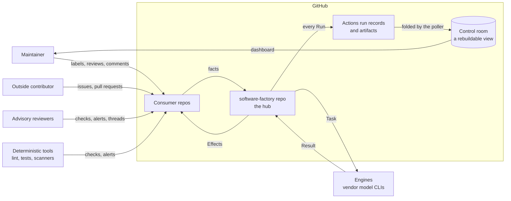
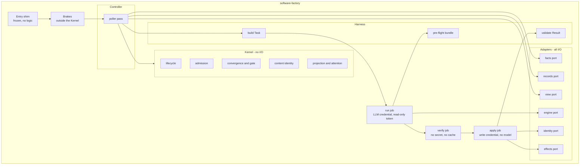
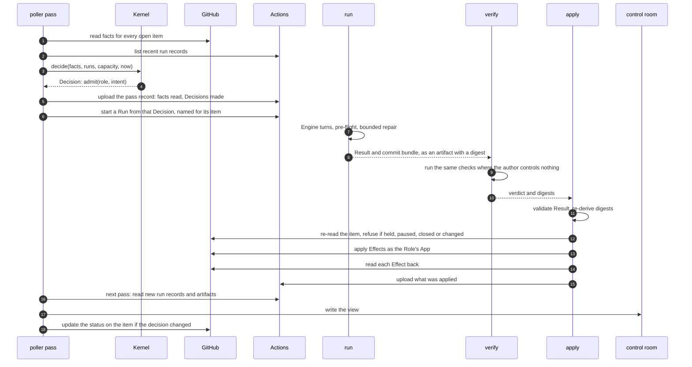
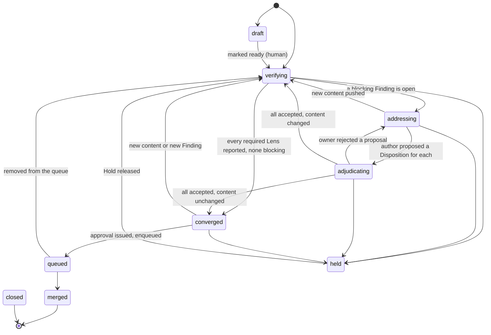
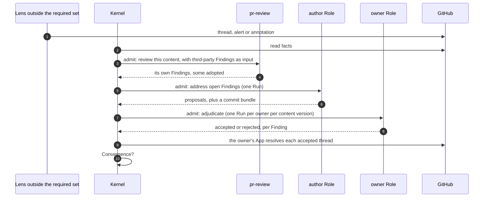

# Software Factory: interaction and contract design

**Status:** Draft for maintainer review
**Date:** 2026-10-10
**Builds on:** [ADR-0013](adr/0013-factory-mvp-reference-architecture.md), the [PRD](../prd/agentic-software-factory.md) and the [architecture review](factory-mvp-architecture-review.md)

## 0. The design on one page

The Factory is a set of agent Roles that turn an issue into a reviewed, merged change across the
org's repos, and a small core that decides what each Role may do next.

**It keeps no state of its own.** Every few minutes one job, the poller, reads every open work item
from GitHub, and reads the list of the Factory's own past Runs from GitHub Actions. From those two
things alone one pure function, the Kernel, works out where each item stands and what should happen
next. If a tick is lost, the next one reaches the same answer.

**A Run is one workflow run with up to three jobs.** `run` gives a model a Task and gets back a
Result that only requests changes. `verify` runs the checks where the author controls nothing.
`apply` reads the item again, and only then makes the changes, through the Role's own GitHub App.
The model never holds a credential that can write.

**A change converges when** every required check has reported, no required reviewer and no person
with write access has an open objection, and, once acceptance contracts are in force, every
criterion written before the work has passing evidence. Third-party reviewers inform the in-house
reviewer, and gate only through it.

**People act in GitHub.** A label holds, releases or admits. A review blocks. A comment steers. The
Factory reaches the Maintainer by assigning the item to them.

**The control room** is a public page built from the Runs' own records. The Factory writes it and
never reads it, so it can be wrong without anything going wrong.

**It is built review-first,** in a repo of its own, served by its own newest Release. The first
milestone is the Factory approving one of its own pull requests.

**Not yet designed** (§9.9): how an issue becomes a pull request; how a Release is cut; what the
Factory does as capacity runs short; how an interrupted Run resumes; the scorecard's sums.

## 1. Purpose

ADR-0013 says what shape the Factory has and why. This document says how its parts talk to each
other, precisely enough to be checked before any of it is built. It is written to be argued with:
every contract has an example, every behaviour has an invariant, and every invariant has a named
way to test it.

It has five layers. Each is an artifact that a check can read.

| Layer | Question it answers | Artifact | Checked by |
|---|---|---|---|
| 1. Structure (§2) | What are the parts and who calls whom? | Diagrams in this document | Review |
| 2. Contracts (§3) | What exactly crosses each boundary? | One schema and golden examples per message | Schema validation of every example |
| 3. Behaviour (§4) | What may happen, in what order, and what must never happen? | The Lifecycle as data, a list of invariants, a simulator | Exhaustive checks on the Lifecycle; seeded simulation with injected faults |
| 4. Team interactions (§5) | Which Role sees what, raises what and decides what? | Role manifests and an authority table | Mechanical checks on the data |
| 5. Platform facts (§6) | What does GitHub actually do? | A list of spikes with pass criteria | One trial each on a canary repo |

Terms are those of the PRD glossary and are used exactly.

### 1.1 Decisions this design takes as given

Made by the Maintainer on 2026-10-10, in addition to ADR-0013's twelve decisions.

| Decision | Effect on this design |
|---|---|
| The repo is `petry-projects/software-factory` | Named throughout |
| A Finding is decided by the Role that owns its domain | The authority table (§5.2) and the Finding lifecycle (§4.3) |
| One GitHub App per Role | Each Role's permissions are a ceiling GitHub enforces (§5.1) |
| The LLM credential is a subscription of the Factory's own, stored as an environment secret in the Factory repo | The engine port (§2.2); the capacity signal is observed, not read (§3.10) |
| The review Intent is built first and reviews everything after it | The build order (§9) |
| The comparison with the POC is a measure, not a gate | The comparator is a later, non-gating component |
| Stopping is the Maintainer's decision, on adoption and use | §9.2 |
| The Factory's Apps share the prefix `combsmith-sf-` | §5.1 |
| Every panel of the control room is public | §8.6 |
| Only required Lenses gate, and domain owners start in shadow (from the pre-mortem, §9.3) | §4.2, §5.2 |
| The Maintainer records continue or stop at two decision points | §9.2 |
| Decisions read GitHub only; the control room is written and never read back (from the simplification pass, §9.4) | §3.9 |
| Every `run` job reads through one shared reader App; a Role gets its own App when it first writes | §5.1 |
| A hosted relay turns webhooks and a timer into nudges; no Consumer repo carries a Factory file | §7.3 |
| Each reviewing Intent declares a rubric, which is a floor and grows from what it missed | §3.14 |
| The Factory's own author Role comes before the control room and the shadow Roles | §9.1 |
| Each Lens has a declared scope of paths | Role manifests (§5.3) |
| A Consumer repo's setup and test commands are part of its onboarding contract | The Consumer entry (§3.12) |
| Design by simulation first, with a formal model held in reserve | §4.5 |
| State is derived from GitHub at every evaluation and never stored | §3.9, §7 |
| The record of a Run is its Actions run record and its artifact | §3.10 |
| Work is noticed by a poller; an event may only ask for a pass | §7.3 |
| The control room is a public, rebuildable view with a dashboard, holding 90 days | §8 |

ADR-0000 to ADR-0012 describe the POC and are not constraints here. Four mechanisms that ADR-0013
takes from them are restated in §2.4 as this design's own rules.

### 1.2 How to read this document

Some of it is rule and some of it is record. An implementer builds from the rules.

| Rules | Record of how the rules were reached |
|---|---|
| §2.4, the four rules; §3, the contracts; §4, behaviour and invariants; §5, Roles and authority; §8.4, the feed; §9.1, the build order; §9.6, the serving channel and cutover | §7, options weighed and the build-or-adopt research; §8.3, what came from another analysis; §9.3 to §9.5 and §9.7 to §9.11, the review passes; §9.12 to §9.14, how it is built; §10, edits made to other documents |

The architecture review in `factory-mvp-architecture-review.md` is history. It records
recommendations that were later replaced, and nothing should be built from it.

### 1.3 Still open

- Whether the POC's agents are capped while the Factory is built. They draw on the same model
  window as the Factory. Uncapped for now, with the budget gauge watched.
- The Kernel's language. Research found no framework worth building on and recommends Python with
  the standard library only at run time (§7.5), and the proof of concept bears that out (§9.13).
  The Maintainer has not yet ruled.

## 2. Structure

### 2.1 Context



Everything the Factory knows about a Work item it reads from GitHub: the item itself, and the
Factory's own run records. Nothing authoritative lives anywhere else. The control room is a view of
those for people. The Factory writes it and never reads it, so it can be wrong, missing or rebuilt
without changing a decision. Everything the Factory does to a Work item is an Effect
applied by one job.

### 2.2 Components



| Component | Responsibility | May not |
|---|---|---|
| Entry shim | Run from the default branch and call the pinned Release | Contain a step or a `run:` block |
| Brakes | Human Pause, Run ceiling, loop count, and on a metered credential a monthly cap read from the provider | Import from `kernel/` or read the control room |
| Controller | One pass: read facts and run records; call the Kernel; start Runs; write the view | Decide anything itself, or read the view |
| Kernel | Every decision: Lifecycle, Admission, Convergence, the gate, content identity, what the item shows and how urgently it needs a person | Open a file, a socket, a process or the environment; read the clock except as an argument; take a comment body |
| Facts port | One snapshot of a Work item from GitHub | Return text to the Kernel |
| Records port | List the Factory's own run records and read their artifacts | Write anything |
| View port | Write the control room's files | Be read by anything that decides |
| Effects port | Apply one Effect and read it back | Run in a job that holds an LLM credential |
| Engine port | Run one vendor CLI on one Task and return its output | Hold a GitHub write credential |
| Identity port | Mint a token for the Role's App, narrowed to the Effects requested | Mint for a Role other than the one in the Result |
| Harness | Build the Task, run the pre-flight bundle, validate the Result | Interpret prose |

Two ports isolate choices that may change: the engine port (the subscription CLI today, a metered
API later under FR-73) and the identity port (one App per Role, with the mint rule in one place).

### 2.3 One Run, end to end



`verify` is a filter, not the verdict. It saves a push by catching failures first, but the code
under test runs inside it and could forge a pass, and the hub's environment is not the Consumer's.
The Consumer repo's own required checks, run on what was pushed, remain the verdict. How often the
two disagree is measured per Consumer, and `verify` is dropped where it is often.

The `verify` steps are skipped for an Intent that changes no code. The Result artifact exists
before `apply` starts, so it is the record of what was intended (§3.6).

### 2.4 Four rules restated

These came from the POC's decision log. They are restated here so that this design does not depend
on that log surviving.

1. **Thin caller.** A workflow that runs from a default branch has jobs that each `uses:` a pinned
   reusable workflow and nothing else. Its only logic is a job-level `if:`.
2. **Immutable tag, moving channel.** A Release is an immutable tag. A channel is a moving tag that
   points at one, moved through one path by one identity under a ruleset. Moving it back is the
   rollback.
3. **No Factory file in a Consumer repo.** The poller reads every repo, and the relay of §7.3 hears
   their events. Adopting the Factory changes nothing in the repo's workflows.
4. **A concurrency key per Work item, declared at job level.** One running and one pending entry
   per item is the coalescing the design wants, not a defect to work around.

## 3. Contracts

### 3.1 The catalogue

Every message carries `schema` (name and major version), an identifier, and the `release` that
produced it.
A reader rejects a major version it does not know. Messages are JSON. Files a person edits are shown
here as YAML because it reads more easily; in the repo they are JSON, since the standard library
has no YAML parser and nothing third-party runs in the Factory.

| Contract | From | To | Carries |
|---|---|---|---|
| Facts | Facts port | Kernel | What GitHub holds about one Work item, as data |
| Decision | Kernel | Controller | Nothing, defer, hold, transition or admit, with a reason |
| Pass record | Controller | Runs, replay | The facts one pass read and the Decisions it made |
| Task | Harness | Engine | Everything one Run needs |
| Result | Engine | Harness | Status, requested Effects, Findings, Dispositions, usage |
| Effect | Result | `apply` | One requested change to the outside world |
| Finding | Any Lens | Kernel | One observation, with a non-text identity |
| Disposition | Author and owner Roles, inside a Result | `apply` | A proposal or a decision on one Finding |
| Run record | Actions, and the Run's own artifacts | Controller | That a Run happened, how it ended and what it produced |
| Control-room view | Controller | People, through dashboards | Every item's computed State, and what only the Factory knows, folded from run records |
| Role manifest | Factory developer | Kernel, Harness | What a Role sees, raises, owns and may do |
| Authority table | Maintainer | Kernel | Who decides each category of Finding |
| Consumer entry | Repo owner | Kernel, `verify` | How one Consumer repo is served |
| Acceptance contract | `qa-lead`, approved by the Maintainer | Kernel, `verify`, the author Role | What a change must show to be correct |
| Rubric | Factory developer, approved by the Maintainer | A reviewing Role, its evals | The least a Role must check, and how it grades what it finds |
| Lifecycle | Factory developer | Kernel | States, Transitions, Gates and actors |

### 3.2 Nudge

A nudge is a request for a pass now. It carries nothing. Every pass evaluates every open item, so
there is nothing for it to say, and "no event carries work" holds because there is no payload to
carry it in.

### 3.3 Facts

One snapshot, read in one query, of what GitHub holds. It is also the fixture format for replay and
for contract tests, so one schema has three uses.

| Field | Content |
|---|---|
| `item`, `state`, `is_draft`, `author` | Identity, open/closed/merged, draft flag, authoring actor |
| `class` | `agent`, `maintainer`, `dependency` or `outside`, worked out by the port from the author and from whether the head is in another repo |
| `last_pusher` | The actor who pushed the head commit |
| `targets_protected` | Whether the base branch is a protected one |
| `mergeable` | Whether the head merges cleanly into the base |
| `diff_size` | Files and lines changed |
| `head`, `base`, `merge_base` | Commit hashes |
| `content_id` | Hash of the pull request's own diff against its merge base, computed by the port |
| `changed_paths` | Paths in that diff |
| `labels` | Names |
| `reviews` | Actor, state, commit, time |
| `threads` | Thread id, path, line, when it was opened, resolved, outdated, opening actor and whether that actor has write access, resolving actor |
| `checks` | Name, App, conclusion, completion time, annotation count |
| `alerts` | Tool, rule, alert number, state, severity, path |
| `queue` | Merge-queue membership |
| `actors_since_human` | Count of automated actions since the last human one, from GitHub's timeline |
| `read_at`, `quota_remaining` | When it was read, and what the installation has left |
| `complete` | For each list above, whether every page was read; and whether the diff behind `content_id` was whole |

An incomplete read is an unreadable one. A list cut off at a page limit must never be taken to mean
"nothing more": the Kernel defers on any fact marked incomplete, and a truncated diff means a
review, never "unchanged".

No field holds prose. Thread and comment bodies are read by the port into a separate `texts` set,
keyed by id and labelled with a trust class. The Harness may put them in a Task. The Kernel never
receives them.

### 3.4 Decision

```json
{
  "schema": "decision/1",
  "id": "d_01JA7P",
  "release": "factory/v0.3.1",
  "item": { "repo": "petry-projects/software-factory", "type": "pull_request", "number": 42 },
  "outcome": "admit",
  "reason": "blocking_findings_proposed",
  "evidence": ["thread:PRRT_kw7", "run:r_01JA6Z"],
  "admit": { "role": "pr-review", "intent": "adjudicate-findings" },
  "transition": { "from": "addressing", "to": "adjudicating" }
}
```

`outcome` is one of `nothing`, `defer`, `hold`, `transition`, `admit`. `reason` is an enumerated
code, never a sentence; the sentence a person reads is rendered from it.

Every pass uploads a **pass record**: the facts it read and the Decisions it made. It serves three
purposes. Any decision can be replayed on a laptop from exactly what the Kernel saw. A Run is
started from a Decision in it, and from nothing else (§3.5). And the control room is built from it.

### 3.5 Task and Result

```json
{
  "schema": "task/1",
  "run": "r_01JA7Q",
  "release": "factory/v0.3.1",
  "role": "pr-review",
  "intent": "adjudicate-findings",
  "item": { "repo": "petry-projects/software-factory", "type": "pull_request", "number": 42 },
  "content_id": "sha256:5d0c",
  "findings": ["f_9c1e", "f_22ab"],
  "texts": [
    { "id": "thread:PRRT_kw1", "trust": "advisory", "source": "coderabbitai", "body": "..." },
    { "id": "issue:body", "trust": "maintainer", "source": "don-petry", "body": "..." }
  ],
  "limits": { "turns": 20, "repair_turns": 2, "seconds": 900, "cost_ceiling_usd": 1.5 },
  "tier": "deep",
  "permitted_effects": ["resolve_thread", "comment"],
  "result_schema": "result/1"
}
```

A Run is started with one input: a pointer to the Decision that admitted it, in a pass record. The
Harness builds the Task from that Decision. A Run started any other way finds no Decision and does
nothing, so nothing that can merely start a workflow can choose what a Run does.

A Task that contains text of class `outside` or `advisory` is given no shell and no network tool.
A review needs neither, and text a stranger wrote is exactly what an injection arrives in.

Trust classes are `maintainer`, `role`, `advisory` and `outside`. Text of any class is data: it
cannot change the Task's permissions, limits or result schema.

`cost_ceiling_usd` limits this one Run. The Harness enforces it, because it knows what its own Run
has spent. It is not an input to Admission.

```json
{
  "schema": "result/1",
  "run": "r_01JA7Q",
  "release": "factory/v0.3.1",
  "status": "completed",
  "dispositions": [
    { "finding": "f_9c1e", "decision": { "result": "accepted" } },
    { "finding": "f_22ab", "decision": { "result": "rejected", "reason": "fix_incomplete" } }
  ],
  "findings": [],
  "effects": [ { "type": "resolve_thread", "thread": "PRRT_kw1" } ],
  "bundle": null,
  "preflight": [],
  "usage": { "engine": "claude-cli", "model": "recorded-by-harness", "input_tokens": 41200, "output_tokens": 2100, "cost_usd": 0.42, "seconds": 310, "session": "s_7f" }
}
```

`status` is `completed`, `incomplete`, `failed`, `refused` or `superseded`. A Result has no field for a commit
hash: code changes are local commits handed over as a bundle, and `apply` writes the hash after it
has pushed and read back. `usage` is filled by the Harness from the CLI's own output, including for
a Run that failed.

### 3.6 Effect

GitHub writes carry no idempotency key. Each Effect type therefore declares how `apply` recognises
that it has already happened.

| Effect | Recovery key | Naturally idempotent |
|---|---|---|
| `push_commits` | The tree digest of the branch head, read back | Yes |
| `open_pull_request` | The head branch name | Yes |
| `submit_review` | A review by this actor on this commit | Yes |
| `resolve_thread` | The thread's resolved flag | Yes |
| `add_label`, `remove_label` | The label's presence | Yes |
| `create_check_run` | `external_id` set to the Effect's id | Yes |
| `enqueue_merge`, `dequeue_merge` | Queue membership | Yes |
| `assign`, `request_review` | The assignee or requested reviewer being present | Yes |
| `add_reaction` | The reaction by this App on that comment | Yes |
| `comment` | None | **No** |

For `comment`, the Result artifact is the intent record: it lists the Effect before `apply`
starts. `apply` uploads the comment's node id after it posts. On recovery an intended comment with
no node id is resolved by listing that App's comments since the Run began, never by matching body
text. Prefer a check run to a comment wherever a person does not need to reply.

Before any Effect, `apply` reads the item again. If it is held, paused, closed, or its `content_id`
is no longer the one the Run was admitted for, `apply` writes nothing and the Run ends as
`superseded`. A Run can wait minutes for a runner, and a hold label added in that time must still
bind.

Two bindings stop `apply` being steered. An approval is submitted for exactly the commit of the
content the Decision admitted, never for a pull request by number alone. And the commit bundle is
taken by the identifier and digest that the `run` job reported, never by name, because the code
under test in `verify` can upload artifacts of its own.

There is no Effect that starts a Run. Only Admission does that.

### 3.7 Finding

```json
{
  "schema": "finding/1",
  "id": "f_9c1e",
  "release": "factory/v0.3.1",
  "source": { "lens": "pr-review", "kind": "role", "actor": "combsmith-sf-pr-review[bot]" },
  "surface": { "type": "thread", "key": "PRRT_kw7" },
  "location": { "path": "kernel/admission.py", "start_line": 88, "end_line": 94 },
  "category": "functional",
  "severity": "major",
  "adopted_from": { "lens": "coderabbit", "surface": { "type": "thread", "key": "PRRT_kw1" } },
  "content_id": "sha256:5d0c"
}
```

- `id` is derived from the source and the surface key. It is never derived from text, so an edited
  summary is not a new Finding.
- `surface.type` is `thread`, `alert`, `annotation`, `check` or `role`.
- `category` is one of `functional`, `security`, `architecture`, `delivery`, `reliability`,
  `requirements`, `mechanical`, `uncategorised`, or `human`.
- `severity` is `blocking`, `major`, `minor` or `info`.
- Category and severity are always fields. A deterministic tool supplies them. A Role supplies them
  for its own Findings. A third-party reviewer that writes them only as prose gets them by
  **adoption**: `pr-review` is given that reviewer's Finding as input and, if it agrees, raises a
  Finding of its own with `adopted_from` set. No code parses the prose and no separate Role exists
  to type it.
- A Finding has no stored status. Whether it is open is read from its surface: the thread's
  resolved flag, the alert's state, the tool's latest report.

### 3.8 Disposition

```json
{
  "finding": "f_9c1e",
  "content_id": "sha256:5d0c",
  "proposal": { "outcome": "fixed", "by": "dev-lead" },
  "decision": { "result": "accepted", "by": "pr-review" }
}
```

A Disposition has two halves, made by two different Roles. The author proposes `fixed`, `declined`,
`deferred` or `not_applicable`. The owner of the Finding's category decides `accepted` or
`rejected`.

It is not kept as a record of its own. Each half travels in the Result of the Run that made it, and
`apply` checks it when it acts: it will not resolve a `security` thread on a decision of declined
or deferred, whichever Role asks. What the gate reads afterwards is the surface itself. A thread
resolved by the owning Role's App is an accepted Disposition. A thread still open after the owner's
Run on this content is a rejected one.

### 3.9 State: derived

The State of a Work item is not stored. It is computed at every evaluation by one Kernel function
from two inputs, both held by GitHub: the facts and the Factory's run records. A stored copy could
only go stale, which is how the POC's markers came to outlive the objects they described.

| Computed every time | From |
|---|---|
| The Lifecycle state and its reason | Facts |
| Whether the item is held, and by whom | A label, and who applied it |
| Whether a Run holds the item now | A run record that is in progress, or admitted and still waiting for a runner |
| How many attempts an Intent has had, and how many Runs the item has had | Run records since the last action by a person with write access, counting item faults only (§3.10) |
| Whether the Factory itself is failing | The outcome of its most recent failed Runs, across items |
| Whose turn it is on an open thread | Whether the author has completed a Run since the thread was opened, and whether the owner has ruled since that Run. Not "the last Run on this content": the author's answer is usually new content (§9.13) |
| Whether a Finding is open | Its thread, alert or tool report |
| Whether an owner accepted or rejected a proposal | The thread, and whether the owner's Run on this content has completed |
| Whether this content was already reviewed | The reviewer's completed Run on this `content_id`, and the review object |

One example shows why attempts must be counted and not assumed. A pull request has a red test, and
nothing else has changed. Either nobody has tried to fix it, or three fix Runs each ran fifteen
minutes, timed out and pushed nothing. The item looks the same in both cases. The run records tell
them apart, and Actions writes a run record even when the job is killed.

Some things only the Factory knows: what a Run cost, and the detail of what a model judged. They
stay in each Run's artifact and are shown in the control room. **No decision reads them.** One
consequence follows: money does not gate. The ceiling that places a Hold is a number of Runs per
Work item, and the Hold states the amount spent (PRD FR-39).

### 3.10 The record of a Run

A Run is one workflow run. Its record has two parts, both kept by GitHub.

**The run record.** Written by Actions, whatever happens to the job. The run's name carries what
the hub's own head commit cannot:

```text
sf petry-projects/markets#521 fix-review-findings dev-lead c:5d0c r:01JA7Q
```

That is the repo and item, the Intent, the Role, the short `content_id` and the Run id. Status,
conclusion, start and end times and the attempt number come from Actions.

**Which run records count.** A pass accepts a run record only if it is a run of the Factory's own
workflow file, from the default branch, started by a schedule or a dispatch, in the Factory repo.
The name is a label for people and is never what identifies a Run. A pull request from a fork runs
its own workflow inside this repo and could give that run any name and any artifacts; it is a
different workflow file and a different event, so it is ignored. Fork workflows also need approval
before they run.

**The artifacts.** `result.json` is the Result of §3.5, uploaded by `run` with its digest. The
commit bundle travels beside it. `applied.json` is uploaded by `apply` and lists each Effect with
what was read back. `outcome.json` is a few bytes written by a final step: how the Run ended and
whose fault it was. Nothing is handed from job to job through the log: the log is shared with
whatever the model prints, and Actions rewrites it when it masks secrets.

A Run that dies before it uploads anything still has a run record, and counts as an attempt
subject to the fault classes below. Its
cost is not known exactly; its duration is the estimate.

**Whose fault a failure was.** A failed Run is one of four kinds, and only the first is an attempt.

| Outcome | Example | Counts as an attempt | Then |
|---|---|---|---|
| `item` | The Engine produced an invalid Result; the fix did not pass | Yes | The item's attempt ceiling applies |
| `capacity` | The model window ran out mid-Run | No | Every model Run is deferred until the window is expected to reset |
| `environment` | A token expired; an App was uninstalled; GitHub was unavailable | No | Several in a row pause Admission automatically, raise one alert, and clear when a probe Run succeeds |
| `superseded` | The item was held or changed before `apply` | No | The next pass decides afresh |

A pass reads `outcome.json` only for Runs that did not succeed, which are few. A killed Run has no
outcome file; it is treated as `item` unless other Runs are failing as `environment` at the same
time. The `capacity` outcome is the capacity signal the PRD has lacked (OQ-3): observed, not
estimated. One cause must never become fifty Holds.

Run records and artifacts are kept for 90 days, which is the Factory's own history (PRD FR-40). The
control room may keep what it has collected for longer (§7.2).

### 3.11 Role manifest

A domain Role as it starts, in shadow:

```yaml
schema: role/1
name: devops-lead
kind: shadow                     # author | reviewer | owner | shadow | advisor
shadows: [delivery]              # becomes `owns` at promotion
lens:
  scope:
    paths: [".github/**", "**/*.tf", "**/*.bicep", "**/Dockerfile*", "infra/**", "scripts/ci/**"]
    exclude: ["docs/**"]
    always: false
  raises: [delivery]
intents:
  - name: review-change           # would it have found something the reviewer missed?
    tier: standard
    permitted_effects: []         # a shadow Role writes nothing
    budget_class: shadow
    evals: evals/review-change
  - name: adjudicate-findings     # would it have decided as the owner did?
    tier: deep
    permitted_effects: []
    budget_class: shadow
    evals: evals/adjudicate-findings
```

Promotion changes three lines in one pull request: `kind: owner`, `owns: [delivery]`, and an `app:`
entry naming the Role's own App, with `resolve_thread` and `comment` added to its permitted Effects
and its budget class set to `gate`.

### 3.12 Authority table and Consumer entry

```yaml
schema: authority/1
max_rounds: 3
shadow_sample: 0.25     # example: the share of items a shadow Role is run on
shadow_budget: 30       # example: sampled items before the Maintainer decides on that Role
categories:
  functional:    { owner: pr-review, shadow: qa-lead,            may_accept: [fixed, declined, deferred, not_applicable] }
  security:      { owner: pr-review, shadow: security-lead,      may_accept: [fixed, not_applicable] }
  architecture:  { owner: pr-review, shadow: solution-architect, may_accept: [fixed, declined, deferred, not_applicable] }
  delivery:      { owner: pr-review, shadow: devops-lead,        may_accept: [fixed, declined, deferred, not_applicable] }
  reliability:   { owner: pr-review, shadow: sre-lead,           may_accept: [fixed, declined, deferred, not_applicable] }
  requirements:  { owner: pr-review,                             may_accept: [fixed, declined, deferred, not_applicable] }
  uncategorised: { owner: pr-review,                             may_accept: [fixed, declined, deferred, not_applicable] }
  mechanical:    { owner: none }      # closes only when the tool stops reporting it
  human:         { owner: human }     # closes only when that person resolves it
escalation: hold_for_maintainer
```

This is the starting table. A domain Role is promoted by moving it from `shadow` to `owner` for its
category, in one pull request (§5.2).

```yaml
schema: consumer/1
repo: petry-projects/markets
ring: next
owner_role: devops-lead
ci_workflows: ["CI"]
verify:
  setup: "scripts/factory-setup.sh"
  test: "scripts/factory-test.sh"
  protected_paths: ["scripts/factory-setup.sh", "scripts/factory-test.sh", ".github/**", "CODEOWNERS"]
reviewers: [coderabbit, cubic, gemini-code-assist, sonarqube-cloud]
```

Adopting the Factory is more than this entry. The repo also needs the two scripts, a ruleset that
matches, the machine user as a code owner, and its Advisory reviewers configured. A **readiness
check** in each pass compares every Consumer repo with that list and publishes what is missing, so
a Repo owner is told and does not have to find out (§8.4).

The entry lives in the Factory repo and rides the Release. The scripts it points at live in the
Consumer repo and are the Consumer's own. `apply` refuses a change to a protected path unless a
human transition is recorded, so an author cannot weaken the tests it is judged by.

### 3.13 Acceptance contract

```yaml
schema: acceptance/1
item: { repo: petry-projects/markets, type: issue, number: 512 }
criteria:
  - id: AC-1
    statement: A stall with no bookings is listed as available.
    priority: P0
    check: { kind: test, ref: "tests/acceptance/test_availability.py::test_unbooked_stall_is_available" }
  - id: AC-2
    statement: Booking one stall twice for the same day is refused.
    priority: P0
    check: { kind: test, ref: "tests/acceptance/test_availability.py::test_double_booking_is_refused" }
  - id: AC-3
    statement: No new runtime dependency is added.
    priority: P1
    check: { kind: static, ref: dependency-diff }
  - id: AC-4
    statement: Errors follow the booking module's existing style.
    priority: P2
    check: { kind: role, ref: pr-review }
protected_paths: ["acceptance/512.yml", "tests/acceptance/test_availability.py"]
```

Every criterion names how it will be checked. The kinds, strongest first:

| Kind | What it is | Strength |
|---|---|---|
| `test` | An executable check that exists, and fails, before the work starts | The author cannot argue with it |
| `scenario` | A held-out scenario the author cannot see. It lives under a different owner, where no Factory App is installed | Cannot be written to |
| `mutation` | Whether the change's own tests can fail at all | Guards against tests that assert nothing |
| `static` | A deterministic tool's report | Exact, for what it covers |
| `role` | A named Role judging the change against the statement | Only as good as that Role |
| `human` | The Maintainer's confirmation | Costs attention |

Two protections are in play and they are different. Against **change**, a protected path is
enough, and so would be an issue, since the implementing Role's App cannot edit issues. Against
**reading**, neither is: every repo here is public, and the reader App that each Run holds is
installed across the org. Only a `scenario` needs to be unseen, which is why held-out sets are kept
under a different owner.

The file and the tests it names are protected paths, so `apply` refuses any change to them by the
Role that implements the work. Who approved the contract is not stored: it is the
Maintainer's approving review at the commit that added the file.

### 3.14 Rubric

A Role that reviews declares how it judges. Without that, a Finding's severity is the model's mood,
and a Result that reports nothing cannot be told from one that did not look.

```yaml
schema: rubric/1
role: pr-review
intent: review-change
version: 3
criteria:
  - id: PR-1
    statement: The change does what its issue asks, and nothing the issue does not ask.
    category: requirements
    evidence: The acceptance contract, or the issue where there is none.
    severity_if_violated: major
  - id: PR-2
    statement: No code path writes outside what the Role's permitted Effects allow.
    category: security
    evidence: The diff.
    severity_if_violated: blocking
  - id: PR-3
    statement: New behaviour has a test that would fail without it.
    category: functional
    evidence: The diff and the test results.
    severity_if_violated: major
    applies_when: { paths: ["**/*.py"] }
```

Three things bind to it.

- **A Finding cites its criterion.** `criterion: PR-3` is a field of the Finding of §3.7, and the
  severity comes from the rubric.
- **A Result reports coverage.** For every criterion that applies: `met`, a Finding, or
  `not_applicable` with a reason. A reviewing Result that omits one fails validation.
- **The Role's eval set is scored against the same rubric,** so what is measured is what runs.

**A rubric is a floor, not a ceiling.** A Role may raise a Finding that cites no criterion. It is
marked off-rubric and counted. An off-rubric Finding that is acted on, or an escaped defect that no
criterion covered, is the evidence for adding a criterion, and that is how a rubric grows. Rubrics
are among the paths only the Maintainer approves (§5.1), because removing a criterion loosens a
gate.

`pr-review` has a rubric from the first slice. Each domain Role gets one before it leaves shadow.

## 4. Behaviour

### 4.1 The pull-request Lifecycle



| State | Meaning | Next actor | Stale after |
|---|---|---|---|
| `draft` | Not ready; the Factory watches and does nothing | Human | 24 h |
| `verifying` | Waiting for required Lenses to report on the current content | Lenses, with deadlines | 30 min |
| `addressing` | Blocking Findings are open | Author Role | 30 min |
| `adjudicating` | Proposals await the owning Roles | Owner Roles | 30 min |
| `converged` | Convergence holds for this content; approval may issue | Reviewer | 15 min |
| `queued` | In the merge queue | GitHub | 15 min |
| `held` | A Hold is in place, human or automatic | As the Hold states | 24 h, or the Hold's own time |
| `merged`, `closed` | Terminal | None | None |

Any state may move to `closed` when a person closes the pull request, and to `held` on a Hold;
those arrows are not all drawn. A
Pause is not a state: it stops Admission for a scope and leaves each item where it is.

Human transitions are declared like any other: marking ready, converting to draft, adding or
removing a hold label, requesting changes, resolving a thread, approving, merging by Override.

The issue Lifecycle is sketched only, because the review Intent is built first: `new`, `triaged`,
`ready`, `in_progress`, `in_review` (the pull request's Lifecycle governs), `done`, `declined`,
`held`. `done` requires a merged change with a non-empty diff that closes the issue.

### 4.2 Convergence and the gate

Convergence is one Kernel function of facts and run records:

1. every Lens **required** for this class of item, this stage and these changed paths has reported
   on the current `content_id`;
2. no Finding of severity `blocking` or `major` raised by a required Lens is open or proposed;
3. no `human` Finding is open. A `human` Finding is a review thread, or a review that requests
   changes, from a person with write access;
4. where the item has an acceptance contract, every criterion has passing evidence on this
   content (§4.8).

A *blocking Finding*, here and in the diagram above, is one that gates: severity `blocking` or
`major`, from a required Lens or a human.

Which Lenses are required is data. The starting set is the deterministic checks, `pr-review` and
humans. A Lens joins it only with a measured contribution (ADR-0013, decision 12).

A Finding from a Lens that is not required is shown and measured. It is given to `pr-review` as
input. If `pr-review` adopts it, it raises a Finding of its own (§3.7), and that one gates. An Advisory reviewer that posts twenty threads therefore costs the reviewer
some reading and cannot hold a pull request by volume, which is how the POC's comment gate failed.

`pr-review` resolves every third-party thread it does not adopt. The ruleset's requirement that
threads be resolved stays in force, so the platform keeps backing the Factory, and each such thread
gets one visible outcome. "Resolved by `pr-review`, not adopted" is then a fact on GitHub, from
which each reviewer's contribution can be counted.

This makes `pr-review` the one funnel for every outside view, and resolving a thread is quieter
than adopting it. So the other direction is counted too: for each reviewer, and for `pr-review`
itself, how many Findings were not adopted and were later proved right by a revert or a fix in the
same place. Shadow Roles are given a sample of the unadopted Findings.

Two rules stop this feeding back into the reviewers themselves. No Factory Finding mentions a
reviewer by name, so none is drawn into a reply. And any feature by which a reviewer approves once
its threads are resolved is switched off, in that reviewer's configuration file in the repo;
otherwise the Factory resolving a thread would hand the reviewer an approval to give.

Model Lenses are admitted only after the deterministic required Lenses have passed on that content.
A change that fails lint is not worth a model's time, and a branch that is pushed every few minutes
settles before a review starts.

The approval is issued only in `converged`, by the reviewer identity, for that `content_id`. If a
push changes the head and not the `content_id`, the approval is re-issued with no Run.

### 4.3 The life of a Finding



- Lenses never address each other. Every arrow passes through the Kernel.
- At first the owner of every model-judged category is `pr-review` itself (§5.2).
- An owner decides in one batched Run per content version, so the number of Runs does not grow with
  the number of threads.
- A shadow Role is given the same Findings on a sample of items. Its decisions are recorded in its
  Run's artifact and compared with the owner's. They move nothing.
- A rejected proposal returns the item to `addressing`. After `max_rounds` the item is placed on
  Hold with the open Findings listed.
- A `security` Finding cannot be accepted as `declined` or `deferred` by any Role. Only an Override
  by the Maintainer does that.
- A `mechanical` Finding is never judged by a model. It closes when its tool stops reporting it.
- A `human` Finding closes only when that person resolves it.

### 4.4 Invariants

These are the properties the simulator asserts. Each is a sentence a test can falsify.

| # | Invariant | PRD |
|---|---|---|
| I-1 | Every open item is evaluated on every pass, and within its state's limit once faults stop; a pass that has not run is itself reported | FR-3, FR-5, FR-43 |
| I-2 | At most one Run that can produce Effects is active per item | FR-16 |
| I-3 | Active Runs never exceed the org limit, and Runs admitted in a window never exceed the Run ceiling | FR-35 |
| I-4 | No Effect is applied twice | ADR-0013, decision 4 |
| I-5 | No Effect is applied from a Result that failed validation, or outside the Role's permitted Effects | FR-9, FR-10 |
| I-6 | No Run is admitted on a held item, and removing the Hold resumes work with no other event | FR-23 |
| I-7 | No Run is admitted under a human Pause, and automation never clears one | FR-24 |
| I-8 | Automated actions since the last human decision never exceed the ceiling | FR-17 |
| I-9 | An approval exists only for a `content_id` on which Convergence held | FR-31, FR-67 |
| I-10 | No Role decides a Disposition on a Finding about its own work | FR-30 |
| I-11 | Unchanged content causes no new review Run | FR-7 |
| I-12 | Every recorded Transition is declared in the Lifecycle | FR-1 |
| I-13 | An unreadable fact or a missing capacity reading never yields an admission | FR-35, C-1 |
| I-14 | Every cycle in the Lifecycle passes through a bounded counter or a human transition | FR-18, FR-57 |
| I-15 | Each Finding has exactly one owner and one Disposition per content version | FR-33 |
| I-16 | A `security` Finding is never closed as declined without an Override record | Maintainer, 2026-10-10 |
| I-17 | The status on an item changes only when the decision changes | ADR-0013, decision 2 |
| I-18 | A Run that ends with no Result counts as an attempt unless its fault is classed as capacity or environment, and its item is re-evaluated | ADR-0013, decision 4 |
| I-19 | No decision reads the control room: the same facts and run records give the same Decision whatever the view holds | §3.9 |
| I-20 | Incomplete facts never converge and never admit | §3.3 |
| I-21 | No Effect is applied to an item that is held, paused, closed or changed at the moment of applying | §3.6 |
| I-22 | A Run does only what a recorded Decision admitted | §3.5 |
| I-23 | A capacity or environment fault is never counted as an attempt, and one cause raises one alert | §3.10 |
| I-24 | An empty diff never converges | FR-4 |
| I-25 | An `outside` item gets no Run until the Maintainer has admitted it | FR-63 |
| I-26 | No approval is attempted where the approver is the author or the last pusher; the item is held instead | C-6 |
| I-27 | No model Lens runs on content that has not passed the deterministic required Lenses | §4.2 |
| I-28 | Attempts are reset only by an action on the item from a person with write access. A stranger's comment, an App's and the machine user's do not count | FR-17 |
| I-29 | Once acceptance contracts are in force, no implementing Run is admitted for an item without an approved one | FR-59 |
| I-30 | No change by an implementing Role touches an acceptance contract or a test it names | FR-59 |
| I-31 | An item with an acceptance contract never converges with a criterion lacking passing evidence on that content | §4.2 |
| I-32 | While more items need the Maintainer than the declared number, no Run is admitted except one that unblocks a merge | C-10 |
| I-33 | Every write on GitHub by a Factory identity matches an Effect that `apply` recorded; one that does not raises an alert | §4.9 |
| I-34 | A run record counts only if it is the Factory's own workflow, on the default branch, started by a schedule or a dispatch | §3.10 |
| I-35 | A Run whose Task holds `outside` or `advisory` text has no shell and no network tool | FR-12 |
| I-36 | An `outside` item's admission holds only if it was given after the author's latest push | FR-63 |
| I-37 | A reviewing Result reports on every criterion of its rubric that applies; one that does not applies no Effect | §3.14 |
| I-38 | A Run asks the Kernel again as it starts, and does nothing if it is no longer the Run that is wanted | §9.13 |

### 4.5 The simulator

The Kernel does no I/O and takes the clock as an argument. That makes it possible to run the real
decision logic against a fake world, quickly, thousands of times.

- **World.** An in-memory GitHub behind the facts, records and effects ports: repos, items, content
  versions, actors, reviews, threads, checks, labels, a merge queue, and run records with artifacts. It applies GitHub's own rules,
  including dismissing an approval when the merge base changes.
- **Actors.** Scripted stand-ins for an author that sometimes fixes and sometimes breaks, Lenses
  that raise Findings, owners that accept or reject, and a Maintainer who labels, reviews and
  merges at arbitrary moments.
- **Clock and scheduler.** Time advances only when the simulator says. It decides which tick or
  nudge is delivered next.
- **Faults.** A tick dropped or delayed by hours. A nudge dropped or duplicated. A job killed at
  every step boundary, including between two Effects and before any artifact is uploaded. The
  control room unwritable, or holding nonsense. A facts read that fails or is stale. A missing capacity reading.
  A Result that fails validation. An Engine that times out. A human acting mid-Run.
- **Properties.** I-2 to I-17 are checked after every step, as are I-19 to I-38. I-1 and I-18 are checked once faults
  stop and the world is left to settle.
- **Reproduction.** Each run has a seed from the standard library's generator. A failure prints the
  seed and the trace, and the trace renders as a sequence diagram.
- **Determinism.** The required check runs a fixed list of seeds, so it cannot fail at random and
  stall every merge. Exploratory seeds run on a schedule and update one tracking item. A seed that
  finds a fault is added to the fixed list with its fix.
- **Further faults,** from the failure-mode pass: a facts read cut off at a page limit; a hold added
  between Admission and `apply`; a Run started with no Decision behind it; every Run failing at
  once for one outside cause.

- **Grounding.** The fake GitHub is only as good as what it assumes. Each rule it applies cites a
  response recorded from the real platform in a trial of §6. A rule with no recording is listed as
  unverified, and `factory / verify` prints that list. The POC's tests passed against a stub that
  accepted calls the real interface rejects; this is the guard against repeating it.

Two things are checked exhaustively rather than sampled, because they are small and finite: the
Lifecycle graph (every state reaches a terminal one, every non-terminal state has a timer, I-14)
and the authority data (§5.4).

The simulator samples interleavings. It does not prove their absence. A formal model in TLA+ would,
for a small model, and is held in reserve, written in Quint (§7.5), for crash recovery if the simulator finds a
fault there that it cannot pin down.

### 4.6 Boundary cases

A sweep on 2026-10-10 ran the Lifecycle against awkward inputs. Each case below now has a rule.

| Case | Rule |
|---|---|
| A pull request from a fork, or from someone who is not a collaborator | Its class is `outside`. It gets no Run, because a Run holds the model credential. It is held as "needs you" until the Maintainer admits it or closes it (I-25). Its status is written for a stranger: what is happening, and that a maintainer has to admit it. Admission lapses when the author pushes again, so a harmless commit cannot be admitted and then replaced (I-36) |
| A dependency update | Its class is `dependency`. Its required Lenses are deterministic ones. The POC's automerge serves it until that Intent is cut over |
| The approver is the author or the last pusher | GitHub rejects or discards the approval. The Kernel reads `author` and `last_pusher`, attempts no approval, and holds the item with that reason (I-26). The machine user therefore never pushes (§5.1) |
| A branch pushed every few minutes | Deterministic Lenses first; a model review starts only on content they have passed (I-27) |
| A Hold released, or a pull request reopened, after attempts ran out | Attempts count since the last action by a person with write access, which grants a fresh allowance. No agent's action does, and nor does a stranger's comment: on a public repo that would let anyone keep an agent running (I-28) |
| An empty diff | Never converges (I-24). The POC merged ten |
| A diff too large to hash or to review | Each class has a size limit. Over it, one Hold, with the choices: split it, or review it by hand. No Run is spent finding out |
| A conflict with the base | `mergeable` is false. It is the author's turn; in the first slice it is the Maintainer's |
| A pull request that targets another feature branch, as stacked pull requests do | The Factory serves pull requests that target a protected branch. Others are shown as not served |
| The poller was down for hours | An item is stale only if it went unevaluated while passes were running. A missing pass is one health alert, not one alert per item |
| A third-party thread the reviewer does not adopt | The reviewer resolves it (§4.2), so the ruleset does not block the merge on it |
| A review thread from someone without write access | On a public repo anyone can open one. It is treated as a third-party reviewer's: `pr-review` adopts it or resolves it. Only a person with write access can hold a pull request with a thread |
| A plain comment from the Maintainer | It steers and gates nothing. It goes into the next Run's Task, and the Role's App reacts to it to show it was read. A plain comment has no resolved state, so it could never be closed. To block, use a review |

Already handled with no special rule, because State is derived: a draft, a conversion back to
draft, a reopened pull request, a force-push during a Run (`apply` re-reads the item), ejection
from the merge queue, and an early approval by a person.

### 4.7 The control vocabulary

Every human control is one ordinary GitHub action, the same for every Role and every item.

| Control | What the Maintainer does | Effect |
|---|---|---|
| Start work on an issue | Add the label `factory:ready` | The issue comes under Factory control |
| Hold | Add the label `factory:hold` | No Run is admitted on the item; an in-flight Run writes nothing (I-6, I-21) |
| Release | Remove the label | The next pass resumes, with a fresh allowance of attempts (I-28) |
| Hands-off | Add the label `factory:hands-off` | The Factory watches the item and never acts on it |
| Admit an outside item | Add the label `factory:admit` | The item is served like any other, until its author pushes again (I-25, I-36) |
| Steer | Write a plain comment | It reaches the next Run's Task and is acknowledged with a reaction |
| Block | Open a review thread, or request changes | A `human` Finding, which gates until that person resolves it |
| Approve | Approve the pull request | A human approval stands as an independent approval |
| Override | Merge through GitHub's own bypass | The merge is recorded as an Override and a reason is asked for on the item |
| Pause | Set the variable `FACTORY_PAUSED` for the org or a repo | No Run is admitted in that scope; only a person clears it |
| Re-evaluate | Nothing | Every pass evaluates every open item |

A pass reads only the issues that carry `factory:ready`, so its cost follows the work in hand and
not the size of the backlog. The rest of the issue Lifecycle is not yet written.

The Factory reaches the Maintainer the same way, through GitHub. When an item becomes "needs you",
the Controller assigns it to the Maintainer, or requests their review on a pull request, and
GitHub's own notifications carry it to email and phone. A fault of the whole Factory goes to one
tracking issue, never to one per item. The Maintainer is notified once per item per reason, and
not again while that reason stands.

**Backpressure from the Maintainer's queue.** When more than a declared number of items need the
Maintainer, Admission admits only Runs that unblock a merge. The starting number is 10. The
Maintainer's attention is the first limit on output (PRD C-10), and a factory that keeps producing
work its one human cannot clear only lengthens the queue (I-32).

### 4.8 Acceptance: what a change is judged against

Conditions 1 to 3 of Convergence say that nobody required has an open objection. That is the
absence of objection. It is not evidence that the change is right. The acceptance contract of §3.13
supplies the other half: a statement, written before the work, of what the change must show.

How correctness is covered:

| Question | Answered by |
|---|---|
| Was the work actually done? | Claims generated by `apply`; an empty diff never converges |
| Did it break what worked? | The repo's tests, its required checks, the merge queue |
| Is it safe and well built? | Deterministic scanners; domain Roles once promoted |
| Is the judge any good? | Eval sets, shadow comparison, escaped defects |
| **Did it do what was asked?** | **The acceptance contract** |
| **Does the new behaviour work?** | **Checks of kind `test`, `scenario` and `mutation` in that contract** |

The flow is one pull request, with two authors in sequence on separate files:

1. An issue states the intent.
2. `qa-lead` makes the first commit on the work's branch: the contract, and failing tests for the
   criteria of kind `test`.
3. The Maintainer approves at that commit. This is what arming the work means: one approval, of a
   concrete thing. GitHub dismisses the approval when the next commit arrives; the review remains
   on that commit, and that is the record.
4. The implementing Role adds its commits to the same branch. `apply` refuses any change to the
   contract or to a test it names.
5. `verify` and the Consumer's own checks run them. The Kernel reads one result per criterion.

Failing tests therefore never reach the default branch, where they would break every other pull
request's checks and the merge queue. "One author per change" holds file by file: no file in the
pull request has two authors.

A criterion that cannot be met is waived only by the Maintainer, as a recorded human transition.

**Who drafts it.** `qa-lead` wraps the vendored BMAD test-architecture agent, whose workflows are
built for this sequence. Three are used and one is not:

| Workflow | Used for |
|---|---|
| Test design | The priority of each criterion and the kind of check it deserves |
| ATDD | Failing acceptance tests written before the implementation |
| Trace, first phase | The map from each criterion to the tests that cover it |
| Trace, second phase | **Not used.** It has a model issue a PASS or FAIL verdict. Here the Kernel decides, from one result per criterion |

Three things have to be built for that to work. The workflows are interactive and produce
documents for people, so the Intent needs a wrapper that runs them in one Run and returns the
contract as data. `qa-lead` becomes a Role that writes code, so it needs an eval set and, when it
first writes, its own App. And the agent starts from criteria it is given: it turns them into
checks and says when one is untestable, but what the work is for comes from the issue.

**Independence of the drafter.** The Role that drafts the contract and the Role that implements it
are different, but models that are wrong tend to be wrong in the same way. A test can then encode
the same misreading as the code it tests. Where the engine configuration allows, the drafting
Intent is served by a different model family from the implementing one. This is the place in the
Lifecycle where a second family buys the most, and it depends on that vendor's quota.

**How strict, and when.** The contract takes effect with the fix and implement Intents (§9.1,
slice 2). At first the rule is only that every criterion names a check and has evidence, and a
`role` check is allowed. It tightens as measurements arrive: `P0` criteria must have an executable
check, then held-out scenarios where they prove their worth.

For the Factory's own repo the contract exists already. The invariants of §4.4 and the simulator
of §4.5 were written before the code, and they are among the paths only the Maintainer may approve
(§5.1).

What this does not fix: criteria that are themselves wrong; the Maintainer's attention, since each
contract is one more approval; a `role` check, which is model judgement; and mutation testing,
whose noise on agent-written changes nobody has measured and for which no shell tool exists.

### 4.9 Threats, and the rules that answer them

A security pass on 2026-10-10 read the design as an attacker with no write access, as a defender
and as an auditor. Everything here is public: repos, run records, logs, artifacts and the control
room. That shapes every row.

| Attack | Rule |
|---|---|
| Inject text the model reads, and have it print the model credential, encoded, into a public log. No network access is needed | Three layers, none sufficient alone. No shell or network tool for a Run that reads untrusted text (I-35). The model CLI's sandbox, if a trial shows it can hide the parent's environment and limit connections (P-26). A credential that belongs to the Factory alone, so that theft is a rotation and not the loss of the Maintainer's own account |
| From a fork, start a workflow run named like a Factory Run, with forged artifacts | Run records count by workflow, event and repo, never by name (I-34) |
| Put instructions in a pull-request title, which reaches the feed, which a board in the Maintainer's own Claude session reads | The feed carries no free text from outside (§8.4) |
| Get a harmless fork commit admitted, then push the real one | Admission lapses on the next push (I-36) |
| Steal what the relay holds | It holds a webhook secret and nothing that can act on the Factory repo. The worst a thief can do is cause passes (§7.3) |
| Forge a fault report from inside a Run, to pause the Factory | A pause needs agreeing faults from Runs on different items, and `apply` and the poller class the faults they see themselves. The worst case is delay, bounded by the probe Run |
| Replace the commit bundle from inside `verify` | The bundle is taken by identifier and digest (§3.6) |
| Craft a Result that has `apply` approve something else | An approval is for exactly the admitted commit (§3.6) |
| Put markup in a title to script the dashboard | The page renders text as text and builds links only from identifiers |
| Use an expression in a workflow to run text as a command | No workflow passes data into a `run:` block by expression; the workflow-security Lens checks it |

**Reconciliation.** The most useful control is a detective one, and the design already records
what it needs. Each pass compares what the machine user and each App actually did on GitHub with
the Effects `apply` recorded. A write with no matching Effect means a credential is being used
outside the Factory, and raises one alert (I-33). This matters most for the machine user's token:
it is long-lived, it can approve, and it can merge.

**Credentials.**

| Credential | Can | Held by | Stored | Rotated |
|---|---|---|---|---|
| The Factory's model subscription | Spend the Factory's model capacity | The `run` job | Environment secret, default branch only | On any suspicion; it is the Factory's alone |
| The machine user's token | Approve and merge, across the org | `apply`, for the review Intent only | Environment secret, default branch only | On a fixed period, and on any reconciliation alert |
| Each Role's App key | Mint that Role's tokens | `apply` | Environment secret, default branch only | On a fixed period |
| The Controller's App key | Start Runs; write the control room, statuses and labels | The poller | Environment secret, default branch only | On a fixed period |
| The reader App's key | Read public repos | The `run` job | Environment secret, default branch only | On a fixed period |
| The held-out sets' credential | Read the held-out repo | The eval job only | Environment secret, default branch only | On a fixed period |
| The relay's webhook secret | Prove that a webhook came from GitHub | The relay | The relay's host | On a fixed period |
| The relay itself | Nothing over the Factory repo | The relay's host | None needed | Not applicable |

If the subscription cannot be used, the fallback is a metered API credential under the monthly cap
of PRD FR-73, held and stored the same way.

Only the Controller can start or delete runs. The readiness check (§3.12) asserts the settings
these rules rest on: fork workflows need approval, the default workflow token is read-only, secret
scanning with push protection is on, and environments are restricted to the default branch. It
also records what each third-party reviewer has been granted, since several can write to branches,
and reports any change.

## 5. Team interactions

### 5.1 Roles and identities

Each Role acts through its own GitHub App, so its permissions are a ceiling the platform enforces.
A token is still narrowed at mint time to the Effects one Result requests.

| Role | At the start | Owns at the start | Owns once promoted | Writes as |
|---|---|---|---|---|
| `pr-review` | Reviewer, and owner of every model-judged category | `functional`, `security`, `architecture`, `delivery`, `reliability`, `requirements`, `uncategorised` | `requirements`, `uncategorised` | Its own App: comment, open and resolve threads. Its approval is submitted by the machine user |
| `dev-lead` | Author, from the fix Intents onward | None | None | Its own App: push to work-item branches, open pull requests, comment |
| `qa-lead` | Shadow; from the fix and implement Intents, author of acceptance contracts | None | `functional` | Its own App when it first drafts a contract |
| `security-lead` | Shadow | None | `security` | Nothing until promoted; then its own App |
| `solution-architect` | Shadow | None | `architecture` | Nothing until promoted; then its own App |
| `devops-lead` | Shadow | None | `delivery`, and Consumer entries | Nothing until promoted; then its own App |
| `sre-lead` | Shadow | None | `reliability` | Nothing until promoted; then its own App |
| `business-analyst` | Advisor on issues | None | None | Its own App when it first comments |
| `scrum-master` | Advisor on planning | None | None | Its own App when it first comments |
| Controller | Not a Role | None | None | Its own App: the control room, the status on the item, labels and the queue |
| Reader | Not a Role | None | None | Nothing. Every `run` job reads through it |

This table is generated from the manifests and the authority table, so it always shows the present
state. The fourth column is the plan.

- **Apps are installed across the org, and tokens are minted for one repo.** A new Consumer repo
  then needs no installation step, and a token cannot reach a repo its Run is not about.
- **Reading is shared; writing is not.** Every `run` job reads GitHub through one App,
  `combsmith-sf-reader`, which can write nothing. A Role is given an App of its own when it first
  needs to write, and `apply` mints that App's token. A Role in shadow writes nothing, so it runs
  on the reader alone until it is promoted.
- The approving review stays with the existing machine user, because a code owner must be a user.
  It approves and does nothing else. It never pushes and never opens a pull request, because GitHub
  will not count an approval from an author or a last pusher.
- **The Maintainer is the only code owner for the Factory's own rules** in the Factory repo:
  `lifecycle/`, the authority table, the rubrics, the gate function, the brakes, the invariants and
  the simulator's fixed seeds, and `.github/`. GitHub then
  enforces that the Factory cannot approve a change to what governs it, whichever Release is
  serving.
- The Apps share the name prefix `combsmith-sf-`, so `qa-lead` acts as `combsmith-sf-qa-lead[bot]`. The frozen Consumer file drops
  Factory-authored events by that prefix, so adding a Role never changes a Consumer file.
- Registering an App is a manual step. "A new Role in one pull request" (NFR-11, UJ-7) becomes one
  pull request plus one registration. A new Intent or trigger for an existing Role is still one
  pull request.

### 5.2 Who decides what

The authority table of §3.12 is the whole rule. Five points follow from it.

- **Ownership is by category, not by path.** A security defect can sit in any file.
- **An owner judges; it does not rewrite.** There is one author per change.
- **A domain Role starts in shadow.** `pr-review` owns every model-judged category at first. On a
  sample of items a domain Role both reviews the change and adjudicates the same Findings, on the
  reader App. What it would have raised and decided is recorded, and binds nothing.
- **A domain Role is promoted on evidence, one Role at a time.** It needs an eval set for its
  adjudicating Intent (FR-55) and a record in shadow that shows it adds something: agreement with
  the owner where the owner was later proved right, and disagreement where the owner was later
  proved wrong. The research is plain that a reviewer no stronger than the author makes the result
  worse, so promotion is never by default.
- **Shadow has a budget.** The evidence for promotion is escaped defects, which are rare, so a Role
  could sit in shadow indefinitely. After a declared number of sampled items the Maintainer decides
  for that Role: promote it, keep sampling, or stop.
- **The security rule holds from the first day.** Whoever owns the category, a `security` Finding
  is never accepted as declined or deferred without an Override.

Once promoted, an owner is measured like any other Lens (FR-69): the share of its acceptances later
reverted or reopened is the number to watch.

### 5.3 What each Role watches

A Lens has a declared scope of paths in its manifest. The scope is an input to Admission: the
Kernel compares it with `changed_paths` and admits the Lens only where they meet.

| Role | Scope | Why |
|---|---|---|
| `devops-lead` | Workflow files, Terraform, Bicep, Dockerfiles, CI scripts | File type is a good proxy for this domain |
| `qa-lead` | Source and test paths; not documentation | A proxy that is mostly right |
| `security-lead` | Always, on any code change | A security defect is not a file type |
| `solution-architect` | Signals, not types: a new top-level directory, a dependency manifest, a schema, a public interface, a decision record, a diff over a declared size | Architecture is cross-cutting |
| `sre-lead` | Runtime configuration, error handling, observability | Narrow by design in the MVP |
| `pr-review` | Always | It reads the change against its issue |

Four rules keep a scope from becoming a blind spot.

1. A scope is not a workflow `paths:` filter. That would put logic in YAML and stop a required
   check from reporting.
2. A Lens whose scope does not match is **not required** for Convergence on that content. It is
   never "awaited".
3. A scope narrows what a Role *raises*. It does not narrow what it *owns*: a `delivery` Finding
   raised by another Lens on any path still goes to whoever owns `delivery`.
4. A scope is measured. A Finding of a Role's category raised by another Lens on a path outside
   that Role's scope is counted as a scope miss.

### 5.4 Mechanical checks on the team

Run by `factory / verify` over the manifests and the authority table.

- Every category has exactly one owner.
- No Role is both the author of a change and the decider of a Disposition on it.
- No Role both proposes and decides the same Disposition.
- Every permitted Effect of every Intent is within the declared ceiling of that Role's App.
- No manifest names another Role's output as a trigger.
- The graph "a Run of X can lead the Kernel to admit a Run of Y" has no cycle that does not pass
  through `max_rounds` or a human transition.
- Every Intent in budget class `gate` has an eval set.
- A Role named `owner` of a category has a promotion record. A `shadow` Role's decision is never
  read by the gate.
- Every Consumer entry names an owner Role, a setup command, a test command and protected paths.

The interaction matrix in §5.1 is generated from this data in the Factory repo. A stale copy fails
the check.

## 6. Platform facts to settle by trial

None of these can be modelled. Each is one trial on a canary repo. Each leaves the real response
it observed as a recorded fixture, which is what the simulator's fake GitHub is grounded in (§4.5).

| # | Question | Pass |
|---|---|---|
| P-1 | Does a pull request authored by an App need an extra approval under the live ruleset's rule for unattributed changes? | One approval suffices |
| P-2 | Can an App enable auto-merge and enter the merge queue? | Yes |
| P-3 | Is an environment secret restricted to the default branch unreadable from a workflow on a work-item branch? | Unreadable |
| P-4 | Can an installation token be minted with a subset of the App's permissions and repos? | Yes |
| P-5 | Can one App resolve a review thread opened by another App or by a third-party reviewer? | Yes, with pull-request write |
| P-6 | Does a job-level `if:` on the actor's prefix drop events authored by the Factory's Apps? | Dropped, with no step run |
| P-7 | Does the machine user's approval satisfy code-owner review and the last-push rule when an App pushed last? | Yes |
| P-8 | What does one pass over every open item in twelve repos cost in GraphQL points, and how often do scheduled ticks arrive in the new repo? | Within the budget of §7.3 |
| P-9 | Can a pass start the next one with the default workflow token? | Yes |
| P-10 | Does a nudge count against the content-creation limit, and can its credential be dispatch-only? | Does not count; can |
| P-11 | Can the Controller's App write the control-room repo, and publish its page, without starting a workflow in the hub? | Yes |
| P-12 | Does a check run's `external_id` round-trip, so it can serve as a recovery key? | Yes |
| P-13 | Does the vendor CLI return validated structured output and usage in headless mode on the subscription credential, at a pinned version? | Yes |
| P-14 | Can a job with no permissions and no cache action write the default-branch cache scope? | Cannot |
| P-15 | Do the retained Advisory reviewers review a pull request authored by an App? | Each one does, or is not counted as a Lens on such pull requests |
| P-16 | How long are run records, logs and artifacts kept in a public repo? | 90 days |
| P-17 | Is a run's name set when the run is created, and visible for a run whose job never started? Can recent runs of one workflow be listed and matched by name within the request budget? | Yes to both |
| P-18 | Does a final step still run, and upload partial usage, when a job times out or is cancelled? | Yes, or duration is the only estimate |
| P-19 | Can a static page in a separate public repo be published from files the Controller writes? | Yes |
| P-20 | Does an event that anyone may cause, such as starring a repo, still start a workflow, and how often may it? | Yes, often enough for a tick every minute or two |
| P-26 | Can the model CLI's sandbox stop a tool reading the parent process's environment, and limit where it connects? | Yes to both, or the first and third layers of §4.9 carry the weight |
| P-27 | Does a fork's pull-request workflow run wait for approval, and can it never be a schedule or dispatch run? | Yes to both |
| P-31 | Does the Controller App's webhook reach a hosted function for every repo it is installed on, and can that function cause a nudge with no credential over the Factory? | Yes to both |
| P-28 | Can the actor who last pushed a pull request's head be read as a fact? | Yes, or I-26 has to be met another way |
| P-29 | Is the hash of a pull request's own diff stable when only the base moves, and how does a truncated diff present? | Stable; truncation is detectable |
| P-30 | Which identity can cut a Release and move a channel tag under a tag ruleset, from a workflow in the Factory repo? | One identity, through one path |
| P-21 | How often may the control room's page be rebuilt, and can a page read the feed files directly from a browser? | The page reads the feed directly and rebuilds only when its own code changes |
| P-23 | How many threads may one App resolve in an hour before GitHub's secondary limits apply? | Enough for about 22 threads a pull request at the Factory's merge rate |
| P-24 | With the Maintainer as the only code owner of a path, does the machine user's approval fail to satisfy code-owner review there? | It fails to satisfy it |
| P-25 | Does resolving a reviewer's thread cause that reviewer to re-post it, reply, or approve? | No, with the configuration of §4.2 |
| P-22 | How soon after it is started does a Run appear in the list of run records? | Soon enough that a pass never admits the same Run twice; the item's lane and I-21 cover the gap |

### 6.1 The order to run them in

An assumption audit on 2026-10-10 ranked each trial by what breaks if its answer is no.

| Batch | Trials | If the answer is no |
|---|---|---|
| **1. Before any code** | P-13 (the model CLI returns structured output on a subscription); P-1, P-7, P-24 (the approval mechanics); P-17, P-22 (run records can be identified); P-3 (secrets are isolated by environment); P-28, P-29 (last pusher and content identity are readable); P-8 (a pass fits its budget) | The design does not work as written. Each of these is a foundation: no Run, no approval, no derived State, no credential boundary, or no poller |
| **2. Before the first approval** | P-9, P-20 (chaining and the outside tick); P-5, P-23, P-25 (resolving others' threads); P-2 (an App in the merge queue); P-30 (cutting a Release); P-27, P-14, P-4 (forks, caches, narrowed tokens); P-26 (the sandbox) | One mechanism is replaced and the design stands. If threads cannot be resolved by an App, required thread resolution is dropped in repos the Factory serves |
| **3. Before the control room** | P-11, P-19, P-21 (publishing the page); P-16, P-18 (retention and final steps) | The page is published another way, or history is shorter |
| **4. As they come up** | P-6, P-10, P-12, P-15 | A detail changes |

Two assumptions are not trials. Whether a subscription used only by automation is within the
vendor's terms is a question for the Maintainer and the vendor. And the numbers this document
gives as starting figures (40 approvals, 10 items in the Maintainer's queue, a shadow budget of 30,
a sample of a quarter, three rounds, the staleness limits) are placeholders to be calibrated from
the first weeks of data.

## 7. State, records and noticing work

ADR-0013 first adopted a git-backed store and a wake per event, both provisionally. The Maintainer
replaced both on 2026-10-10. This section records what was decided, why, and what was set aside.

### 7.1 Why there is no store

The first design kept a State record per Work item and an append-only Ledger in a git store that
only the Controller wrote. The question that undid it was simple: why can State not be determined
from the issue and the pull request?

Mostly it can. The Lifecycle state, the Hold, the thread and alert Findings and the reviews are all
on GitHub, and a stored copy of any of them is a copy that can go stale. What cannot be read from
the item is a small residue (§3.9): that a Run was attempted, what it cost, and what a model
judged. GitHub already keeps the first of these, because every Run is a workflow run, and Actions
records a run even when its job is killed. The other two are in the Run's own artifact.

So nothing needs a second authoritative store. That also answers the adversarial review, which
faulted the first design for keeping control state that could not be rebuilt, where every
comparable system rebuilds its state from the platform.

### 7.2 Where each thing lives

| Need | Where it lives | Written by |
|---|---|---|
| Everything about the Work item | The issue and the pull request | People, Lenses and `apply` |
| That a Run happened, how it ended, how long it took | The Actions run record, named for its item | Actions |
| What a Run produced: the Result, its cost, what a model judged | An artifact with a digest | `run` and `apply` |
| The handoff from `run` to `verify` to `apply` | The same artifact, verified by digest | `run` |
| A fast index of the last two, and every item's computed State | The control room (§8) | The Controller |

GitHub is the source of truth for all of it. The control room is a materialized view: it holds
nothing GitHub does not for the 90 days GitHub keeps run records, and for that span it can be
rebuilt. It may keep what it has collected for as long as it likes. Older history then exists only
there, and is used for reporting and never for a decision.

What this costs:

- **A killed Run's cost is unknown.** The vendor CLI reports usage when an invocation ends.
  Duration is the estimate, and a final step uploads whatever partial usage exists.
- **History is 90 days.** The Maintainer accepted this in place of the 180 the PRD first asked for.
  Aggregates last longer: the control room's own git history keeps every scorecard it has held.
- **Deleted run records undercount attempts.** A Run that wrote nothing leaves no other trace.
  Deleting them needs write access to the Factory repo, and the count of automated actions on the
  item catches every case where a Run did write. This is accepted and not designed for.
- **Money does not gate.** No decision reads the control room, and cost is known only there. The
  ceiling that places a Hold is a number of Runs per Work item; the Hold states the amount spent.
  A Run still stops itself at its own cost limit. On a metered credential a monthly cap is a brake
  read from the provider's own usage figure, which is exact and outside the Factory (FR-73).
- **An issue with no pull request has no Run on it yet,** so there is nothing to record until the
  first Run, which is then a run record like any other.

### 7.3 Noticing work

The Controller has to evaluate an item when something about it changes and when time passes.
GitHub Actions offers an event, which is lost if its run is evicted, and a schedule, which arrives
late or not at all.

| # | Noticing must | From |
|---|---|---|
| W-1 | Be correct whichever single event or tick is lost | FR-5, FR-19 |
| W-2 | Reach a decision within 15 minutes at the 95th percentile after a change that produces no event | ADR-0013, decision 11 |
| W-3 | Use at most 10% of the org's job-minutes, from a pool of 20 slots shared with all CI | PRD §7, C-9 |
| W-4 | Stay under 3,000 GraphQL points an hour at peak | ADR-0013, decision 11, NFR-14 |
| W-5 | Keep one writer per item and coalesce requests that arrive during a Run | FR-16 |
| W-6 | Put no file and no credential in a Consumer repo | FR-51 |
| W-7 | Be unable to feed itself without bound | FR-18 |
| W-8 | Notice that CI has finished | Review §14.2 |
| W-9 | Need no always-on service | C-4 |

| Option | How it works | Meets | Fails or strains |
|---|---|---|---|
| 1. A wake per event | A file in each Consumer forwards every subscribed event to the hub, which starts one Controller run for that item | W-2 at its best, W-5, W-9 | W-3: about three jobs per event, and at least 12,500 events a week from the busiest repo. W-1 still needs a sweep. W-7: the Factory's own writes are events. W-8: a `workflow_run` trigger must name each workflow |
| 2. A scheduled poller | One job on a timer lists every open item in every repo in a few queries and evaluates them all in one process | W-1, W-3 to W-9. Nothing at all in any Consumer | W-2: a schedule cannot be finer than five minutes, about 60% of ticks are dropped here, and gaps of hours have been observed |
| 3. A looping job | One job ticks every 30 seconds for some hours, then starts its successor | W-1 to W-8 | W-9 in spirit. One of 20 slots, permanently. GitHub's terms do not say whether this is allowed |
| **4. A poller with nudges** | Option 2 is the base. An event carries no work: it only asks for a pass now. The poller holds one concurrency group, so any number of nudges during a pass collapse into exactly one more pass | W-1, W-3 to W-9, and W-2 while the relay is up | W-2 when the relay is down, when only the schedule remains |

**Decided: option 4, built as option 2 first.**

- Passes cannot overlap, and at most one waits behind the one running. A flood of events costs at
  most back-to-back passes: one runner slot, 5% of the pool.
- A pass ends by starting its successor if anything is due sooner than the next tick. Scheduled
  ticks then only restart a broken chain.
- The Factory's own writes cannot run away. A nudge asks for a pass; whether a Run is admitted is
  still Admission's decision, under the brakes.
- One pass is the only decider, so an org-wide limit is a decision inside one process. No lease and
  no race.
- A Run is still its own workflow run, holding its item's lane from `run` to `apply`.
- Several staggered schedule lines on the poller restart a broken chain. A second scheduled
  workflow was considered as a watchdog and dropped: it is the same unreliable scheduler twice.
- **A hosted relay supplies the low latency, and holds no credential over the Factory.** One small
  stateless function outside GitHub does two things. It receives the Controller App's webhooks,
  which GitHub sends for every repo the App is installed on, and it runs a timer. Each webhook and
  each tick becomes a nudge. It checks each webhook's signature, keeps no state and decides
  nothing. This is what replaces a nudge file in every Consumer repo: no file anywhere, and events
  heard everywhere.
- A nudge carries nothing and passes coalesce, so the relay causes one through something anyone may
  do: for example, starring a designated repo. There is then nothing on the relay worth stealing;
  a credential able to start a workflow could also cancel runs and delete run records. Anyone can
  cause a pass this way, and the cost of that is already bounded at one runner slot.
- The relay is the one permitted exception to "no always-on service". Correctness never depends on
  it: if it is down, the Factory falls back to GitHub's schedule and only latency suffers. Which
  host, and which public event, are settled by trial (P-20, P-31).
- The Factory's own repo nudges the poller directly, from a workflow of its own, from the first
  day.
- Only the poller can be started from outside the Factory, and it takes no inputs. A Run starts
  from a recorded Decision (§3.5), so a credential that can start workflows cannot direct one.
- Option 3 is held until GitHub's terms are answered. Option 1 is held unless a requirement appears
  for a response in seconds; none is in the PRD.

### 7.4 What was set aside

| Option | Why not |
|---|---|
| A branch in the Factory repo holding State records and a Ledger | A second authoritative copy of what GitHub holds; contended under many writers |
| The same in a private data repo | The same, and the source it would hide is already public |
| A record on the item: a check run's output or one comment | Nothing an issue can carry; a comment record is a marker again |
| Events batched as artifacts and committed by one job | Two paths to keep correct, for a log Actions already keeps |
| A database | Needs an always-on service |

### 7.5 Build the Kernel, or adopt one

Researched on 2026-10-11 from project repos, release pages and official documentation. Nothing was
installed or run. Versions and dates are as read that day.

**Verdict: build the Kernel, and adopt only libraries that run at test time.** No framework fits
"a pure function over facts read afresh on every pass, with nothing stored" better than a few
hundred lines of the Factory's own code.

| Part of the Kernel | Verdict | Why |
|---|---|---|
| The Lifecycle | Build: versioned data, its own interpreter and graph check | The one credible library, XState, advances a stored snapshot by events. This Kernel works State out from facts each time. Its graph tools list paths; they do not prove that every state ends |
| Admission and the gate | Build, as plain functions | The policy engines (OPA, Cedar, Zen, CUE) are separate binaries or native code. Using one turns each decision into a call to another process, in a second language, and slows a simulator that needs thousands of runs |
| The authority table | Build, as data with a schema | Cedar's model is the nearest fit and is far larger than a table needs |
| The simulator | Build it; adopt a property-testing library to drive it | Hypothesis in Python and fast-check in TypeScript are equivalent, one dependency each, and both replay a failure from a seed |
| The formal model held in reserve | Quint, in preference to TLA+ written by hand | It has a seeded simulator of its own and hands the same specification to the model checkers |
| Schemas | Keep JSON Schema | CUE is a separate binary and is not yet at version 1 |

Two things are worth copying and not running, since both need a server: the shape of
`palantir/policy-bot`'s rule file, where named rules are combined with "and" and "or"; and the
design of Prow's Tide, which also reads the platform's state afresh on every pass.

Excluded because each needs a server, a database or both: Temporal, Restate, DBOS, Inngest,
Hatchet, Zuul and Kodiak. Mergify's engine is no longer open, and bors-ng is archived. The agent
frameworks, LangGraph among them, offer nothing to a deterministic function.

**What would change the verdict.**

| If | Then |
|---|---|
| The Lifecycle comes to need nested or parallel states | Adopt XState, which means TypeScript |
| Policy has to be edited or audited by someone other than the Maintainer, or vary by repo | Adopt OPA, in the job that decides and never in `apply` |
| The simulator finds a fault in ordering that it cannot explain | Make the Quint model a required check |

**What this means for the language.** No candidate forces the choice. The facts that bear on it:

| Fact | Favours |
|---|---|
| The runner's default image has Python 3.12 and Node 22, with newer versions of each cached | Neither |
| Node runs TypeScript files directly without a build, but the Node 22 documentation still calls that a release candidate; it is stable from Node 24.12 | Python, slightly, until the runner's default moves |
| Run that way, TypeScript loses enums and some other syntax, and nothing checks the types; a type checker is still a development dependency | Neither: Python needs one too |
| A schema validator with no dependencies exists for Python, though only up to draft 07; the usual TypeScript one has four | Python, slightly, because `apply` should carry as little third-party code as possible |
| The page in the control room is JavaScript whichever is chosen | TypeScript, slightly |
| Adopting XState would require TypeScript | TypeScript, only if the first row of the table above comes true |

**Recommendation: Python, standard library only at run time, with Hypothesis as a test-only
dependency that never enters `apply`.** A laptop needs a current Python installed; the system one
on macOS is too old for the test library. Pin the runner image by version, not `ubuntu-latest`,
since the default will move.

Sources: the runner image's software list
(<https://github.com/actions/runner-images/blob/main/images/ubuntu/Ubuntu2404-Readme.md>); Node's
TypeScript documentation (<https://nodejs.org/api/typescript.html>); XState's pure transitions
(<https://stately.ai/docs/pure-transitions>); OPA's command line
(<https://www.openpolicyagent.org/docs/cli>); Quint (<https://quint.sh/docs/getting-started>);
Hypothesis's stateful testing (<https://hypothesis.readthedocs.io/en/latest/stateful.html>);
policy-bot (<https://github.com/palantir/policy-bot>); Tide
(<https://docs.prow.k8s.io/docs/components/core/tide/>).

Not verified: whether a Quint run repeats exactly from its seed. The merge queue's availability to
a public repo on the free plan is not stated in the documentation; it is in use on
`.github-private`, which settles it.

## 8. The control room

### 8.1 Purpose

`petry-projects/software-factory-control-room` houses the Factory's view and presents it to the
people who operate it, for understanding and for action. It is a public repo holding files the
Controller writes and a static page that reads them.

It was shaped by a separate analysis of what a situation room for the fleet should be:
`petry-projects/.github-private#2242 — Situation-room view for the agent fleet: build it from
native Claude Code parts, not a command-center product`. That analysis surveyed fourteen products
and found that each shows only the agents it launches, so none can show a fleet that runs as
workflows. Its verdict was to build a view over GitHub. §8.3 says what is taken from it and what
this design changes.

### 8.2 Objectives

| # | The control room | Serves |
|---|---|---|
| CR-1 | Answers "what needs me?" first. Items are ordered by the human action they need, and each states the decision, the evidence and the choices | UJ-2, FR-27 |
| CR-2 | Shows one definition of State. Every status is computed by the Kernel, the same function that decides. The page computes nothing | FR-2 |
| CR-3 | Is never a source of truth, and the Factory never reads it. It is rebuilt from GitHub, and the page computes the view's age in the browser, so a stalled Factory shows as stale without anything having to run | FR-43 |
| CR-4 | Is read-only. A person acts in GitHub, through a declared human transition, and the page links there | FR-22 |
| CR-5 | Covers every Consumer repo on one page | PRD §1 |
| CR-6 | Shows cost and capacity: a budget gauge, cost per change, the share that was rework, cost by Role | UJ-8, UJ-9, FR-38 |
| CR-7 | Shows whether the Factory is adopted, used and better: the scorecard, each Lens's contribution, and the measures of §9.2 | FR-42, FR-69 |
| CR-8 | Links every number to the Runs behind it | UJ-9 |
| CR-9 | Replaces recurring report issues with one page | FR-44 |
| CR-10 | Is one feed with several lenses. The files are the contract; a page, an Artifact or a mod only renders them | §8.5 |
| CR-11 | Costs no model tokens to refresh. The poller writes it as a by-product of deciding | C-3 |

It is not a control plane. It starts no Run, steers no agent and stores no agent state in a project
board. It is also not where a chat session's output is made terser; that is a session setting.

### 8.3 What is taken from the situation-room analysis

| The analysis says | Here |
|---|---|
| Build, do not adopt a command-center product | Adopted. The PRD's market research reached the same finding for the whole Factory |
| Never store status; compute it and show the snapshot's age | Adopted, and taken further: it is computed once, by the Kernel, so the board cannot disagree with the Factory about why something waits |
| Columns: Working, Needs you, In review, Ready to merge | Adopted as the attention classes of §8.4, with Stale added |
| Order rows by the human action required | Adopted as CR-1 |
| Feed the board from a GraphQL snapshot taken by a chat session | Replaced. The poller already reads every open item on every pass; the board reads its output. No session has to be open, no tokens are spent, and no interactive API quota is used |
| Include a budget gauge fed by per-run accounting | Adopted as CR-6. The accounting is the residue of §3.9 |
| Decisions as choices, answerable from a phone | Supported: a Hold that needs a decision carries enumerated choices, so any lens can render them as buttons |
| Decisions still execute in GitHub | Adopted as CR-4 |
| One org-level project as the pipeline view, with no custom agent-state fields | Compatible, and outside the Factory. The control room's pipeline panel shows the same thing from computed State |
| A self-written mod as a heads-up display | A lens over the same files (§8.5). It reads the view and does not poll GitHub |
| Keep it private; a public page on a public repo is world-readable | **Not adopted as written.** See §8.6 |

### 8.4 The feed

| File | Holds |
|---|---|
| `view/meta.json` | When the view was written, by which pass and Release, and how far back it reaches |
| `view/items.json` | Every open Work item: computed State, reason, attention class, next actor, the decision required, age, attempts, Runs so far against the budget of 10 a merge, cost, links |
| `view/runs/<date>.jsonl` | One line per Run: the run record and the usage and outcome from its artifact |
| `view/findings.json` | Open Findings with category, severity, owner and Disposition; and per reviewer, how many were adopted and how many unadopted ones were later proved right |
| `view/scorecard.json` | The success metrics of PRD §9 and the adoption and use measures of §9.2 |
| `view/comparison.json` | The weekly comparison of the POC and the Factory (§9.2) |
| `view/capacity.json` | Usage per window, the estimate of what is left, and the degradation stage |
| `view/health.json` | Whether Admission is paused and why, when the last pass ran, and recent capacity and environment faults |
| `view/consumers.json` | Each Consumer repo's ring, and what its readiness check finds missing |

```json
{
  "schema": "view-item/1",
  "item": { "repo": "petry-projects/software-factory", "type": "pull_request", "number": 42 },
  "state": "held",
  "reason": "max_rounds_reached",
  "attention": "needs_you",
  "next_actor": "maintainer",
  "decision_required": {
    "question": "rounds_exhausted",
    "choices": ["grant_another_round", "accept_as_is", "close"],
    "evidence": ["finding:f_22ab", "run:r_01JA7Q"]
  },
  "content_id": "sha256:5d0c",
  "age_hours": 19.5,
  "attempts": { "fix-review-findings": 3, "adjudicate-findings": 3 },
  "runs": 9,
  "cost_usd": 4.8,
  "sources": ["run:r_01JA6Z", "run:r_01JA7Q"],
  "url": "https://github.com/petry-projects/software-factory/pull/42"
}
```

The page reads these files directly and is rebuilt only when its own code changes.

The feed carries no free text from outside. An item is a repo and a number, and reasons are codes.
A title is a separate field marked untrusted. The page shows it as text. A lens that feeds a model,
such as a board inside a Claude session, drops it: that session holds the Maintainer's own
permissions, and a pull-request title is something a stranger writes.

`question` and `choices` are enumerated codes. The sentence a person reads is rendered from them.

Attention classes, in the order the page lists them:

| Class | Meaning | From |
|---|---|---|
| `needs_you` | A decision, an approval or an answer is required of the Maintainer | A Hold that needs a decision; an open `human` Finding; a `security` Finding awaiting Override; an `outside` item awaiting admission |
| `failed` | Verification failed and no Run is addressing it | `addressing` with attempts exhausted, or a required check red |
| `review` | Waiting on Lenses or owners | `verifying`, `adjudicating` |
| `ready` | Converged and approved, or in the queue | `converged`, `queued` |
| `working` | A Run holds the item | A run record in progress |
| `stale` | Unevaluated past its state's limit while passes were running | I-1 breached |
| `not_served` | Outside what the Factory serves | A pull request that does not target a protected branch |

The class is computed by the Kernel beside the State, so the status on the item and the row on the
page are always the same answer.

### 8.5 Lenses

| Lens | Reads | For |
|---|---|---|
| The status on the Work item | The Kernel's projection | One item, where the work is |
| The dashboard page | The feed | The whole portfolio, on any device |
| A private Artifact board in the Maintainer's Claude Code session | The feed | The decision queue, beside the session that acts on it |
| A mod band in the desktop Code tab | The feed | A heads-up count of what needs a person |

### 8.6 Public or private

The Maintainer chose a public view with a public page. The situation-room analysis says to keep the
board private. They are reconciled as follows.

- **The view hides nothing by being private.** Its sources are the issues, pull requests, run
  records and artifacts of public repos. The weekly cost report is already a public issue.
- **A free plan publishes a page only from a public repo.**
- **What a public page does add is aggregation.** One page that lists every held item and how much
  budget is left makes the Factory's state easier to read for anyone, not only its operator.
- **The private lens remains.** The Artifact board of §8.5 is private by construction and reads the
  same files.

Decided on 2026-10-10: every panel is public, the budget gauge included.

## 9. Build order and stopping

### 9.1 Order

The review Intent comes first, so that the Factory reviews itself and everything built after it.
The first slice is defined by one event: **the Factory approves one of its own pull requests.**
Anything not needed for that event is in a later slice.

| Slice | Delivers | Who approves Factory changes |
|---|---|---|
| 0. Foundations | A small proof of concept of the Kernel, the schemas and the validators, built first (§9.13). The context the Factory's authors work from: `AGENTS.md`, standards, a decision log and the lessons of the POC (§9.14). The repo, its ruleset and `factory / verify`. The schemas the first slice uses, with golden examples. The pull-request Lifecycle. The rubric for `pr-review`. The simulator with a skeleton Kernel. Three Apps: the Controller's, the reviewer's and the shared reader. The trials of §6 that the first slice rests on, each leaving a fixture | The Maintainer |
| 1. First approval | The facts and records ports. The Kernel's Lifecycle, Convergence and gate. The poller, nudged directly by the Factory's own repo. `run` and `apply` for the review Intent, with its eval set. Deterministic checks read as Findings. The status on the item. A feed of two files, `meta` and `items` | The Maintainer, until the first Release on `next` serves the Factory's repo; then the Factory's reviewer, with the Maintainer able to block |
| 2. The Factory's own author | The fix and implement Intents under the run contract, with `verify`. Acceptance contracts drafted by `qa-lead` and approved by the Maintainer (§4.8). From here the Factory writes most of its own code | The Factory |
| 3. A Consumer repo, and the weekly comparison | The first `stable` Release, promoted on evidence from `next`. One low-risk Consumer, cut over by pause and repoint (§9.6). The relay. The weekly comparison of the POC and the Factory, as a file and one tracking issue (§9.2) | The Factory |
| 4. The control room | The rest of the feed and the dashboard page. Adoption counted per Advisory reviewer. Runs per merge on every item | The Factory |
| 5. Domain Roles in shadow | The reviewing and adjudicating Intents of `qa-lead`, `security-lead`, `solution-architect`, `devops-lead` and `sre-lead`, each with its rubric and eval set, running on the reader App on a sample and binding nothing. Promotion follows, one Role at a time, and brings that Role its own App | The Factory |
| 6. Onward | The initiative driver and the remaining personas, as in the review's migration shape | The Factory |

The control room and the shadow Roles come after the Factory's own author, on the Maintainer's
decision of 2026-10-11. Until slice 2 every line of Factory code is written in the Maintainer's own
sessions (§9.12), so the sooner the Factory can write, the sooner that load falls. Until slice 4
the Maintainer has the status on each item and the two feed files.

**Slice 0 is done when** the proof of concept has answered its questions; an agent given only the
repo's own context can add a rule to the Kernel and pass the required check without being told
how; `factory / verify` is a required check and passes; every schema the first
slice uses has an example that validates; the Lifecycle passes its exhaustive checks; the simulator
runs its fixed seeds against a skeleton Kernel; the three Apps exist; and each platform trial the
first slice rests on has a recorded fixture.

**Slice 1 is done when** a Release on `next` has reviewed a pull request to the Factory's repo, the
machine user's approval of it stands, the pull request has merged through the queue, and its status
block said why at each step.

**The critical path to that event,** worked backwards from it:

1. The pull request merges through the queue: the Factory repo has a ruleset, a merge queue and
   `factory / verify` running on `merge_group`.
2. The machine user's approval stands: it is a code owner for the paths the pull request touches,
   and it is neither the author nor the last pusher. The Maintainer's own sessions therefore push
   as the Maintainer.
3. `apply` submitted that approval: the effects and identity ports exist, the reviewer's App and
   the machine user's token are environment secrets, and the Result validated.
4. `run` produced the Result: the Harness built a Task from a Decision, the engine port ran the
   pinned CLI with the tools that Intent is allowed, and the Factory's model credential exists.
5. The review Intent has a prompt, a result schema and **an eval set**. A gate-deciding Intent may
   not serve without one (FR-55), so the eval set is on the critical path. Its cheapest source is
   the POC's own history: merged pull requests later reverted or fixed are known answers.
6. The poller started the Run: the Controller's App exists, and a pass recorded the Decision.
7. The Kernel reached that Decision: the pull-request Lifecycle, Convergence and the gate, with the
   deterministic Lenses already reported. Those Lenses are workflows in the Factory repo: lint,
   workflow security, code scanning.
8. The pass read the facts and the run records: the two ports, with completeness flags.
9. All of it ran from a Release on `next`: something cut that Release and moved the channel
   (P-30), and the entry shim called it.
10. Every pull request that built the above was approved by the Maintainer, under the count of
    §9.2.
11. Before any of it, the first batch of trials (§6.1).

**Not in slice 1:** the fix and implement Intents, acceptance contracts, adoption measurement,
domain Roles, path scopes, the relay, the dashboard page, the private
Artifact board, the comparator against the POC, any App beyond the three named, any Consumer repo.

Until the first Release on `next` serves the Factory's repo, the Maintainer's attention is the
line's capacity. That is why slice 1 is cut this narrowly, and why §9.2 counts the approvals it
takes. No change reviews itself: the Release that reviews a pull request was cut before that pull
request existed.

One rule protects recovery. The Maintainer's own approval and the hermetic required check never
depend on the Factory running. When the Release that serves the Factory is broken, that is the way
out.

Using the POC's reviewer for the bootstrap was considered. Its comment gate can be satisfied only
by the POC's author Role and has no switch, so it would need a change to the POC first. It remains
the fallback if the count in §9.2 is passed.

### 9.2 Stopping

Decided by the Maintainer on 2026-10-10: there is no period and no automatic rule. If the Factory
is not adopted and used, the Maintainer decides to stop. This replaces both the parity rule and the
outcome-based rule recorded earlier that day.

The control room exists to make that an informed decision. It shows:

| Shown | Why |
|---|---|
| Consumer repos served, and the share of the org's merged pull requests the Factory handled | Adoption |
| Runs a week, and how often the Maintainer overrides or works around the Factory | Use |
| Standing approvals, issue-to-merge time and runs per merge, against the POC's baseline (at most 40%, 24.5 hours, about 1,500) | Whether it is better |
| Escaped defects | Whether "better" was bought by weaker review |

None of these stops anything by itself.

**A weekly comparison.** From slice 3 a scorecard is produced every week, automatically, setting
the POC beside the Factory on the same measures: standing approvals, time from issue to merge, runs
per merge, and escaped defects. The poller already reads every repo, served or not, so the POC's
side costs nothing extra to measure. It is a file in the feed and one tracking issue that is
updated, never one issue a week. This replaces a single re-measurement on a fixed date: the
Maintainer sees every week whether the Factory is ahead.

With no period set, the decision needs a moment at which it is made. Two events serve:

| Decision point | The Maintainer records | Shown beforehand |
|---|---|---|
| The first Release on `next` that serves the Factory's repo | Continue or stop | How many Factory pull requests the Maintainer has approved, against a starting figure of 40 |
| The first Consumer repo served | Continue or stop | The adoption and use measures above |

The control room also shows what share of Factory pull requests needed the Maintainer only because
they touched a protected path (§5.1). Early on that will be most of them, and the approval count
should be read with it.

The record is a file in the Factory repo. Passing 40 approvals before that Release stops
nothing; it is the signal to shrink the slice further or to fall back on the POC's reviewer.

### 9.3 What a pre-mortem changed

A pre-mortem on 2026-10-10 assumed the Factory had been abandoned and asked why. Seven causes were
ranked, and each changed this document.

| Likely cause of failure | Change made |
|---|---|
| The bootstrap starves on the Maintainer's attention | Slice 1 cut to one event, with a written list of what is out (§9.1); approvals counted (§9.2) |
| Domain owners make it slower and no better | Owners start in shadow and are promoted on evidence (§5.2) |
| Third-party threads become the new comment gate | Only required Lenses gate; other Findings gate only when the reviewer adopts them (§4.2) |
| The simulator passes and GitHub disagrees | The fake GitHub is grounded in recorded responses (§4.5, §6) |
| The poller goes quiet | Staggered schedule lines, an optional external timer, and staleness computed in the browser (§7.3, §8.2) |
| Two systems run forever | Decision points keyed to events (§9.2) |
| The model window runs out | Shadow Roles run on a sample; Runs per merge shown on every item (§3.12, §8.4) |

### 9.4 What a simplification pass removed

A second pass on 2026-10-10 asked of each part what requirement would fail without it.

| Part | Replaced by |
|---|---|
| The control room as an input to decisions | Decisions read GitHub only. The view is written and never read back (§3.9) |
| A separate intake Role typing third-party prose | Adoption by `pr-review`, whose own Finding carries the fields (§3.7) |
| Dispositions as standing records | The thread, resolved by the owner's App; the two halves travel in Results (§3.8) |
| An App for every Role from the first day | One shared reader App; a Role's own App when it first writes (§5.1) |
| A watchdog workflow | Staggered schedule lines, and an optional external timer (§7.3) |
| The Wake contract and a next-evaluation time on every Decision | A nudge that carries nothing; a staleness limit per state (§3.2, §4.1) |

Kept after the same question: the three-job split, content identity, the four brakes, the
simulator, a separate control-room repo, and both channels with their rings. Both channels and the
ring file exist from the first commit, because the entry shim is frozen and should have its final
shape from the start. The Factory's own repo is served by `next` (§9.6); `stable` is unused until
there is a Consumer.

### 9.5 What a failure-mode pass added

A third pass on 2026-10-10 went component by component: how each fails, how anyone would know, and
what it takes down.

| Component | Failure | Change made |
|---|---|---|
| Facts port | A partial read taken as "nothing open", giving a false approval | Completeness flags; incomplete is unreadable (§3.3, I-20) |
| `apply` | Writing on an item held or changed while the Run waited | `apply` re-reads the item first (§3.6, I-21) |
| Run start | Anything able to start a workflow directing a Run | A Run starts only from a recorded Decision (§3.5, I-22) |
| Whole Factory | One outside cause counted as an attempt on every item | Faults classed; environment faults pause Admission once (§3.10, I-23) |
| Engine | The model window running out mid-Run | A `capacity` outcome defers model Runs and is the capacity signal (§3.10) |
| Kernel | A wrong decision nobody can reproduce | Every pass records what it read and decided (§3.4) |
| Required check | A random seed blocking every merge | A fixed seed list gates; exploration is scheduled (§4.5) |
| `verify` | A forged or unrepresentative pass read as the verdict | `verify` is a filter; the Consumer's checks are the verdict (§2.3) |
| Control room | The page lagging the feed | The page reads the feed directly (§8.4, P-21) |

Found sound as designed: a partial `apply` heals at the next pass, because State is derived from
what was actually written; a lost nudge, a dropped tick or a dead timer costs latency only; and a
wrong control room changes no decision.

### 9.6 Which channel serves the Factory's own repo, and how a Consumer is cut over

A consistency pass found that the first `stable` Release could not be reached. ADR-0013 promoted a
Release to `stable` only on verified Effects from the `next` ring, the Factory's own repo was
always served by `stable`, and nothing was on `next`. Two ways out were compared.

| | A canary repo on `next`, the Factory's repo on `stable` | The Factory's repo on `next` |
|---|---|---|
| Evidence for promotion | Synthetic work items someone scripted. They test what was thought of, which the simulator already does | Every real pull request to the Factory: varied, numerous, and unscripted |
| What gates the Factory's own changes | A Release promoted on that thin evidence | A Release that is cut and tagged but not yet promoted |
| A bad Release | Reaches the Factory's repo only after promotion | Reaches the Factory's repo at once, and only that repo |
| Recovery | Move `stable` back | Move `next` back; the Maintainer's approval and the required check do not depend on it |
| Speed of the loop | A fix to the reviewer waits for promotion | A fix serves the Factory at the next cut |
| Extra parts | A repo and a library of synthetic items to maintain | None |

**Decided: the Factory's repo is served by `next`.** The canary's apparent safety is thin, because
the Release it would protect the Factory from is promoted on evidence weaker than the Factory's own
traffic. Serving the Factory from `next` is ordinary practice: the team that builds a thing runs it
first. What still protects the Factory's own merges is the deterministic required check, the brakes
outside the Kernel, and the Maintainer's ability to block.

The self-hosting rule is restated to match. No change reviews itself, because a Release is cut from
what is already merged. A Release reaches `stable`, and so any Consumer, only on evidence from
`next`.

**Cutover is pause, then repoint.** With a poller there is nothing in the Factory for a Consumer's
workflow to call, so cutover is two switches in two repos:

1. The POC's channel tag for that Intent family moves to a commit where the family does nothing.
2. The Factory's ring file lists the repo for that family, and takes effect at its next Release.

They cannot change together. In this order the gap is "nobody serves that family on that repo for a
while", and never "both do". The Maintainer accepted the gap on 2026-10-10. Rollback is the same
two switches reversed.

### 9.7 What a consistency pass found

An independent reader compared the five documents on 2026-10-10 after about ten rounds of edits.
Every cross-reference resolved. Three findings were design holes and are settled above and in
§7.2: the unreachable first `stable` Release, a spend cap that survived after money stopped gating,
and a cutover that still called a mechanism the poller had removed. The rest were statements left
behind by earlier decisions, and were corrected in the same change.

### 9.8 What the last two passes changed

A pass that read the design as each party to it, and a pass that followed each decision one step
further, both on 2026-10-10.

| Finding | Change made |
|---|---|
| Nothing pushed to the Maintainer, and the controls were never listed | The control vocabulary; assignment and review requests as the notification (§4.7) |
| A plain comment cannot be resolved, and anyone can open a thread on a public repo | A plain comment steers; only a review from a person with write access gates (§4.2, §4.6) |
| A stranger's comment would reset an agent's attempts | Only a person with write access resets them (I-28) |
| Failing acceptance tests would turn the default branch red | One pull request, with the contract as its first commit (§4.8) |
| The contract's drafter and the implementer share blind spots | A different model family for the drafting Intent where configuration allows (§4.8) |
| `pr-review` becomes the single funnel for outside views | Unadopted Findings later proved right are counted (§4.2) |
| The Maintainer's notifications flood | One notice per item per reason; backpressure from the queue (§4.7, I-32) |
| A pass's cost grows with the backlog | Issues come under control by a label (§4.7) |
| A held-out set readable by the Role it tests | Held-out sets under a different owner (§3.13) |
| A Role in shadow forever | A shadow budget (§5.2) |

### 9.9 What is not yet designed

Found by explaining the design on one page and by comparing it with the PRD group by group.

| Requirement | State |
|---|---|
| FR-1, for issues | The issue Lifecycle is a list of state names. How an issue becomes a pull request is not designed |
| FR-6, resumable Runs | Not designed. A Run that times out pushes nothing and starts again |
| FR-12, the injection test suite | Required before promotion; not designed |
| FR-14, shared-branch safety | The rule is stated; the push guard is to be carried over from the POC |
| FR-21, FR-36, priority and graceful degradation | Backpressure and the capacity outcome exist. The stages between full service and Pause are not designed |
| FR-38, complete cost attribution | Met for every Run that ends. A killed Run's cost is an estimate from its duration |
| FR-42, the scorecard | The feed file is named. How each metric is computed is not designed |
| FR-45 to FR-49, release | Channels, rings and rollback are decided. The tooling that cuts and promotes is not designed |
| FR-55, evals | Required for every gate-deciding and code-writing Intent. None is built |

### 9.10 What the day's changes bought

The POC, ADR-0013 as first drafted, and this design, against the things that cost effort to build
and to run.

| | POC | ADR-0013, first draft | This design |
|---|---|---|---|
| Authoritative stores beside GitHub | Labels and about eighty kinds of marker | A git-backed State record and Ledger | None |
| How work is noticed | An agent per event; fifteen workflows to recover what was lost | A wake per event, with leases and a sweep | One poller; an event only asks for a pass |
| Files a Consumer repo must carry | Several stubs per agent | One | None required |
| What gates an approval | Every comment from nine reviewers | Structured Findings from every Lens | Required Lenses, people with write access, and acceptance evidence |
| What a change is judged against | Not defined | Not defined | An acceptance contract written first |
| Who decides a Finding | The author's own claim, verified afterwards | One gate function | The owner of its category; domain Roles in shadow until earned |
| Where the Maintainer looks | Each item, and machine-filed issues | A status block per item | A status per item and one public page |
| History | Unbounded but unqueryable | 180 days | 90 days |
| Parts specified before building | None | Twelve decisions | Contracts with examples, 36 invariants, a simulator, 30 trials |

What it cost: history is half as long; money no longer gates, only a count of Runs does; latency
depends on an outside tick; there are four repos and, in time, about ten Apps; and nine PRD
requirements were reworded to match (§10).

### 9.11 The case for not building this

The strongest case for the option the review rejected, hardening the POC, is made here so that it
is answered and not ignored.

- Several of this design's rules are policy, and the POC could adopt them without a rewrite: only
  required Lenses gate, deterministic checks before a model review, no branch updates without a
  conflict, attempts counted from run records. The review said the first of these would do more
  for the largest failure class than the rewrite, and could be tried in weeks.
- The same control plane delivered 79 merges a week at a median under an hour in July. What changed
  was the number of gates an approval had to survive.
- The Maintainer's attention is the binding limit, and a rebuild spends it: bootstrap approvals,
  two systems, acceptance contracts, and a design that grew by eight review passes in a day.
- This repo's record on finishing migrations is poor.

What that case cannot reach is structural. The POC's model holds the write credential, nothing
admits Runs in one place, there is no single Release, and State is implicit. Four of the review's
seven root causes sit there, and no policy change moves them.

The case does land one point, which is put to the Maintainer: the configuration fixes and the
narrower gate were recommended as worth having whatever else is decided, and as the cheapest test
of how much of the rest is needed. They are now tracked outside this document, in
`petry-projects/.github-private#2276 — Epic: fixes to the current factory that are worth making whatever is rebuilt (lessons from the factory MVP review)`.

### 9.12 How it is built before it builds itself

Until slice 2 the Factory has no author of its own. Its code is written in the Maintainer's
interactive sessions: Claude Code in the desktop app, the strongest available model, and the BMAD
workflows vendored in `.github-private`. The POC's author agent does not serve the new repo, since
that would bring the owner account's token and the POC's rules into a repo meant to start clean.

What makes that way of working produce good code:

| Practice | How |
|---|---|
| One story to a session | Each session starts from a written handoff and a plan, and ends at one pull request with at most four acceptance criteria. Long sessions lose their thread |
| Stories before code | Epics and stories, then a readiness check of PRD, architecture and stories against each other, then one story file per piece of work |
| Failing tests first | The test-architecture workflow writes the acceptance tests before the implementing session starts, as `qa-lead` will later do by itself |
| The specification runs | Schemas, invariants and the simulator are in the repo. One command verifies locally exactly what the required check verifies |
| Hooks hold the line | After each edit, the fast checks run. A session cannot end with the verification failing. A push as the machine user is refused. An edit to a protected path is refused unless the Maintainer asked for it |
| A reader that did not write it | Before a pull request, a fresh context reviews the diff, and a separate pass looks only for security faults. For a change to the Kernel, a second model family reads the diff once and reports. Reviewers report; they do not converse |
| Tests that can fail | Mutation testing on the Kernel, which is pure functions and so cheap to mutate |
| Types as the code is written | A type checker and a linter are required checks, and a language-server plugin shows their errors to the agent as it edits |
| Trials leave fixtures | Every platform trial records the real response, which the simulator's fake GitHub is then held to |
| The Maintainer's attention | Replies lead with the verdict, decisions arrive as choices, and status lives on a page, as set out in the situation-room analysis |

On plugins: the built-in review, security-review and orchestration features are preferred to
community plugins that install hooks or run with broad reach. One such plugin is close in spirit to
this design, a council of six specialist reviewers; it should be read before it is installed, since
a plugin's hooks run with the session's own permissions.

### 9.13 The first proof of concept

Before the repo, the Apps or any credential exists, a small proof of concept is built: the Kernel,
the schemas and the validators, and nothing that touches GitHub. It needs no decision from the
platform trials, and it tests the claim this whole design rests on, that the decisions can be a
pure function which is checked before it is trusted.

| It contains | It answers |
|---|---|
| A schema and a golden example for the facts, the Decision, the Finding, the acceptance contract, the rubric and the authority table | Can every contract of §3 be written down and checked mechanically? |
| A validator for those schemas with no third-party code | Is the standard library enough for what `apply` must check? |
| The pull-request Lifecycle as data, and its exhaustive check | Does the Lifecycle of §4.1 terminate, and is every cycle bounded? |
| The Kernel's decision for a pull request: derived State, Convergence, Admission and the attention class | Can State really be derived from facts and run records alone? |
| The boundary cases of §4.6 as tests, and a first seeded simulator with two faults | Do the invariants hold, and does a failure replay from its seed? |
| A check that the Kernel imports nothing able to do I/O | Can the boundary be asserted by a tool? |

It is written in Python with the standard library only, as recommended in §7.5, and is where that
recommendation is tested. It is built locally and becomes the first commits of the Factory repo.
It is not a throwaway: what survives review stays.

**What it found**, built on 2026-10-11. It is about 1,300 lines, of which the Kernel is 340, and it
needs nothing installed.

| Question | Answer |
|---|---|
| Can the contracts be written down and checked? | Yes. Nine schemas, each with an example, and four counter-examples that must be rejected, including facts that carry prose and a Decision whose reason is a sentence |
| Is the standard library enough for validation? | Yes, in about a hundred lines, for the subset of JSON Schema these contracts use. The validator refuses a schema that uses anything else |
| Does the Lifecycle terminate? | Yes. The check also catches an unbounded cycle and a dead end when either is put in on purpose |
| Can State be derived from facts and run records alone? | Yes, with two corrections to this design, below |
| Do the invariants hold under faults? | On 300 fixed seeds, with stale reads, incomplete reads, dropped ticks, a Run missing from the list and Runs killed mid-flight. A failure prints its seed and a trace |
| Can the tests fail? | Nineteen deliberate breaks of the Kernel, one rule each; all nineteen are caught |
| Can the Kernel's purity be asserted by a tool? | Yes, from its syntax tree |
| Does it run on a stock laptop? | Yes, on Python 3.9 and 3.12 with the same results from the same seeds |

**Two errors in this design that the simulator found.** Both are corrected above.

- *Whose turn it is.* This document said the turn is read from the Role of the last completed Run
  on the current content. But the author's answer to a thread is usually new content. On that new
  content the last Run is the reviewer's re-review, so the thread was never judged and the author
  was sent to fix it again, until the Run ceiling stopped it. Four in ten simulated pull requests
  ended that way. With the rule corrected, 279 of 300 merge under faults.
- *A Run that has been admitted but has not started.* A pass that cannot see it admits another.
  The records port must report a Run that is waiting for a runner, and the Kernel must count it
  as holding the item.

**One rule the simulator added** (I-38). When the list of runs lags behind a Run just started, a
pass can still admit a duplicate. A Run therefore asks the Kernel again as it starts, and does
nothing if it is no longer the Run that is wanted.

**Smaller findings.** Seeds reproduce across Python versions only if the simulator avoids the
library's `choice`, whose sequence differs between versions. Data files are JSON, not YAML. In the
simulation a pull request takes a median of three model Runs to merge and ten at the ninetieth
percentile, against the PRD's ceiling of ten; that is a property of the made-up rates at which
reviews find faults and checks fail, and says nothing yet about the real ones.

### 9.14 Context engineering

Most of the Factory is written by agents, and an agent builds from what it is given to read. That
context is treated as part of the product: versioned, reviewed, kept small, and tested. Slice 0
establishes it, on the Maintainer's instruction of 2026-10-11.

| What | Its job | Rule that keeps it good |
|---|---|---|
| `AGENTS.md` at the root | What the repo is, the rules that are never broken, the one command that verifies, and a map of where things live | Short enough to be read in full on every task. Every rule in it names the check that enforces it; a rule no check enforces is a wish |
| An `AGENTS.md` in each major directory | The rules of that place only: in `kernel/`, no I/O and the clock as an argument | Read only when working there, so the root file stays short |
| Standards | How code, tests, workflows, security boundaries and reviews are done here | One page each. Examples before prose. The review standard is the rubric of §3.14, not a second copy |
| A decision log | Why each structural choice was made, and the boundary a check can assert | It starts again in the new repo at number one, with the current state of ADR-0013 and no history of how it was reached |
| Lessons | What the POC learned the hard way: each failure, the rule it produced, the check that holds the rule | Drawn from this repo's 1,100-line `AGENTS.md`, its postmortems, the review's root causes and defects, and the standards repo. A lesson with no check is rewritten until it has one, or dropped |
| The glossary | The PRD's terms, used exactly | One term, one meaning; a synonym is a defect |
| Skills | Procedures done rarely and exactly: run a platform trial, cut a Release, add a Role | Loaded when the task calls for them, so they cost nothing otherwise |
| Hooks and permissions | The rules that must hold whatever the agent was told | Enforcement by tool, not by instruction (§9.12) |

Three practices come from outside this org and are adopted as they stand: keep what is always
loaded small and disclose the rest on demand; prefer a worked example to a paragraph of
instruction; and treat context like code, so that a change to it is reviewed and, where an eval
exists, measured.

The test of the context is in slice 0's exit: an agent given only the repo can add a rule to the
Kernel and pass the required check without being told how.

## 10. What this design changes elsewhere

Recorded in the same change as this document.

| Document | Change |
|---|---|
| ADR-0013, decision 2 | State is derived and never stored. The record of a Run is its Actions run record and its artifact. The control room is a rebuildable view that no decision reads |
| ADR-0013, decision 3 | The Controller is a poller. An event may only ask for a pass. The Consumer file is optional. A Run starts only from a recorded Decision. An automatic pause is derived from recent faults |
| ADR-0013, decision 4 | The Result artifact is the intent record. `apply` re-reads the item before any Effect. `verify` is a filter |
| ADR-0013, decision 5 | One App per Role, registered when the Role first writes; one shared reader App. The machine user never pushes. The Maintainer alone owns the Factory's own rules |
| ADR-0013, decision 7 | An owning Role resolving a thread is a declared Role transition, beside the human one. An owning Role starts in shadow. The reviewer resolves third-party threads it does not adopt. A plain comment steers; a review from a person with write access gates |
| ADR-0013, decision 6 | The Factory's own repo is served by `next` |
| ADR-0013, decision 10 | The review Intent on the Factory's own repo is the first component. The comparison with the POC is a measure, not a gate. Stopping is the Maintainer's decision, on adoption and use. Cutover is pause, then repoint |
| ADR-0013, decision 11 | No longer two provisional mechanisms. The poller's latency and cost are measured against the same thresholds |
| ADR-0013, decision 12 | The starting required set is named. A third-party Finding gates only when the reviewer adopts it, and adoption is what gives it typed fields |
| PRD, FR-40 and the glossary | History is 90 days. The State record is computed; the Ledger is the run records and artifacts, indexed in the control room |
| PRD, OQ-2, OQ-3, OQ-8, OQ-9 | Recorded as decided, with what remains open |
| PRD, NFR-11 | A new Role is one pull request plus one App registration |
| PRD, FR-39, FR-73, C-4 | The ceiling that gates is Runs per Work item, with the amount shown. The monthly cap applies on a metered credential. An optional external timer is permitted |
| PRD, FR-59 and the non-goals | The acceptance contract; defining what a change is judged against is in scope |
| ADR-0013, decision 12 and Consequences | Convergence requires evidence for each acceptance criterion |
| PRD, FR-2, FR-32, FR-33, FR-50, FR-51 and the glossary | Brought into line: no next-evaluation time, required Lenses in place of awaited reviewers, Dispositions read from the surface, the Factory served by `next`, the Consumer file optional |
