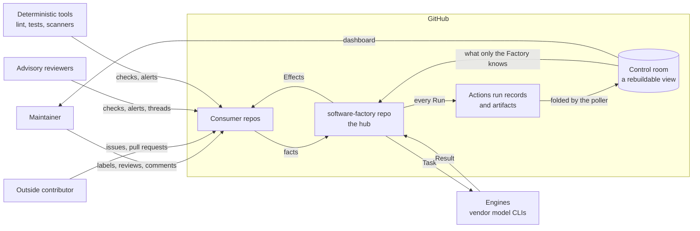
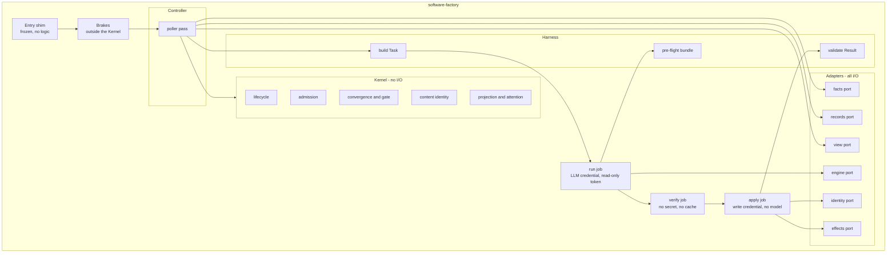
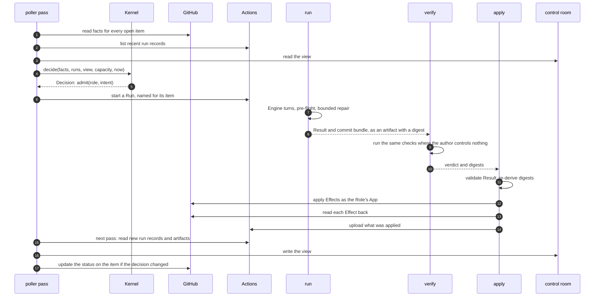
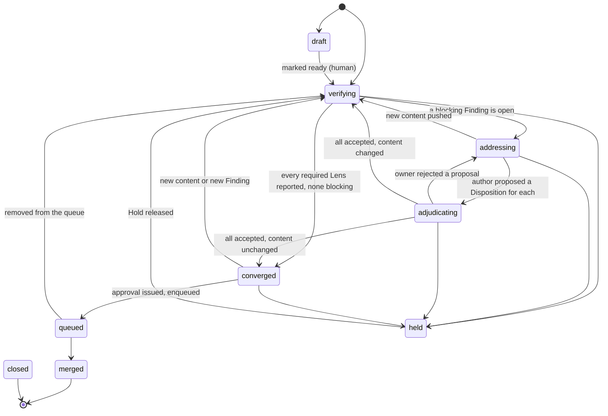
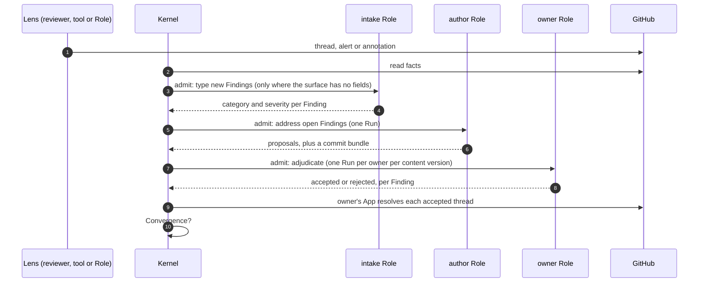

# Software Factory: interaction and contract design

**Status:** Draft for maintainer review
**Date:** 2026-10-10
**Builds on:** [ADR-0013](adr/0013-factory-mvp-reference-architecture.md), the [PRD](../prd/agentic-software-factory.md) and the [architecture review](factory-mvp-architecture-review.md)

## 1. Purpose

ADR-0013 says what shape the Factory has and why. This document says how its parts talk to each
other, precisely enough to be checked before any of it is built. It is written to be argued with:
every contract has an example, every behaviour has an invariant, and every invariant has a named
way to test it.

It has five layers. Each is an artifact that a check can read.

| Layer | Question it answers | Artifact | Checked by |
|---|---|---|---|
| 1. Structure (§2) | What are the parts and who calls whom? | Diagrams in this document | Review |
| 2. Contracts (§3) | What exactly crosses each boundary? | One schema and golden examples per message | Schema validation of every example |
| 3. Behaviour (§4) | What may happen, in what order, and what must never happen? | The Lifecycle as data, a list of invariants, a simulator | Exhaustive checks on the Lifecycle; seeded simulation with injected faults |
| 4. Team interactions (§5) | Which Role sees what, raises what and decides what? | Role manifests and an authority table | Mechanical checks on the data |
| 5. Platform facts (§6) | What does GitHub actually do? | A list of spikes with pass criteria | One trial each on a canary repo |

Terms are those of the PRD glossary and are used exactly.

### 1.1 Decisions this design takes as given

Made by the Maintainer on 2026-10-10, in addition to ADR-0013's twelve decisions.

| Decision | Effect on this design |
|---|---|
| The repo is `petry-projects/software-factory` | Named throughout |
| A Finding is decided by the Role that owns its domain | The authority table (§5.2) and the Finding lifecycle (§4.3) |
| One GitHub App per Role | Each Role's permissions are a ceiling GitHub enforces (§5.1) |
| The LLM credential is the existing subscription, stored as an environment secret in the Factory repo | The engine port (§2.2); no new capacity signal |
| The review Intent is built first and reviews everything after it | The build order (§9) |
| The comparison with the POC is a measure, not a gate | The comparator is a later, non-gating component |
| The stopping rule is judged on outcomes | §9.2 |
| Each Lens has a declared scope of paths | Role manifests (§5.3) |
| A Consumer repo's setup and test commands are part of its onboarding contract | The Consumer entry (§3.12) |
| Design by simulation first, with a formal model held in reserve | §4.5 |
| State is derived from GitHub at every evaluation and never stored | §3.9, §7 |
| The record of a Run is its Actions run record and its artifact | §3.10 |
| Work is noticed by a poller; an event may only ask for a pass | §7.3 |
| The control room is a public, rebuildable view with a dashboard, holding 90 days | §8 |

ADR-0000 to ADR-0012 describe the POC and are not constraints here. Four mechanisms that ADR-0013
takes from them are restated in §2.4 as this design's own rules.

### 1.2 Still open

- The period after which the stopping rule is judged (§9.2).
- The name prefix shared by the Factory's Apps (§5.1).
- Whether any panel is kept off the public dashboard (§8.6).
- Where held-out eval sets live. The control room is public, so it is not there.

## 2. Structure

### 2.1 Context



Everything the Factory knows about a Work item it reads from GitHub: the item itself, and the
Factory's own run records. Nothing authoritative lives anywhere else. The control room is a view of
those, and can be deleted and rebuilt. Everything the Factory does to a Work item is an Effect
applied by one job.

### 2.2 Components



| Component | Responsibility | May not |
|---|---|---|
| Entry shim | Run from the default branch and call the pinned Release | Contain a step or a `run:` block |
| Brakes | Human Pause, Run ceiling, loop count, monthly spend cap | Import from `kernel/` or read the control room for the loop count |
| Controller | One pass: read facts, run records and the view; call the Kernel; start Runs; write the view | Decide anything itself |
| Kernel | Every decision: Lifecycle, Admission, Convergence, the gate, content identity, what the item shows and how urgently it needs a person | Open a file, a socket, a process or the environment; read the clock except as an argument; take a comment body |
| Facts port | One snapshot of a Work item from GitHub | Return text to the Kernel |
| Records port | List the Factory's own run records and read their artifacts | Write anything |
| View port | Read and write the control room's files | Be the only source of anything a decision needs |
| Effects port | Apply one Effect and read it back | Run in a job that holds an LLM credential |
| Engine port | Run one vendor CLI on one Task and return its output | Hold a GitHub write credential |
| Identity port | Mint a token for the Role's App, narrowed to the Effects requested | Mint for a Role other than the one in the Result |
| Harness | Build the Task, run the pre-flight bundle, validate the Result | Interpret prose |

Two ports isolate choices that may change: the engine port (the subscription CLI today, a metered
API later under FR-73) and the identity port (one App per Role, with the mint rule in one place).

### 2.3 One Run, end to end



Steps 8 to 10 are skipped for an Intent that changes no code. The Result artifact of step 8 exists
before `apply` starts, so it is the record of what was intended (§3.6).

### 2.4 Four rules restated

These came from the POC's decision log. They are restated here so that this design does not depend
on that log surviving.

1. **Thin caller.** A workflow that runs from a default branch has jobs that each `uses:` a pinned
   reusable workflow and nothing else. Its only logic is a job-level `if:`.
2. **Immutable tag, moving channel.** A Release is an immutable tag. A channel is a moving tag that
   points at one, moved through one path by one identity under a ruleset. Moving it back is the
   rollback.
3. **At most one Factory file in a Consumer repo.** It is byte-identical to the template in the
   Release the repo follows, and it never needs editing for a new Role, Intent or trigger.
4. **A concurrency key per Work item, declared at job level.** One running and one pending entry
   per item is the coalescing the design wants, not a defect to work around.

## 3. Contracts

### 3.1 The catalogue

Every message carries `schema` (name and major version), `id`, and the `release` that produced it.
A reader rejects a major version it does not know. Messages are JSON. Files a person edits are YAML.

| Contract | From | To | Carries |
|---|---|---|---|
| Wake | Consumer ingress or timer | Controller | At most a Work item's identity |
| Facts | Facts port | Kernel | What GitHub holds about one Work item, as data |
| Decision | Kernel | Controller | Nothing, defer, hold, transition or admit, with a reason |
| Task | Harness | Engine | Everything one Run needs |
| Result | Engine | Harness | Status, requested Effects, Findings, Dispositions, usage |
| Effect | Result | `apply` | One requested change to the outside world |
| Finding | Any Lens | Kernel | One observation, with a non-text identity |
| Disposition | Author and owner Roles | Kernel | A proposal and a decision on one Finding |
| Run record | Actions, and the Run's own artifacts | Controller | That a Run happened, how it ended and what it produced |
| Control-room view | Controller | Kernel, dashboards | What only the Factory knows, folded from run records; and every item's computed State |
| Role manifest | Factory developer | Kernel, Harness | What a Role sees, raises, owns and may do |
| Authority table | Maintainer | Kernel | Who decides each category of Finding |
| Consumer entry | Repo owner | Kernel, `verify` | How one Consumer repo is served |
| Lifecycle | Factory developer | Kernel | States, Transitions, Gates and actors |

### 3.2 Wake

```json
{ "schema": "wake/1", "repo": "petry-projects/markets", "item": { "type": "pull_request", "number": 521 } }
```

`item` is optional. A wake with no item means "evaluate everything overdue". The Kernel's functions
take no wake, so the property "no event carries work" is a matter of signatures.

### 3.3 Facts

One snapshot, read in one query, of what GitHub holds. It is also the fixture format for replay and
for contract tests, so one schema has three uses.

| Field | Content |
|---|---|
| `item`, `state`, `is_draft`, `author` | Identity, open/closed/merged, draft flag, authoring actor |
| `head`, `base`, `merge_base` | Commit hashes |
| `content_id` | Hash of the pull request's own diff against its merge base, computed by the port |
| `changed_paths` | Paths in that diff |
| `labels` | Names |
| `reviews` | Actor, state, commit, time |
| `threads` | Thread id, path, line, resolved, outdated, opening actor, resolving actor |
| `checks` | Name, App, conclusion, completion time, annotation count |
| `alerts` | Tool, rule, alert number, state, severity, path |
| `queue` | Merge-queue membership |
| `actors_since_human` | Count of automated actions since the last human one, from GitHub's timeline |
| `read_at`, `quota_remaining` | When it was read, and what the installation has left |

No field holds prose. Thread and comment bodies are read by the port into a separate `texts` set,
keyed by id and labelled with a trust class. The Harness may put them in a Task. The Kernel never
receives them.

### 3.4 Decision

```json
{
  "schema": "decision/1",
  "item": { "repo": "petry-projects/software-factory", "type": "pull_request", "number": 42 },
  "outcome": "admit",
  "reason": "blocking_findings_proposed",
  "evidence": ["finding:f_9c1e", "finding:f_22ab"],
  "admit": { "role": "qa-lead", "intent": "adjudicate-findings", "lease_seconds": 1800 },
  "transition": { "from": "addressing", "to": "adjudicating" },
  "next_eval_at": "2026-10-10T19:30:00Z"
}
```

`outcome` is one of `nothing`, `defer`, `hold`, `transition`, `admit`. `reason` is an enumerated
code, never a sentence; the sentence a person reads is rendered from it. Every outcome except a
terminal one carries `next_eval_at`.

### 3.5 Task and Result

```json
{
  "schema": "task/1",
  "run": "r_01JA7Q",
  "role": "qa-lead",
  "intent": "adjudicate-findings",
  "item": { "repo": "petry-projects/software-factory", "type": "pull_request", "number": 42 },
  "content_id": "sha256:5d0c",
  "findings": ["f_9c1e", "f_22ab"],
  "texts": [
    { "id": "thread:PRRT_kw1", "trust": "advisory", "source": "coderabbitai", "body": "..." },
    { "id": "issue:body", "trust": "maintainer", "source": "don-petry", "body": "..." }
  ],
  "limits": { "turns": 20, "repair_turns": 2, "seconds": 900, "cost_ceiling_usd": 1.5 },
  "tier": "deep",
  "permitted_effects": ["resolve_thread", "comment"],
  "result_schema": "result/1"
}
```

Trust classes are `maintainer`, `role`, `advisory` and `outside`. Text of any class is data: it
cannot change the Task's permissions, limits or result schema.

```json
{
  "schema": "result/1",
  "run": "r_01JA7Q",
  "status": "completed",
  "dispositions": [
    { "finding": "f_9c1e", "decision": "accepted" },
    { "finding": "f_22ab", "decision": "rejected", "reason": "fix_incomplete" }
  ],
  "findings": [],
  "effects": [ { "type": "resolve_thread", "thread": "PRRT_kw1" } ],
  "bundle": null,
  "preflight": [],
  "usage": { "engine": "claude-cli", "model": "recorded-by-harness", "input_tokens": 41200, "output_tokens": 2100, "cost_usd": 0.42, "seconds": 310, "session": "s_7f" }
}
```

`status` is `completed`, `incomplete`, `failed` or `refused`. A Result has no field for a commit
hash: code changes are local commits handed over as a bundle, and `apply` writes the hash after it
has pushed and read back. `usage` is filled by the Harness from the CLI's own output, including for
a Run that failed.

### 3.6 Effect

GitHub writes carry no idempotency key. Each Effect type therefore declares how `apply` recognises
that it has already happened.

| Effect | Recovery key | Naturally idempotent |
|---|---|---|
| `push_commits` | The tree digest of the branch head, read back | Yes |
| `open_pull_request` | The head branch name | Yes |
| `submit_review` | A review by this actor on this commit | Yes |
| `resolve_thread` | The thread's resolved flag | Yes |
| `add_label`, `remove_label` | The label's presence | Yes |
| `create_check_run` | `external_id` set to the Effect's id | Yes |
| `enqueue_merge`, `dequeue_merge` | Queue membership | Yes |
| `comment` | None | **No** |

For `comment`, the Result artifact is the intent record: it lists the Effect before `apply`
starts. `apply` uploads the comment's node id after it posts. On recovery an intended comment with
no node id is resolved by listing that App's comments since the Run began, never by matching body
text. Prefer a check run to a comment wherever a person does not need to reply.

There is no Effect that starts a Run. Only Admission does that.

### 3.7 Finding

```json
{
  "schema": "finding/1",
  "id": "f_9c1e",
  "source": { "lens": "coderabbit", "kind": "advisory", "actor": "coderabbitai[bot]" },
  "surface": { "type": "thread", "key": "PRRT_kw1" },
  "location": { "path": "kernel/admission.py", "start_line": 88, "end_line": 94 },
  "category": "functional",
  "severity": "major",
  "typed_by": { "kind": "intake", "run": "r_01JA6Z" },
  "content_id": "sha256:5d0c",
  "status": "open"
}
```

- `id` is derived from the source and the surface key. It is never derived from text, so an edited
  summary is not a new Finding.
- `surface.type` is `thread`, `alert`, `annotation`, `check` or `role`.
- `category` is one of `functional`, `security`, `architecture`, `delivery`, `reliability`,
  `requirements`, `mechanical`, `uncategorised`, or `human`.
- `severity` is `blocking`, `major`, `minor` or `info`.
- `typed_by.kind` is `native` when the surface supplies category and severity as fields (an alert,
  a Role's own Finding) and `intake` when a listed Role read the prose and typed it. This is the
  one place a model reads a third party's text to produce a record the gate uses, and it is
  recorded on the Finding so that it can be measured.

### 3.8 Disposition

```json
{
  "schema": "disposition/1",
  "finding": "f_9c1e",
  "content_id": "sha256:5d0c",
  "proposal": { "outcome": "fixed", "by": "dev-lead", "evidence": { "commit": "written-by-apply" } },
  "decision": { "result": "accepted", "by": "qa-lead", "run": "r_01JA7Q" }
}
```

A Disposition has two halves, written by two different Roles. The author proposes `fixed`,
`declined`, `deferred` or `not_applicable`. The owner of the Finding's category decides `accepted`
or `rejected`. There is exactly one Disposition per Finding per content version.

### 3.9 State: derived, with a small residue

The State of a Work item is not stored. It is computed at every evaluation by one Kernel function
from three inputs: the facts, the Factory's run records, and the residue below. A stored copy could
only go stale, which is how the POC's markers came to outlive the objects they described.

| Computed every time | From |
|---|---|
| The Lifecycle state and its reason | Facts |
| Whether the item is held, and by whom | A label, and who applied it |
| Whether a Run holds the item now | A run record in progress |
| How many attempts an Intent has had | Run records |
| The status of a Finding that lives in a thread or an alert | Facts |
| Whether this content was already reviewed | The review on an earlier commit with the same `content_id` |

The residue is what only the Factory knows and GitHub has no field for. It is written once, by the
Run that produced it, into that Run's artifact:

| Residue | Why it cannot be computed |
|---|---|
| What a Run cost | Tokens are known only to the Harness |
| What a model judged: a Finding's category and severity, an owner's decision | Recomputing costs a model call and may give a different answer, so the gate would flap |
| Which `content_id` a Lens examined and found clean | A Lens that finds nothing writes nothing on the item |

One example shows why attempts must be counted and not assumed. A pull request has a red test, and
nothing else has changed. Either nobody has tried to fix it, or three fix Runs each ran fifteen
minutes, timed out and pushed nothing. The item looks the same in both cases. The run records tell
them apart, and Actions writes a run record even when the job is killed.

### 3.10 The record of a Run

A Run is one workflow run. Its record has two parts, both kept by GitHub.

**The run record.** Written by Actions, whatever happens to the job. The run's name carries what
the hub's own head commit cannot:

```text
sf petry-projects/markets#521 fix-review-findings dev-lead c:5d0c r:01JA7Q
```

That is the repo and item, the Intent, the Role, the short `content_id` and the Run id. Status,
conclusion, start and end times and the attempt number come from Actions.

**The artifacts.** `result.json` is the Result of §3.5, uploaded by `run` with its digest. The
commit bundle travels beside it. `applied.json` is uploaded by `apply` and lists each Effect with
what was read back. Nothing is handed from job to job through the log: the log is shared with
whatever the model prints, and Actions rewrites it when it masks secrets.

A Run that dies before it uploads anything still has a run record, and counts as an attempt. Its
cost is not known exactly; its duration is the estimate.

Run records and artifacts are kept for 90 days, which is the Factory's history (PRD FR-40).

### 3.11 Role manifest

```yaml
schema: role/1
name: devops-lead
app: petry-sf-devops-lead        # proposed prefix, section 5.1
kind: owner                      # author | reviewer | owner | advisor
lens:
  scope:
    paths: [".github/**", "**/*.tf", "**/*.bicep", "**/Dockerfile*", "infra/**", "scripts/ci/**"]
    exclude: ["docs/**"]
    always: false
  raises: [delivery]
owns: [delivery]
intents:
  - name: review-change
    tier: standard
    permitted_effects: [comment]
    budget_class: advisory
    evals: evals/review-change
  - name: adjudicate-findings
    tier: deep
    permitted_effects: [resolve_thread, comment]
    budget_class: gate
    evals: evals/adjudicate-findings
```

### 3.12 Authority table and Consumer entry

```yaml
schema: authority/1
max_rounds: 3
categories:
  functional:    { owner: qa-lead,            may_accept: [fixed, declined, deferred, not_applicable] }
  security:      { owner: security-lead,      may_accept: [fixed, not_applicable] }
  architecture:  { owner: solution-architect, may_accept: [fixed, declined, deferred, not_applicable] }
  delivery:      { owner: devops-lead,        may_accept: [fixed, declined, deferred, not_applicable] }
  reliability:   { owner: sre-lead,           may_accept: [fixed, declined, deferred, not_applicable] }
  requirements:  { owner: pr-review,          may_accept: [fixed, declined, deferred, not_applicable] }
  uncategorised: { owner: pr-review,          may_accept: [fixed, declined, deferred, not_applicable] }
  mechanical:    { owner: none }      # closes only when the tool stops reporting it
  human:         { owner: human }     # closes only when that person resolves it
escalation: hold_for_maintainer
```

```yaml
schema: consumer/1
repo: petry-projects/markets
ring: next
owner_role: devops-lead
ci_workflows: ["CI"]
verify:
  setup: "scripts/factory-setup.sh"
  test: "scripts/factory-test.sh"
  protected_paths: ["scripts/factory-setup.sh", "scripts/factory-test.sh", ".github/**", "CODEOWNERS"]
reviewers: [coderabbit, cubic, gemini-code-assist, sonarqube-cloud]
nudge_installed: false
```

The entry lives in the Factory repo and rides the Release. The scripts it points at live in the
Consumer repo and are the Consumer's own. `apply` refuses a change to a protected path unless a
human transition is recorded, so an author cannot weaken the tests it is judged by.

## 4. Behaviour

### 4.1 The pull-request Lifecycle



| State | Meaning | Next actor | Longest wait before re-evaluation |
|---|---|---|---|
| `draft` | Not ready; the Factory watches and does nothing | Human | 24 h |
| `verifying` | Waiting for required Lenses to report on the current content | Lenses, with deadlines | 30 min |
| `addressing` | Blocking Findings are open | Author Role | 30 min |
| `adjudicating` | Proposals await the owning Roles | Owner Roles | 30 min |
| `converged` | Convergence holds for this content; approval may issue | Reviewer | 15 min |
| `queued` | In the merge queue | GitHub | 15 min |
| `held` | A Hold is in place, human or automatic | As the Hold states | 24 h, or the Hold's own time |
| `merged`, `closed` | Terminal | None | None |

Any state may move to `closed` when a person closes the pull request, and to `held` on a Hold. A
Pause is not a state: it stops Admission for a scope and leaves each item where it is.

Human transitions are declared like any other: marking ready, converting to draft, adding or
removing a hold label, requesting changes, resolving a thread, approving, merging by Override.

The issue Lifecycle is sketched only, because the review Intent is built first: `new`, `triaged`,
`ready`, `in_progress`, `in_review` (the pull request's Lifecycle governs), `done`, `declined`,
`held`. `done` requires a merged change with a non-empty diff that closes the issue.

### 4.2 Convergence and the gate

Convergence is one Kernel function of facts and State:

1. every Lens required for this class of item, this stage and these changed paths has reported on
   the current `content_id`, or its deadline has passed and it is not one that must report;
2. no Finding of severity `blocking` or `major` is open or proposed;
3. no `human` Finding is open.

The approval is issued only in `converged`, by the reviewer identity, for that `content_id`. If a
push changes the head and not the `content_id`, the approval is re-issued with no Run.

### 4.3 The life of a Finding



- Lenses never address each other. Every arrow passes through the Kernel.
- An owner decides in one batched Run per content version, so the number of Runs does not grow with
  the number of threads.
- A rejected proposal returns the item to `addressing`. After `max_rounds` the item is placed on
  Hold with the open Findings listed.
- A `security` Finding cannot be accepted as `declined` or `deferred` by any Role. Only an Override
  by the Maintainer does that.
- A `mechanical` Finding is never judged by a model. It closes when its tool stops reporting it.
- A `human` Finding closes only when that person resolves it.
- A Finding whose source no longer reports it on new content becomes `superseded`.

### 4.4 Invariants

These are the properties the simulator asserts. Each is a sentence a test can falsify.

| # | Invariant | PRD |
|---|---|---|
| I-1 | Every open item is evaluated on every pass, and within its state's limit once faults stop; a pass that has not run is itself reported | FR-3, FR-5, FR-43 |
| I-2 | At most one Run that can produce Effects is active per item | FR-16 |
| I-3 | Active Runs never exceed the org limit, and spend never exceeds the cap | FR-35, FR-73 |
| I-4 | No Effect is applied twice | ADR-0013 §4 |
| I-5 | No Effect is applied from a Result that failed validation, or outside the Role's permitted Effects | FR-9, FR-10 |
| I-6 | No Run is admitted on a held item, and removing the Hold resumes work with no other event | FR-23 |
| I-7 | No Run is admitted under a human Pause, and automation never clears one | FR-24 |
| I-8 | Automated actions since the last human decision never exceed the ceiling | FR-17 |
| I-9 | An approval exists only for a `content_id` on which Convergence held | FR-31, FR-67 |
| I-10 | No Role decides a Disposition on a Finding about its own work | FR-30 |
| I-11 | Unchanged content causes no new review Run | FR-7 |
| I-12 | Every recorded Transition is declared in the Lifecycle | FR-1 |
| I-13 | An unreadable fact or a missing capacity reading never yields an admission | FR-35, C-1 |
| I-14 | Every cycle in the Lifecycle passes through a bounded counter or a human transition | FR-18, FR-57 |
| I-15 | Each Finding has exactly one owner and one Disposition per content version | FR-33 |
| I-16 | A `security` Finding is never closed as declined without an Override record | Maintainer, 2026-10-10 |
| I-17 | The status on an item changes only when the decision changes | ADR-0013 §2 |
| I-18 | A Run that ends with no Result counts as an attempt, and its item is re-evaluated | ADR-0013 §4 |
| I-19 | A view rebuilt from GitHub equals the view updated pass by pass | §8 |
| I-20 | A decision that finds the view missing or behind recomputes or defers; it never admits | C-1 |

### 4.5 The simulator

The Kernel does no I/O and takes the clock as an argument. That makes it possible to run the real
decision logic against a fake world, quickly, thousands of times.

- **World.** An in-memory GitHub behind the facts, records and effects ports: repos, items, content
  versions, actors, reviews, threads, checks, labels, a merge queue, and run records with artifacts. It applies GitHub's own rules,
  including dismissing an approval when the merge base changes.
- **Actors.** Scripted stand-ins for an author that sometimes fixes and sometimes breaks, Lenses
  that raise Findings, owners that accept or reject, and a Maintainer who labels, reviews and
  merges at arbitrary moments.
- **Clock and scheduler.** Time advances only when the simulator says. It decides which tick or
  nudge is delivered next.
- **Faults.** A tick dropped or delayed by hours. A nudge dropped or duplicated. A job killed at
  every step boundary, including between two Effects and before any artifact is uploaded. The
  view missing, or one pass behind. A facts read that fails or is stale. A missing capacity reading.
  A Result that fails validation. An Engine that times out. A human acting mid-Run.
- **Properties.** I-2 to I-17 are checked after every step, as are I-19 and I-20. I-1 and I-18 are checked once faults
  stop and the world is left to settle.
- **Reproduction.** Each run has a seed from the standard library's generator. A failure prints the
  seed and the trace, and the trace renders as a sequence diagram.

Two things are checked exhaustively rather than sampled, because they are small and finite: the
Lifecycle graph (every state reaches a terminal one, every non-terminal state has a timer, I-14)
and the authority data (§5.4).

The simulator samples interleavings. It does not prove their absence. A formal model in TLA+ would,
for a small model, and is held in reserve for leases and crash recovery if the simulator finds a
fault there that it cannot pin down.

## 5. Team interactions

### 5.1 Roles and identities

Each Role acts through its own GitHub App, so its permissions are a ceiling the platform enforces.
A token is still narrowed at mint time to the Effects one Result requests.

| Role | Kind | Raises | Owns | App may |
|---|---|---|---|---|
| `dev-lead` | Author | None | None | Push to work-item branches, open pull requests, comment |
| `pr-review` | Reviewer | `requirements` | `requirements`, `uncategorised` | Comment, open and resolve threads. Its approval is submitted by the machine user |
| `qa-lead` | Owner | `functional` | `functional` | Comment, open and resolve threads |
| `security-lead` | Owner | `security` | `security` | Comment, open and resolve threads |
| `solution-architect` | Owner | `architecture` | `architecture` | Comment, open and resolve threads |
| `devops-lead` | Owner | `delivery` | `delivery`, Consumer entries | Comment, open and resolve threads |
| `sre-lead` | Owner | `reliability` | `reliability` | Comment, open and resolve threads |
| `business-analyst` | Advisor | `requirements`, on issues | None | Comment |
| `scrum-master` | Advisor | None on code | None | Comment |
| Controller | Not a Role | None | None | Write the control room, the status on the item, labels and the queue |

- The approving review stays with the existing machine user, because a code owner must be a user.
- The Apps share a name prefix, proposed as `petry-sf-`. The frozen Consumer file drops
  Factory-authored events by that prefix, so adding a Role never changes a Consumer file.
- Registering an App is a manual step. "A new Role in one pull request" (NFR-11, UJ-7) becomes one
  pull request plus one registration. A new Intent or trigger for an existing Role is still one
  pull request.

### 5.2 Who decides what

The authority table of §3.12 is the whole rule. Three points follow from it.

- **Ownership is by category, not by path.** A security defect can sit in any file.
- **An owner judges; it does not rewrite.** There is one author per change.
- **An owner becomes a gate.** Its adjudicating Intent therefore needs an eval set before it is
  allowed to close anything (FR-55), and its record is measured like any other Lens (FR-69): the
  share of its acceptances later reverted or reopened is the number to watch.

### 5.3 What each Role watches

A Lens has a declared scope of paths in its manifest. The scope is an input to Admission: the
Kernel compares it with `changed_paths` and admits the Lens only where they meet.

| Role | Scope | Why |
|---|---|---|
| `devops-lead` | Workflow files, Terraform, Bicep, Dockerfiles, CI scripts | File type is a good proxy for this domain |
| `qa-lead` | Source and test paths; not documentation | A proxy that is mostly right |
| `security-lead` | Always, on any code change | A security defect is not a file type |
| `solution-architect` | Signals, not types: a new top-level directory, a dependency manifest, a schema, a public interface, a decision record, a diff over a declared size | Architecture is cross-cutting |
| `sre-lead` | Runtime configuration, error handling, observability | Narrow by design in the MVP |
| `pr-review` | Always | It reads the change against its issue |

Four rules keep a scope from becoming a blind spot.

1. A scope is not a workflow `paths:` filter. That would put logic in YAML and stop a required
   check from reporting.
2. A Lens whose scope does not match is **not required** for Convergence on that content. It is
   never "awaited".
3. A scope narrows what a Role *raises*. It does not narrow what it *owns*: a `delivery` Finding
   raised by another Lens on any path still goes to `devops-lead`.
4. A scope is measured. A Finding of a Role's category raised by another Lens on a path outside
   that Role's scope is counted as a scope miss.

### 5.4 Mechanical checks on the team

Run by `factory / verify` over the manifests and the authority table.

- Every category has exactly one owner.
- No Role is both the author of a change and the decider of a Disposition on it.
- No Role both proposes and decides the same Disposition.
- Every permitted Effect of every Intent is within the declared ceiling of that Role's App.
- No manifest names another Role's output as a trigger.
- The graph "a Run of X can lead the Kernel to admit a Run of Y" has no cycle that does not pass
  through `max_rounds` or a human transition.
- Every Intent in budget class `gate` has an eval set.
- Every Consumer entry names an owner Role, a setup command, a test command and protected paths.

The interaction matrix in §5.1 is generated from this data in the Factory repo. A stale copy fails
the check.

## 6. Platform facts to settle by trial

None of these can be modelled. Each is one trial on a canary repo, with the result recorded.

| # | Question | Pass |
|---|---|---|
| P-1 | Does a pull request authored by an App need an extra approval under the live ruleset's rule for unattributed changes? | One approval suffices |
| P-2 | Can an App enable auto-merge and enter the merge queue? | Yes |
| P-3 | Is an environment secret restricted to the default branch unreadable from a workflow on a work-item branch? | Unreadable |
| P-4 | Can an installation token be minted with a subset of the App's permissions and repos? | Yes |
| P-5 | Can one App resolve a review thread opened by another App or by a third-party reviewer? | Yes, with pull-request write |
| P-6 | Does a job-level `if:` on the actor's prefix drop events authored by the Factory's Apps? | Dropped, with no step run |
| P-7 | Does the machine user's approval satisfy code-owner review and the last-push rule when an App pushed last? | Yes |
| P-8 | What does one pass over every open item in twelve repos cost in GraphQL points, and how often do scheduled ticks arrive in the new repo? | Within the budget of §7.3 |
| P-9 | Can a pass start the next one with the default workflow token? | Yes |
| P-10 | Does a nudge count against the content-creation limit, and can its credential be dispatch-only? | Does not count; can |
| P-11 | Can the Controller's App write the control-room repo, and publish its page, without starting a workflow in the hub? | Yes |
| P-12 | Does a check run's `external_id` round-trip, so it can serve as a recovery key? | Yes |
| P-13 | Does the vendor CLI return validated structured output and usage in headless mode on the subscription credential, at a pinned version? | Yes |
| P-14 | Can a job with no permissions and no cache action write the default-branch cache scope? | Cannot |
| P-15 | Do the retained Advisory reviewers review a pull request authored by an App? | Each one does, or is dropped from the awaited set |
| P-16 | How long are run records, logs and artifacts kept in a public repo? | 90 days |
| P-17 | Is a run's name set when the run is created, and visible for a run whose job never started? Can recent runs of one workflow be listed and matched by name within the request budget? | Yes to both |
| P-18 | Does a final step still run, and upload partial usage, when a job times out or is cancelled? | Yes, or duration is the only estimate |
| P-19 | Can a static page in a separate public repo be published from files the Controller writes? | Yes |

## 7. State, records and noticing work

ADR-0013 first adopted a git-backed store and a wake per event, both provisionally. The Maintainer
replaced both on 2026-10-10. This section records what was decided, why, and what was set aside.

### 7.1 Why there is no store

The first design kept a State record per Work item and an append-only Ledger in a git store that
only the Controller wrote. The question that undid it was simple: why can State not be determined
from the issue and the pull request?

Mostly it can. The Lifecycle state, the Hold, the thread and alert Findings and the reviews are all
on GitHub, and a stored copy of any of them is a copy that can go stale. What cannot be read from
the item is a small residue (§3.9): that a Run was attempted, what it cost, and what a model
judged. GitHub already keeps the first of these, because every Run is a workflow run, and Actions
records a run even when its job is killed. The other two are in the Run's own artifact.

So nothing needs a second authoritative store. That also answers the adversarial review, which
faulted the first design for keeping control state that could not be rebuilt, where every
comparable system rebuilds its state from the platform.

### 7.2 Where each thing lives

| Need | Where it lives | Written by |
|---|---|---|
| Everything about the Work item | The issue and the pull request | People, Lenses and `apply` |
| That a Run happened, how it ended, how long it took | The Actions run record, named for its item | Actions |
| What a Run produced: the Result, its cost, what a model judged | An artifact with a digest | `run` and `apply` |
| The handoff from `run` to `verify` to `apply` | The same artifact, verified by digest | `run` |
| A fast index of the last two, and every item's computed State | The control room (§8) | The Controller |

GitHub is the source of truth for all of it. The control room is a materialized view: it holds
nothing GitHub does not, for the 90 days GitHub keeps it.

What this costs:

- **A killed Run's cost is unknown.** The vendor CLI reports usage when an invocation ends.
  Duration is the estimate, and a final step uploads whatever partial usage exists.
- **History is 90 days.** The Maintainer accepted this in place of the PRD's 180.
- **Decisions read a view.** Cost and model judgements reach the Kernel through the control room,
  because downloading every artifact on every pass is too slow. I-19 and I-20 are the guard: the
  view must equal a rebuild, and a missing view defers.
- **An issue with no pull request has no Run on it yet,** so there is nothing to record until the
  first Run, which is then a run record like any other.

### 7.3 Noticing work

The Controller has to evaluate an item when something about it changes and when time passes.
GitHub Actions offers an event, which is lost if its run is evicted, and a schedule, which arrives
late or not at all.

| # | Noticing must | From |
|---|---|---|
| W-1 | Be correct whichever single event or tick is lost | FR-5, FR-19 |
| W-2 | Reach a decision within 15 minutes at the 95th percentile after a change that produces no event | ADR-0013 §11 |
| W-3 | Use at most 10% of the org's job-minutes, from a pool of 20 slots shared with all CI | NFR-1, C-9 |
| W-4 | Stay under 3,000 GraphQL points an hour at peak | ADR-0013 §11, NFR-14 |
| W-5 | Keep one writer per item and coalesce requests that arrive during a Run | FR-16 |
| W-6 | Put at most one unchanging file, and no write credential, in a Consumer repo | FR-51 |
| W-7 | Be unable to feed itself without bound | FR-18 |
| W-8 | Notice that CI has finished | Review §14.2 |
| W-9 | Need no always-on service | C-4 |

| Option | How it works | Meets | Fails or strains |
|---|---|---|---|
| 1. A wake per event | A file in each Consumer forwards every subscribed event to the hub, which starts one Controller run for that item | W-2 at its best, W-5, W-9 | W-3: about three jobs per event, and at least 12,500 events a week from the busiest repo. W-1 still needs a sweep. W-7: the Factory's own writes are events. W-8: a `workflow_run` trigger must name each workflow |
| 2. A scheduled poller | One job on a timer lists every open item in every repo in a few queries and evaluates them all in one process | W-1, W-3 to W-9. Nothing at all in any Consumer | W-2: a schedule cannot be finer than five minutes, about 60% of ticks are dropped here, and gaps of hours have been observed |
| 3. A looping job | One job ticks every 30 seconds for some hours, then starts its successor | W-1 to W-8 | W-9 in spirit. One of 20 slots, permanently. GitHub's terms do not say whether this is allowed |
| **4. A poller with nudges** | Option 2 is the base. An event carries no work: it only asks for a pass now. The poller holds one concurrency group, so any number of nudges during a pass collapse into exactly one more pass | W-1, W-3 to W-9. W-2 wherever a nudge file is installed | W-2 elsewhere. A Consumer that wants low latency carries a file, with a credential that can only dispatch |

**Decided: option 4, built as option 2 first.**

- Passes cannot overlap, and at most one waits behind the one running. A flood of events costs at
  most back-to-back passes: one runner slot, 5% of the pool.
- A pass ends by starting its successor if anything is due sooner than the next tick. Scheduled
  ticks then only restart a broken chain.
- The Factory's own writes cannot run away. A nudge asks for a pass; whether a Run is admitted is
  still Admission's decision, under the brakes.
- One pass is the only decider, so an org-wide limit is a decision inside one process. No lease and
  no race.
- A Run is still its own workflow run, holding its item's lane from `run` to `apply`.
- Option 3 is held until GitHub's terms are answered. Option 1 is held unless a requirement appears
  for a response in seconds; none is in the PRD.

### 7.4 What was set aside

| Option | Why not |
|---|---|
| A branch in the Factory repo holding State records and a Ledger | A second authoritative copy of what GitHub holds; contended under many writers |
| The same in a private data repo | The same, and the source it would hide is already public |
| A record on the item: a check run's output or one comment | Nothing an issue can carry; a comment record is a marker again |
| Events batched as artifacts and committed by one job | Two paths to keep correct, for a log Actions already keeps |
| A database | Needs an always-on service |

## 8. The control room

### 8.1 Purpose

`petry-projects/software-factory-control-room` houses the Factory's view and presents it to the
people who operate it, for understanding and for action. It is a public repo holding files the
Controller writes and a static page that reads them.

It was shaped by a separate analysis of what a situation room for the fleet should be:
`petry-projects/.github-private#2242 — Situation-room view for the agent fleet: build it from
native Claude Code parts, not a command-center product`. That analysis surveyed fourteen products
and found that each shows only the agents it launches, so none can show a fleet that runs as
workflows. Its verdict was to build a view over GitHub. §8.3 says what is taken from it and what
this design changes.

### 8.2 Objectives

| # | The control room | Serves |
|---|---|---|
| CR-1 | Answers "what needs me?" first. Items are ordered by the human action they need, and each states the decision, the evidence and the choices | UJ-2, FR-27 |
| CR-2 | Shows one definition of State. Every status is computed by the Kernel, the same function that decides. The page computes nothing | FR-2 |
| CR-3 | Is never a source of truth. It is rebuilt from GitHub, says when it was last written, and says so plainly when it is stale | FR-43 |
| CR-4 | Is read-only. A person acts in GitHub, through a declared human transition, and the page links there | FR-22 |
| CR-5 | Covers every Consumer repo on one page | PRD §1 |
| CR-6 | Shows cost and capacity: a budget gauge, cost per change, the share that was rework, cost by Role | UJ-8, UJ-9, FR-38 |
| CR-7 | Shows whether the Factory is working: the scorecard, each Lens's contribution, and the stopping rule's three measures against the POC's baseline | FR-42, FR-69, §9.2 |
| CR-8 | Links every number to the Runs behind it | UJ-9 |
| CR-9 | Replaces recurring report issues with one page | FR-44 |
| CR-10 | Is one feed with several lenses. The files are the contract; a page, an Artifact or a mod only renders them | §8.5 |
| CR-11 | Costs no model tokens to refresh. The poller writes it as a by-product of deciding | C-3 |

It is not a control plane. It starts no Run, steers no agent and stores no agent state in a project
board. It is also not where a chat session's output is made terser; that is a session setting.

### 8.3 What is taken from the situation-room analysis

| The analysis says | Here |
|---|---|
| Build, do not adopt a command-center product | Adopted. The PRD's market research reached the same finding for the whole Factory |
| Never store status; compute it and show the snapshot's age | Adopted, and taken further: it is computed once, by the Kernel, so the board cannot disagree with the Factory about why something waits |
| Columns: Working, Needs you, In review, Ready to merge | Adopted as the attention classes of §8.4, with Stale added |
| Order rows by the human action required | Adopted as CR-1 |
| Feed the board from a GraphQL snapshot taken by a chat session | Replaced. The poller already reads every open item on every pass; the board reads its output. No session has to be open, no tokens are spent, and no interactive API quota is used |
| Include a budget gauge fed by per-run accounting | Adopted as CR-6. The accounting is the residue of §3.9 |
| Decisions as choices, answerable from a phone | Supported: a Hold that needs a decision carries enumerated choices, so any lens can render them as buttons |
| Decisions still execute in GitHub | Adopted as CR-4 |
| One org-level project as the pipeline view, with no custom agent-state fields | Compatible, and outside the Factory. The control room's pipeline panel shows the same thing from computed State |
| A self-written mod as a heads-up display | A lens over the same files (§8.5). It reads the view and does not poll GitHub |
| Keep it private; a public page on a public repo is world-readable | **Not adopted as written.** See §8.6 |

### 8.4 The feed

| File | Holds |
|---|---|
| `view/meta.json` | When the view was written, by which pass and Release, and how far back it reaches |
| `view/items.json` | Every open Work item: computed State, reason, attention class, next actor, the decision required, age, attempts, cost, links |
| `view/runs/<date>.jsonl` | One line per Run: the run record and the usage and outcome from its artifact |
| `view/findings.json` | Open Findings with category, severity, owner and Disposition |
| `view/scorecard.json` | The success metrics of PRD §9 and the stopping rule's measures |
| `view/capacity.json` | Usage per window, the estimate of what is left, and the degradation stage |

```json
{
  "schema": "view-item/1",
  "item": { "repo": "petry-projects/software-factory", "type": "pull_request", "number": 42 },
  "state": "held",
  "reason": "max_rounds_reached",
  "attention": "needs_you",
  "next_actor": "maintainer",
  "decision_required": {
    "question": "rounds_exhausted",
    "choices": ["grant_another_round", "accept_as_is", "close"],
    "evidence": ["finding:f_22ab", "run:r_01JA7Q"]
  },
  "content_id": "sha256:5d0c",
  "age_hours": 19.5,
  "attempts": { "fix-review-findings": 3, "adjudicate-findings": 3 },
  "cost_usd": 4.8,
  "sources": ["run:r_01JA6Z", "run:r_01JA7Q"],
  "url": "https://github.com/petry-projects/software-factory/pull/42"
}
```

`question` and `choices` are enumerated codes. The sentence a person reads is rendered from them.

Attention classes, in the order the page lists them:

| Class | Meaning | From |
|---|---|---|
| `needs_you` | A decision, an approval or an answer is required of the Maintainer | A Hold that needs a decision; an open `human` Finding; a `security` Finding awaiting Override |
| `failed` | Verification failed and no Run is addressing it | `addressing` with attempts exhausted, or a required check red |
| `review` | Waiting on Lenses or owners | `verifying`, `adjudicating` |
| `ready` | Converged and approved, or in the queue | `converged`, `queued` |
| `working` | A Run holds the item | A run record in progress |
| `stale` | Past its state's limit with no evaluation | I-1 breached |

The class is computed by the Kernel beside the State, so the status on the item and the row on the
page are always the same answer.

### 8.5 Lenses

| Lens | Reads | For |
|---|---|---|
| The status on the Work item | The Kernel's projection | One item, where the work is |
| The dashboard page | The feed | The whole portfolio, on any device |
| A private Artifact board in the Maintainer's Claude Code session | The feed | The decision queue, beside the session that acts on it |
| A mod band in the desktop Code tab | The feed | A heads-up count of what needs a person |

### 8.6 Public or private

The Maintainer chose a public view with a public page. The situation-room analysis says to keep the
board private. They are reconciled as follows.

- **The view hides nothing by being private.** Its sources are the issues, pull requests, run
  records and artifacts of public repos. The weekly cost report is already a public issue.
- **A free plan publishes a page only from a public repo.**
- **What a public page does add is aggregation.** One page that lists every held item and how much
  budget is left makes the Factory's state easier to read for anyone, not only its operator.
- **The private lens remains.** The Artifact board of §8.5 is private by construction and reads the
  same files.

Open: whether any panel, the budget gauge in particular, is left off the public page and shown only
in the private lens.

## 9. Build order and the stopping rule

### 9.1 Order

The review Intent comes first, so that the Factory reviews itself and everything built after it.

| Slice | Delivers | Who approves Factory changes |
|---|---|---|
| 0. Foundations | The repo, its ruleset and `factory / verify`. Every schema of §3 with golden examples. The Lifecycle and authority data. The simulator with a skeleton Kernel. The Apps. The trials of §6 | The Maintainer |
| 1. Review, end to end | The facts and records ports, the Kernel's Lifecycle, Convergence and gate, the poller, `run` and `apply` for the review Intent, Finding intake from threads, checks and alerts, the status on the item, and the control room's feed with a first page. Serving the Factory's own repo | The Maintainer, until the first `stable` Release; then the Factory's reviewer, with the Maintainer able to block |
| 2. Domain owners | The adjudicating Intents of `qa-lead`, `security-lead`, `solution-architect` and `devops-lead`, each with its eval set | The Factory |
| 3. Fix Intents | Fix CI and fix review findings under the run contract, with `verify` | The Factory |
| 4. A Consumer repo | One low-risk Consumer on the `next` ring | The Factory |
| 5. Onward | Implementation, the initiative driver, the remaining personas, as in the review's migration shape | The Factory |

Two consequences are worth stating. Until the first `stable` Release the Maintainer's attention is
the line's capacity, which argues for keeping slice 0 and slice 1 small. And the self-hosting rule
holds throughout: a candidate Release never reviews the change that produces it.

Using the POC's reviewer for the bootstrap was considered. Its comment gate can be satisfied only
by the POC's author Role and has no switch, so it would need a change to the POC first. It remains
the fallback if slices 0 and 1 turn out to need more approvals than the Maintainer can give.

### 9.2 The stopping rule

Agreed in principle on 2026-10-10, replacing the parity rule recorded earlier that day.

After the Factory has served its own repo and one Consumer repo for a period the Maintainer sets,
the migration stops unless the Factory beats the POC's baseline on all three of:

| Measure | POC baseline | Source |
|---|---|---|
| Share of agent-authored merges with a standing independent approval | At most 40% | PRD NFR-3 |
| Issue to merge, median | 24.5 hours | PRD NFR-2 |
| Workflow runs per merged pull request | About 1,500 | PRD NFR-1 |

Escaped defects (SM-C1) are reported beside them, so that the three are not bought by weaker
review. The period is still to be set; the earlier limit was four weeks.

## 10. What this design changes elsewhere

Recorded in the same change as this document.

| Document | Change |
|---|---|
| ADR-0013, decision 2 | State is derived and never stored. The record of a Run is its Actions run record and its artifact. The control room is a rebuildable view |
| ADR-0013, decision 3 | The Controller is a poller. An event may only ask for a pass. The Consumer file is optional |
| ADR-0013, decision 4 | The Result artifact is the intent record |
| ADR-0013, decision 5 | One App per Role |
| ADR-0013, decision 7 | An owning Role resolving a thread is a declared Role transition, beside the human one |
| ADR-0013, decision 10 | The review Intent on the Factory's own repo is the first component. The comparison with the POC is a measure, not a gate. The stopping rule is outcome-based |
| ADR-0013, decision 11 | No longer two provisional mechanisms. The poller's latency and cost are measured against the same thresholds |
| ADR-0013, decision 12 | A listed intake Role may read a thread's prose to type a Finding; the gate reads only the typed record |
| PRD, FR-40 and the glossary | History is 90 days. The State record is computed; the Ledger is the run records and artifacts, indexed in the control room |
| PRD, OQ-2, OQ-3, OQ-8, OQ-9 | Recorded as decided, with what remains open |
| PRD, NFR-11 | A new Role is one pull request plus one App registration |
