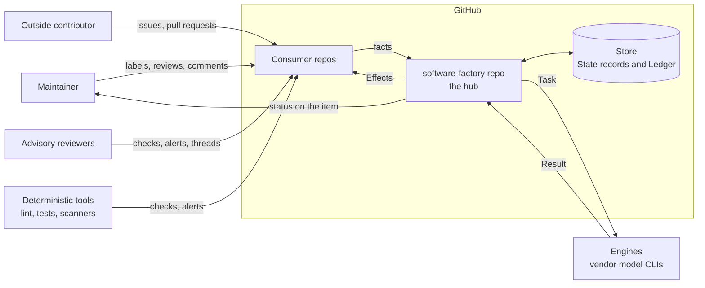
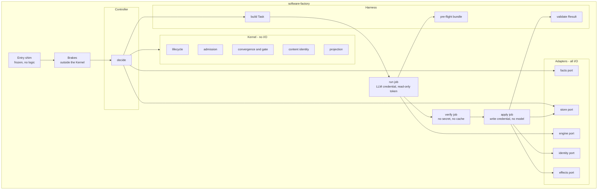
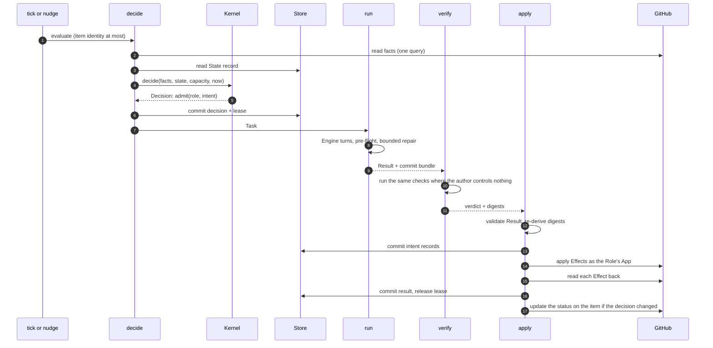
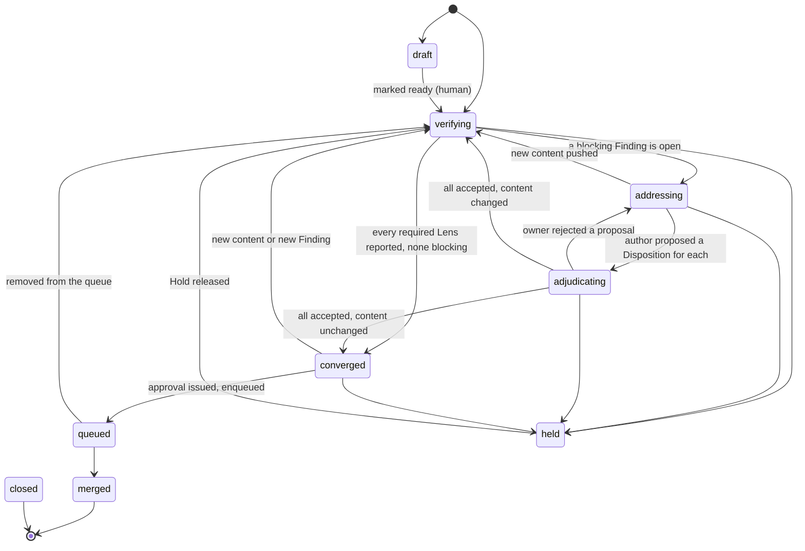
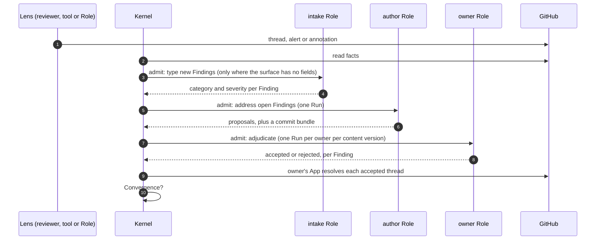

# Software Factory: interaction and contract design

**Status:** Draft for maintainer review
**Date:** 2026-10-10
**Builds on:** [ADR-0013](adr/0013-factory-mvp-reference-architecture.md), the [PRD](../prd/agentic-software-factory.md) and the [architecture review](factory-mvp-architecture-review.md)

## 1. Purpose

ADR-0013 says what shape the Factory has and why. This document says how its parts talk to each
other, precisely enough to be checked before any of it is built. It is written to be argued with:
every contract has an example, every behaviour has an invariant, and every invariant has a named
way to test it.

It has five layers. Each is an artifact that a check can read.

| Layer | Question it answers | Artifact | Checked by |
|---|---|---|---|
| 1. Structure (§2) | What are the parts and who calls whom? | Diagrams in this document | Review |
| 2. Contracts (§3) | What exactly crosses each boundary? | One schema and golden examples per message | Schema validation of every example |
| 3. Behaviour (§4) | What may happen, in what order, and what must never happen? | The Lifecycle as data, a list of invariants, a simulator | Exhaustive checks on the Lifecycle; seeded simulation with injected faults |
| 4. Team interactions (§5) | Which Role sees what, raises what and decides what? | Role manifests and an authority table | Mechanical checks on the data |
| 5. Platform facts (§6) | What does GitHub actually do? | A list of spikes with pass criteria | One trial each on a canary repo |

Terms are those of the PRD glossary and are used exactly.

### 1.1 Decisions this design takes as given

Made by the Maintainer on 2026-10-10, in addition to ADR-0013's twelve decisions.

| Decision | Effect on this design |
|---|---|
| The repo is `petry-projects/software-factory` | Named throughout |
| A Finding is decided by the Role that owns its domain | The authority table (§5.2) and the Finding lifecycle (§4.3) |
| One GitHub App per Role | Each Role's permissions are a ceiling GitHub enforces (§5.1) |
| The LLM credential is the existing subscription, stored as an environment secret in the Factory repo | The engine port (§2.2); no new capacity signal |
| The review Intent is built first and reviews everything after it | The build order (§8) |
| The comparison with the POC is a measure, not a gate | The comparator is a later, non-gating component |
| The stopping rule is judged on outcomes | §8.2 |
| Each Lens has a declared scope of paths | Role manifests (§5.3) |
| A Consumer repo's setup and test commands are part of its onboarding contract | The Consumer entry (§3.12) |
| Design by simulation first, with a formal model held in reserve | §4.5 |

ADR-0000 to ADR-0012 describe the POC and are not constraints here. Four mechanisms that ADR-0013
takes from them are restated in §2.4 as this design's own rules.

### 1.2 Still open

- Where the store lives and how work is noticed. §7 sets out the need, the requirements and the
  options, with a recommendation.
- The period after which the stopping rule is judged (§8.2).
- The name prefix shared by the Factory's Apps (§5.1).

## 2. Structure

### 2.1 Context



Everything the Factory knows about a Work item it reads from GitHub as facts or from its own store.
Everything it does to a Work item is an Effect applied by one job. Nothing else writes.

### 2.2 Components



| Component | Responsibility | May not |
|---|---|---|
| Entry shim | Run from the default branch and call the pinned Release | Contain a step or a `run:` block |
| Brakes | Human Pause, Run ceiling, loop count, monthly spend cap | Import from `kernel/` or read the Ledger for the loop count |
| Controller | Read facts and State, call the Kernel, record the decision, start the jobs | Decide anything itself |
| Kernel | Every decision: Lifecycle, Admission, Convergence, the gate, content identity, what the item shows | Open a file, a socket, a process or the environment; read the clock except as an argument; take a comment body |
| Facts port | One snapshot of a Work item from GitHub | Return text to the Kernel |
| Store port | Read and write State records and Ledger events | Be called by anything but the Controller and `apply` |
| Effects port | Apply one Effect and read it back | Run in a job that holds an LLM credential |
| Engine port | Run one vendor CLI on one Task and return its output | Hold a GitHub write credential |
| Identity port | Mint a token for the Role's App, narrowed to the Effects requested | Mint for a Role other than the one in the Result |
| Harness | Build the Task, run the pre-flight bundle, validate the Result | Interpret prose |

Three ports exist because three choices are open or provisional: the store port (git today, §7),
the engine port (subscription CLI today, metered API later under FR-73), and the identity port (one
App per Role, decided, but isolated so the mint rule lives in one place).

### 2.3 One Run, end to end



Steps 8 to 10 are skipped for an Intent that changes no code. Step 13 exists because GitHub writes
carry no idempotency key (§3.6).

### 2.4 Four rules restated

These came from the POC's decision log. They are restated here so that this design does not depend
on that log surviving.

1. **Thin caller.** A workflow that runs from a default branch has jobs that each `uses:` a pinned
   reusable workflow and nothing else. Its only logic is a job-level `if:`.
2. **Immutable tag, moving channel.** A Release is an immutable tag. A channel is a moving tag that
   points at one, moved through one path by one identity under a ruleset. Moving it back is the
   rollback.
3. **At most one Factory file in a Consumer repo.** It is byte-identical to the template in the
   Release the repo follows, and it never needs editing for a new Role, Intent or trigger.
4. **A concurrency key per Work item, declared at job level.** One running and one pending entry
   per item is the coalescing the design wants, not a defect to work around.

## 3. Contracts

### 3.1 The catalogue

Every message carries `schema` (name and major version), `id`, and the `release` that produced it.
A reader rejects a major version it does not know. Messages are JSON. Files a person edits are YAML.

| Contract | From | To | Carries |
|---|---|---|---|
| Wake | Consumer ingress or timer | Controller | At most a Work item's identity |
| Facts | Facts port | Kernel | What GitHub holds about one Work item, as data |
| Decision | Kernel | Controller | Nothing, defer, hold, transition or admit, with a reason |
| Task | Harness | Engine | Everything one Run needs |
| Result | Engine | Harness | Status, requested Effects, Findings, Dispositions, usage |
| Effect | Result | `apply` | One requested change to the outside world |
| Finding | Any Lens | Kernel | One observation, with a non-text identity |
| Disposition | Author and owner Roles | Kernel | A proposal and a decision on one Finding |
| State record | Kernel, via the store port | Kernel | What the Factory owns about one Work item |
| Ledger event | Controller and `apply` | Scorecard, replay | One fact about what the Factory did |
| Role manifest | Factory developer | Kernel, Harness | What a Role sees, raises, owns and may do |
| Authority table | Maintainer | Kernel | Who decides each category of Finding |
| Consumer entry | Repo owner | Kernel, `verify` | How one Consumer repo is served |
| Lifecycle | Factory developer | Kernel | States, Transitions, Gates and actors |

### 3.2 Wake

```json
{ "schema": "wake/1", "repo": "petry-projects/markets", "item": { "type": "pull_request", "number": 521 } }
```

`item` is optional. A wake with no item means "evaluate everything overdue". The Kernel's functions
take no wake, so the property "no event carries work" is a matter of signatures.

### 3.3 Facts

One snapshot, read in one query, of what GitHub holds. It is also the fixture format for replay and
for contract tests, so one schema has three uses.

| Field | Content |
|---|---|
| `item`, `state`, `is_draft`, `author` | Identity, open/closed/merged, draft flag, authoring actor |
| `head`, `base`, `merge_base` | Commit hashes |
| `content_id` | Hash of the pull request's own diff against its merge base, computed by the port |
| `changed_paths` | Paths in that diff |
| `labels` | Names |
| `reviews` | Actor, state, commit, time |
| `threads` | Thread id, path, line, resolved, outdated, opening actor, resolving actor |
| `checks` | Name, App, conclusion, completion time, annotation count |
| `alerts` | Tool, rule, alert number, state, severity, path |
| `queue` | Merge-queue membership |
| `actors_since_human` | Count of automated actions since the last human one, from GitHub's timeline |
| `read_at`, `quota_remaining` | When it was read, and what the installation has left |

No field holds prose. Thread and comment bodies are read by the port into a separate `texts` set,
keyed by id and labelled with a trust class. The Harness may put them in a Task. The Kernel never
receives them.

### 3.4 Decision

```json
{
  "schema": "decision/1",
  "item": { "repo": "petry-projects/software-factory", "type": "pull_request", "number": 42 },
  "outcome": "admit",
  "reason": "blocking_findings_proposed",
  "evidence": ["finding:f_9c1e", "finding:f_22ab"],
  "admit": { "role": "qa-lead", "intent": "adjudicate-findings", "lease_seconds": 1800 },
  "transition": { "from": "addressing", "to": "adjudicating" },
  "next_eval_at": "2026-10-10T19:30:00Z"
}
```

`outcome` is one of `nothing`, `defer`, `hold`, `transition`, `admit`. `reason` is an enumerated
code, never a sentence; the sentence a person reads is rendered from it. Every outcome except a
terminal one carries `next_eval_at`.

### 3.5 Task and Result

```json
{
  "schema": "task/1",
  "run": "r_01JA7Q",
  "role": "qa-lead",
  "intent": "adjudicate-findings",
  "item": { "repo": "petry-projects/software-factory", "type": "pull_request", "number": 42 },
  "content_id": "sha256:5d0c",
  "findings": ["f_9c1e", "f_22ab"],
  "texts": [
    { "id": "thread:PRRT_kw1", "trust": "advisory", "source": "coderabbitai", "body": "..." },
    { "id": "issue:body", "trust": "maintainer", "source": "don-petry", "body": "..." }
  ],
  "limits": { "turns": 20, "repair_turns": 2, "seconds": 900, "cost_ceiling_usd": 1.5 },
  "tier": "deep",
  "permitted_effects": ["resolve_thread", "comment"],
  "result_schema": "result/1"
}
```

Trust classes are `maintainer`, `role`, `advisory` and `outside`. Text of any class is data: it
cannot change the Task's permissions, limits or result schema.

```json
{
  "schema": "result/1",
  "run": "r_01JA7Q",
  "status": "completed",
  "dispositions": [
    { "finding": "f_9c1e", "decision": "accepted" },
    { "finding": "f_22ab", "decision": "rejected", "reason": "fix_incomplete" }
  ],
  "findings": [],
  "effects": [ { "type": "resolve_thread", "thread": "PRRT_kw1" } ],
  "bundle": null,
  "preflight": [],
  "usage": { "engine": "claude-cli", "model": "recorded-by-harness", "input_tokens": 41200, "output_tokens": 2100, "cost_usd": 0.42, "seconds": 310, "session": "s_7f" }
}
```

`status` is `completed`, `incomplete`, `failed` or `refused`. A Result has no field for a commit
hash: code changes are local commits handed over as a bundle, and `apply` writes the hash after it
has pushed and read back. `usage` is filled by the Harness from the CLI's own output, including for
a Run that failed.

### 3.6 Effect

GitHub writes carry no idempotency key. Each Effect type therefore declares how `apply` recognises
that it has already happened.

| Effect | Recovery key | Naturally idempotent |
|---|---|---|
| `push_commits` | The tree digest of the branch head, read back | Yes |
| `open_pull_request` | The head branch name | Yes |
| `submit_review` | A review by this actor on this commit | Yes |
| `resolve_thread` | The thread's resolved flag | Yes |
| `add_label`, `remove_label` | The label's presence | Yes |
| `create_check_run` | `external_id` set to the Effect's id | Yes |
| `enqueue_merge`, `dequeue_merge` | Queue membership | Yes |
| `comment` | None | **No** |

For `comment`, `apply` commits an intent record to the store before it posts, and records the
comment's node id after. On recovery an intent with no node id is resolved by listing the actor's
comments since the intent's time, never by matching body text. Prefer a check run to a comment
wherever a person does not need to reply.

There is no Effect that starts a Run. Only Admission does that.

### 3.7 Finding

```json
{
  "schema": "finding/1",
  "id": "f_9c1e",
  "source": { "lens": "coderabbit", "kind": "advisory", "actor": "coderabbitai[bot]" },
  "surface": { "type": "thread", "key": "PRRT_kw1" },
  "location": { "path": "kernel/admission.py", "start_line": 88, "end_line": 94 },
  "category": "functional",
  "severity": "major",
  "typed_by": { "kind": "intake", "run": "r_01JA6Z" },
  "content_id": "sha256:5d0c",
  "status": "open"
}
```

- `id` is derived from the source and the surface key. It is never derived from text, so an edited
  summary is not a new Finding.
- `surface.type` is `thread`, `alert`, `annotation`, `check` or `role`.
- `category` is one of `functional`, `security`, `architecture`, `delivery`, `reliability`,
  `requirements`, `mechanical`, `uncategorised`, or `human`.
- `severity` is `blocking`, `major`, `minor` or `info`.
- `typed_by.kind` is `native` when the surface supplies category and severity as fields (an alert,
  a Role's own Finding) and `intake` when a listed Role read the prose and typed it. This is the
  one place a model reads a third party's text to produce a record the gate uses, and it is
  recorded on the Finding so that it can be measured.

### 3.8 Disposition

```json
{
  "schema": "disposition/1",
  "finding": "f_9c1e",
  "content_id": "sha256:5d0c",
  "proposal": { "outcome": "fixed", "by": "dev-lead", "evidence": { "commit": "written-by-apply" } },
  "decision": { "result": "accepted", "by": "qa-lead", "run": "r_01JA7Q" }
}
```

A Disposition has two halves, written by two different Roles. The author proposes `fixed`,
`declined`, `deferred` or `not_applicable`. The owner of the Finding's category decides `accepted`
or `rejected`. There is exactly one Disposition per Finding per content version.

### 3.9 State record

```json
{
  "schema": "state/1",
  "item": { "repo": "petry-projects/software-factory", "type": "pull_request", "number": 42 },
  "lifecycle": "pull_request/1",
  "state": "adjudicating",
  "reason": "blocking_findings_proposed",
  "since": "2026-10-10T19:02:11Z",
  "next_eval_at": "2026-10-10T19:30:00Z",
  "hold": null,
  "lease": { "run": "r_01JA7Q", "role": "qa-lead", "intent": "adjudicate-findings", "expires_at": "2026-10-10T19:32:11Z" },
  "reviewed": { "content_id": "sha256:41aa", "verdict": "withheld" },
  "attempts": { "fix-review-findings": 2, "adjudicate-findings": 1 },
  "rounds": 2,
  "spend": { "cost_usd": 3.1, "runs": 6 },
  "findings": { "f_9c1e": "proposed", "f_22ab": "proposed" },
  "projection_hash": "sha256:be07"
}
```

It holds only what GitHub does not. Reviews, checks, labels, merges and thread state are read as
facts at every evaluation and never trusted from the record.

### 3.10 Ledger event

```json
{
  "schema": "event/1",
  "id": "e_01JA7R",
  "at": "2026-10-10T19:07:40Z",
  "kind": "run_result",
  "item": { "repo": "petry-projects/software-factory", "type": "pull_request", "number": 42 },
  "role": "qa-lead", "intent": "adjudicate-findings", "run": "r_01JA7Q",
  "status": "completed", "pass": "rework",
  "usage": { "cost_usd": 0.42, "seconds": 310 }
}
```

`kind` is one of `decision_changed`, `transition`, `human_transition`, `override`, `run_admitted`,
`run_result`, `effect_intent`, `effect_applied`, `effect_failed`, `lease_released`,
`finding_raised`, `finding_typed`, `disposition_recorded`, `capacity_reading`, `pause_changed`.
A repeated identical decision is counted on the State record, not appended.

### 3.11 Role manifest

```yaml
schema: role/1
name: devops-lead
app: petry-sf-devops-lead        # proposed prefix, section 5.1
kind: owner                      # author | reviewer | owner | advisor
lens:
  scope:
    paths: [".github/**", "**/*.tf", "**/*.bicep", "**/Dockerfile*", "infra/**", "scripts/ci/**"]
    exclude: ["docs/**"]
    always: false
  raises: [delivery]
owns: [delivery]
intents:
  - name: review-change
    tier: standard
    permitted_effects: [comment]
    budget_class: advisory
    evals: evals/review-change
  - name: adjudicate-findings
    tier: deep
    permitted_effects: [resolve_thread, comment]
    budget_class: gate
    evals: evals/adjudicate-findings
```

### 3.12 Authority table and Consumer entry

```yaml
schema: authority/1
max_rounds: 3
categories:
  functional:    { owner: qa-lead,            may_accept: [fixed, declined, deferred, not_applicable] }
  security:      { owner: security-lead,      may_accept: [fixed, not_applicable] }
  architecture:  { owner: solution-architect, may_accept: [fixed, declined, deferred, not_applicable] }
  delivery:      { owner: devops-lead,        may_accept: [fixed, declined, deferred, not_applicable] }
  reliability:   { owner: sre-lead,           may_accept: [fixed, declined, deferred, not_applicable] }
  requirements:  { owner: pr-review,          may_accept: [fixed, declined, deferred, not_applicable] }
  uncategorised: { owner: pr-review,          may_accept: [fixed, declined, deferred, not_applicable] }
  mechanical:    { owner: none }      # closes only when the tool stops reporting it
  human:         { owner: human }     # closes only when that person resolves it
escalation: hold_for_maintainer
```

```yaml
schema: consumer/1
repo: petry-projects/markets
ring: next
owner_role: devops-lead
ci_workflows: ["CI"]
verify:
  setup: "scripts/factory-setup.sh"
  test: "scripts/factory-test.sh"
  protected_paths: ["scripts/factory-setup.sh", "scripts/factory-test.sh", ".github/**", "CODEOWNERS"]
reviewers: [coderabbit, cubic, gemini-code-assist, sonarqube-cloud]
nudge_installed: false
```

The entry lives in the Factory repo and rides the Release. The scripts it points at live in the
Consumer repo and are the Consumer's own. `apply` refuses a change to a protected path unless a
human transition is recorded, so an author cannot weaken the tests it is judged by.

## 4. Behaviour

### 4.1 The pull-request Lifecycle



| State | Meaning | Next actor | Longest wait before re-evaluation |
|---|---|---|---|
| `draft` | Not ready; the Factory watches and does nothing | Human | 24 h |
| `verifying` | Waiting for required Lenses to report on the current content | Lenses, with deadlines | 30 min |
| `addressing` | Blocking Findings are open | Author Role | 30 min |
| `adjudicating` | Proposals await the owning Roles | Owner Roles | 30 min |
| `converged` | Convergence holds for this content; approval may issue | Reviewer | 15 min |
| `queued` | In the merge queue | GitHub | 15 min |
| `held` | A Hold is in place, human or automatic | As the Hold states | 24 h, or the Hold's own time |
| `merged`, `closed` | Terminal | None | None |

Any state may move to `closed` when a person closes the pull request, and to `held` on a Hold. A
Pause is not a state: it stops Admission for a scope and leaves each item where it is.

Human transitions are declared like any other: marking ready, converting to draft, adding or
removing a hold label, requesting changes, resolving a thread, approving, merging by Override.

The issue Lifecycle is sketched only, because the review Intent is built first: `new`, `triaged`,
`ready`, `in_progress`, `in_review` (the pull request's Lifecycle governs), `done`, `declined`,
`held`. `done` requires a merged change with a non-empty diff that closes the issue.

### 4.2 Convergence and the gate

Convergence is one Kernel function of facts and State:

1. every Lens required for this class of item, this stage and these changed paths has reported on
   the current `content_id`, or its deadline has passed and it is not one that must report;
2. no Finding of severity `blocking` or `major` is open or proposed;
3. no `human` Finding is open.

The approval is issued only in `converged`, by the reviewer identity, for that `content_id`. If a
push changes the head and not the `content_id`, the approval is re-issued with no Run.

### 4.3 The life of a Finding



- Lenses never address each other. Every arrow passes through the Kernel.
- An owner decides in one batched Run per content version, so the number of Runs does not grow with
  the number of threads.
- A rejected proposal returns the item to `addressing`. After `max_rounds` the item is placed on
  Hold with the open Findings listed.
- A `security` Finding cannot be accepted as `declined` or `deferred` by any Role. Only an Override
  by the Maintainer does that.
- A `mechanical` Finding is never judged by a model. It closes when its tool stops reporting it.
- A `human` Finding closes only when that person resolves it.
- A Finding whose source no longer reports it on new content becomes `superseded`.

### 4.4 Invariants

These are the properties the simulator asserts. Each is a sentence a test can falsify.

| # | Invariant | PRD |
|---|---|---|
| I-1 | Every non-terminal, non-held item has a next evaluation time, and is evaluated within its state's limit once faults stop | FR-3, FR-5 |
| I-2 | At most one Run that can produce Effects is active per item | FR-16 |
| I-3 | Active Runs never exceed the org limit, and spend never exceeds the cap | FR-35, FR-73 |
| I-4 | No Effect is applied twice | ADR-0013 §4 |
| I-5 | No Effect is applied from a Result that failed validation, or outside the Role's permitted Effects | FR-9, FR-10 |
| I-6 | No Run is admitted on a held item, and removing the Hold resumes work with no other event | FR-23 |
| I-7 | No Run is admitted under a human Pause, and automation never clears one | FR-24 |
| I-8 | Automated actions since the last human decision never exceed the ceiling | FR-17 |
| I-9 | An approval exists only for a `content_id` on which Convergence held | FR-31, FR-67 |
| I-10 | No Role decides a Disposition on a Finding about its own work | FR-30 |
| I-11 | Unchanged content causes no new review Run | FR-7 |
| I-12 | Every recorded Transition is declared in the Lifecycle | FR-1 |
| I-13 | An unreadable fact or a missing capacity reading never yields an admission | FR-35, C-1 |
| I-14 | Every cycle in the Lifecycle passes through a bounded counter or a human transition | FR-18, FR-57 |
| I-15 | Each Finding has exactly one owner and one Disposition per content version | FR-33 |
| I-16 | A `security` Finding is never closed as declined without an Override record | Maintainer, 2026-10-10 |
| I-17 | The status on an item changes only when the decision changes | ADR-0013 §2 |
| I-18 | A lease with no Result is released, and its item re-evaluated | ADR-0013 §4 |

### 4.5 The simulator

The Kernel does no I/O and takes the clock as an argument. That makes it possible to run the real
decision logic against a fake world, quickly, thousands of times.

- **World.** An in-memory GitHub behind the facts and effects ports: repos, items, content versions,
  actors, reviews, threads, checks, labels and a merge queue. It applies GitHub's own rules,
  including dismissing an approval when the merge base changes.
- **Actors.** Scripted stand-ins for an author that sometimes fixes and sometimes breaks, Lenses
  that raise Findings, owners that accept or reject, and a Maintainer who labels, reviews and
  merges at arbitrary moments.
- **Clock and scheduler.** Time advances only when the simulator says. It decides which tick or
  nudge is delivered next.
- **Faults.** A tick dropped or delayed by hours. A nudge dropped or duplicated. A job killed at
  every step boundary, including between two Effects and between the last Effect and the store
  write. A store write rejected. A facts read that fails or is stale. A missing capacity reading.
  A Result that fails validation. An Engine that times out. A human acting mid-Run.
- **Properties.** I-2 to I-17 are checked after every step. I-1 and I-18 are checked once faults
  stop and the world is left to settle.
- **Reproduction.** Each run has a seed from the standard library's generator. A failure prints the
  seed and the trace, and the trace renders as a sequence diagram.

Two things are checked exhaustively rather than sampled, because they are small and finite: the
Lifecycle graph (every state reaches a terminal one, every non-terminal state has a timer, I-14)
and the authority data (§5.4).

The simulator samples interleavings. It does not prove their absence. A formal model in TLA+ would,
for a small model, and is held in reserve for leases and crash recovery if the simulator finds a
fault there that it cannot pin down.

## 5. Team interactions

### 5.1 Roles and identities

Each Role acts through its own GitHub App, so its permissions are a ceiling the platform enforces.
A token is still narrowed at mint time to the Effects one Result requests.

| Role | Kind | Raises | Owns | App may |
|---|---|---|---|---|
| `dev-lead` | Author | None | None | Push to work-item branches, open pull requests, comment |
| `pr-review` | Reviewer | `requirements` | `requirements`, `uncategorised` | Comment, open and resolve threads. Its approval is submitted by the machine user |
| `qa-lead` | Owner | `functional` | `functional` | Comment, open and resolve threads |
| `security-lead` | Owner | `security` | `security` | Comment, open and resolve threads |
| `solution-architect` | Owner | `architecture` | `architecture` | Comment, open and resolve threads |
| `devops-lead` | Owner | `delivery` | `delivery`, Consumer entries | Comment, open and resolve threads |
| `sre-lead` | Owner | `reliability` | `reliability` | Comment, open and resolve threads |
| `business-analyst` | Advisor | `requirements`, on issues | None | Comment |
| `scrum-master` | Advisor | None on code | None | Comment |
| Controller | Not a Role | None | None | Write the store, the status on the item, labels and the queue |

- The approving review stays with the existing machine user, because a code owner must be a user.
- The Apps share a name prefix, proposed as `petry-sf-`. The frozen Consumer file drops
  Factory-authored events by that prefix, so adding a Role never changes a Consumer file.
- Registering an App is a manual step. "A new Role in one pull request" (NFR-11, UJ-7) becomes one
  pull request plus one registration. A new Intent or trigger for an existing Role is still one
  pull request.

### 5.2 Who decides what

The authority table of §3.12 is the whole rule. Three points follow from it.

- **Ownership is by category, not by path.** A security defect can sit in any file.
- **An owner judges; it does not rewrite.** There is one author per change.
- **An owner becomes a gate.** Its adjudicating Intent therefore needs an eval set before it is
  allowed to close anything (FR-55), and its record is measured like any other Lens (FR-69): the
  share of its acceptances later reverted or reopened is the number to watch.

### 5.3 What each Role watches

A Lens has a declared scope of paths in its manifest. The scope is an input to Admission: the
Kernel compares it with `changed_paths` and admits the Lens only where they meet.

| Role | Scope | Why |
|---|---|---|
| `devops-lead` | Workflow files, Terraform, Bicep, Dockerfiles, CI scripts | File type is a good proxy for this domain |
| `qa-lead` | Source and test paths; not documentation | A proxy that is mostly right |
| `security-lead` | Always, on any code change | A security defect is not a file type |
| `solution-architect` | Signals, not types: a new top-level directory, a dependency manifest, a schema, a public interface, a decision record, a diff over a declared size | Architecture is cross-cutting |
| `sre-lead` | Runtime configuration, error handling, observability | Narrow by design in the MVP |
| `pr-review` | Always | It reads the change against its issue |

Four rules keep a scope from becoming a blind spot.

1. A scope is not a workflow `paths:` filter. That would put logic in YAML and stop a required
   check from reporting.
2. A Lens whose scope does not match is **not required** for Convergence on that content. It is
   never "awaited".
3. A scope narrows what a Role *raises*. It does not narrow what it *owns*: a `delivery` Finding
   raised by another Lens on any path still goes to `devops-lead`.
4. A scope is measured. A Finding of a Role's category raised by another Lens on a path outside
   that Role's scope is counted as a scope miss.

### 5.4 Mechanical checks on the team

Run by `factory / verify` over the manifests and the authority table.

- Every category has exactly one owner.
- No Role is both the author of a change and the decider of a Disposition on it.
- No Role both proposes and decides the same Disposition.
- Every permitted Effect of every Intent is within the declared ceiling of that Role's App.
- No manifest names another Role's output as a trigger.
- The graph "a Run of X can lead the Kernel to admit a Run of Y" has no cycle that does not pass
  through `max_rounds` or a human transition.
- Every Intent in budget class `gate` has an eval set.
- Every Consumer entry names an owner Role, a setup command, a test command and protected paths.

The interaction matrix in §5.1 is generated from this data in the Factory repo. A stale copy fails
the check.

## 6. Platform facts to settle by trial

None of these can be modelled. Each is one trial on a canary repo, with the result recorded.

| # | Question | Pass |
|---|---|---|
| P-1 | Does a pull request authored by an App need an extra approval under the live ruleset's rule for unattributed changes? | One approval suffices |
| P-2 | Can an App enable auto-merge and enter the merge queue? | Yes |
| P-3 | Is an environment secret restricted to the default branch unreadable from a workflow on a work-item branch? | Unreadable |
| P-4 | Can an installation token be minted with a subset of the App's permissions and repos? | Yes |
| P-5 | Can one App resolve a review thread opened by another App or by a third-party reviewer? | Yes, with pull-request write |
| P-6 | Does a job-level `if:` on the actor's prefix drop events authored by the Factory's Apps? | Dropped, with no step run |
| P-7 | Does the machine user's approval satisfy code-owner review and the last-push rule when an App pushed last? | Yes |
| P-8 | What does one pass over every open item in twelve repos cost in GraphQL points, and how often do scheduled ticks arrive in the new repo? | Within the budget of §7.2 |
| P-9 | Can a pass start the next one with the default workflow token? | Yes |
| P-10 | Does a nudge count against the content-creation limit, and can its credential be dispatch-only? | Does not count; can |
| P-11 | Can the Controller's App write the store without starting a workflow? | Yes |
| P-12 | Does a check run's `external_id` round-trip, so it can serve as a recovery key? | Yes |
| P-13 | Does the vendor CLI return validated structured output and usage in headless mode on the subscription credential, at a pinned version? | Yes |
| P-14 | Can a job with no permissions and no cache action write the default-branch cache scope? | Cannot |
| P-15 | Do the retained Advisory reviewers review a pull request authored by an App? | Each one does, or is dropped from the awaited set |

## 7. Open: the store, and how work is noticed

ADR-0013 adopts a git-backed store and a wake per event provisionally (decision 11). This section
sets out what each has to do, what the options are, and how the two choices depend on each other.

### 7.1 Why a store is needed, and what it must do

GitHub records reviews, checks, labels, threads and merges. It does not record the things the
Factory decides for itself: where an item is in its Lifecycle and why, how many attempts and how
much money have been spent on it, which Findings have which Dispositions, when it is next due, and
which Run currently holds it. The POC keeps these in labels and about eighty kinds of hidden
comment marker, each read by a different script. That is the first root cause in the review.

The Factory also needs a history: the Ledger. The scorecard, cost per change, the per-Lens measure,
promotion evidence and the stopping rule of §8.2 are all read from it.

| # | The store must | From |
|---|---|---|
| S-1 | Record a state change and its events together, or neither | ADR-0013 §2 |
| S-2 | Have one writing identity | ADR-0013 §2 |
| S-3 | Let two deciders that race be told apart, so that an org-wide limit holds | FR-16, FR-35 |
| S-4 | Keep an append-only history for 180 days, queryable by item, Role, repo, Release and time | FR-40, FR-41 |
| S-5 | Be readable on a laptop, for replay | FR-58 |
| S-6 | Need no always-on service and no paid plan | C-2, C-4 |
| S-7 | Hold no secret; allow cost data and held-out eval sets to be kept from the Roles they score | FR-55, FR-62, OQ-8 |
| S-8 | Stay within GitHub's guidance: about 6 pushes a minute to a repo and about 3,000 entries in a directory | Review §14.1 |
| S-9 | Be read without spending API quota | NFR-14 |
| S-10 | Survive a job dying between an Effect and its record | ADR-0013 §4 |

| Option | How it works | Meets | Fails or strains |
|---|---|---|---|
| **A. A branch in the Factory repo** | One JSON file per item under `state/`, daily event files under `ledger/`, sharded by repo and date. A transition is one commit. A rejected push means another writer got there first: fetch and decide again | S-1 to S-6, S-9, S-10 | S-7: public, and readable by every Role. S-8 under many writers. The branch must be kept out of every workflow trigger and ruleset |
| **B. A separate data repo** | The same layout and mechanics in a repo of its own, written by the Controller's App | Everything in A, and S-7 if the repo is private | One more repo. A private Ledger means scorecard links are readable only by the Maintainer |
| **C. GitHub objects only** | No second store. State is rebuilt from facts at every evaluation, with a small typed record on the item (a check run's output, or one comment by the Controller). Leases are git refs, since creating a ref that exists fails. History is workflow artifacts | S-2, S-3, S-6, S-9 | S-1 and S-10 weakly. S-4: artifacts expire at 90 days and cannot be queried. A record in a comment is a marker again, though only one |
| **D. Split hot and cold** | Light state as in C. Jobs upload events as artifacts, and one scheduled job commits them to git | S-2 to S-9 | S-1: the state change and its events are no longer one commit, which ADR-0013 §2 requires. Two paths to keep correct |
| **E. A database** | A hosted store | S-1 to S-5, S-7 to S-10 | S-6. Excluded while "no always-on infrastructure" stands |

The strain on A and B is contention, and contention comes from how many writers there are, which
is the next choice.

### 7.2 Why something must notice work, and what it must do

The Controller has to evaluate an item when something about it changes (a push, a review, a label,
a finished check) and when time passes (a deadline, a retry time, a budget window). GitHub Actions
offers two ways to start anything. An event starts a workflow in the repo where it happened, and is
lost if its run is evicted. A schedule starts a workflow on a timer, late or not at all. The POC
builds its work queue from the first and its retries from the second, and loses work to both.

| # | Noticing must | From |
|---|---|---|
| W-1 | Be correct whichever single event or tick is lost | FR-5, FR-19 |
| W-2 | Reach a decision within 15 minutes at the 95th percentile after a change that produces no event | ADR-0013 §11 |
| W-3 | Use at most 10% of the org's job-minutes, from a pool of 20 slots shared with all CI | NFR-1, C-9 |
| W-4 | Stay under 3,000 GraphQL points an hour at peak | ADR-0013 §11, NFR-14 |
| W-5 | Keep one writer per item and coalesce requests that arrive during a Run | FR-16 |
| W-6 | Put at most one unchanging file, and no write credential, in a Consumer repo | FR-51 |
| W-7 | Be unable to feed itself without bound | FR-18 |
| W-8 | Fire a deferral when its time comes | FR-3 |
| W-9 | Notice that CI has finished | Review §14.2 |
| W-10 | Need no always-on service | C-4 |

| Option | How it works | Meets | Fails or strains |
|---|---|---|---|
| **1. A wake per event** | A file in each Consumer forwards every subscribed event to the hub. The entry shim resolves the ring and starts one Controller run for that item | W-2 at its best, W-5, W-10 | W-3: about three jobs per event, and at least 12,500 events a week from the busiest repo; 7% of slots on average and 33% at peak even with Factory-authored events dropped. W-1 and W-8 still need a sweep. W-7: the Factory's own writes are events. W-9: a `workflow_run` trigger must name each workflow. Many Controller runs write the store at once |
| **2. A scheduled poller** | One job on a timer lists every open item in every repo in a few queries, evaluates them all in one process and writes once | W-1, W-3 to W-10. Nothing at all in any Consumer. It reads check state itself, so W-9 holds | W-2: a schedule cannot be finer than five minutes, about 60% of ticks are dropped here, and gaps of hours have been observed |
| **3. A looping job** | One job ticks every 30 seconds for some hours, then starts its successor | W-1 to W-9 | W-10 in spirit: it is an always-on process on GitHub's runner. One of 20 slots, permanently. GitHub's terms bar using Actions as a serverless application and do not say whether this is one |
| **4. A poller with nudges** | Option 2 is the base. An event does not carry work: it only asks the poller to run now. The poller holds one concurrency group, so any number of nudges during a pass collapse into exactly one more pass | W-1, W-3 to W-10. W-2 wherever a nudge file is installed | W-2 elsewhere. A Consumer that wants low latency still carries a file, with a credential that can only dispatch |

How a poller evaluates, and why its cost is bounded:

- Each pass is one job. Passes cannot overlap, and at most one waits behind the one running. A
  flood of events therefore costs at most back-to-back passes: one runner slot, or 5% of the pool.
- A pass ends by starting its successor if anything is due sooner than the next tick. Scheduled
  ticks then only restart a broken chain.
- The Factory's own writes cannot run away. A nudge it causes only asks for a pass, and whether a
  Run is admitted is still Admission's decision, under the brakes.
- A Run is still its own workflow run, holding the item's lane from `run` to `apply`.

### 7.3 How the two choices depend on each other

Under option 1 there are as many store writers as there are events in flight. That is where the
review's estimate of 8 to 18 pushes a minute comes from, and why leases need compare-and-swap.

Under options 2 and 4 the poller is the only decider. It writes one commit per pass, and `apply`
writes one per Run. At the POC's volume that is a few hundred writes a week, not thousands. Org-wide
limits become a decision inside one process, so S-3 is met without a race. Requirement S-8 stops
being a concern, and the choice between store options A and B becomes a question of visibility
alone.

### 7.4 Recommendation

**Option 4, built as option 2 first, over store option B.**

- Build the poller. It is the smallest thing that is correct, it needs nothing in any Consumer
  repo, and it is what the review's comparison found every similar system does.
- Measure W-2 on the Factory's own repo. Add the nudge file where latency is shown to matter.
- Hold option 3 until GitHub's terms are answered, and option 1 unless a requirement appears for a
  response in seconds. None is in the PRD.
- Put the store in a data repo of its own, and start it private. A private store can be opened
  later; a public one cannot be taken back. It is also the only option here that gives held-out
  eval sets a place the Roles under test cannot read.

This changes ADR-0013 in two places if accepted. Decision 3's ingress file becomes optional per
Consumer, and decision 11's comparison of two wake paths becomes a measurement of one, with the
other added on evidence.

## 8. Build order and the stopping rule

### 8.1 Order

The review Intent comes first, so that the Factory reviews itself and everything built after it.

| Slice | Delivers | Who approves Factory changes |
|---|---|---|
| 0. Foundations | The repo, its ruleset and `factory / verify`. Every schema of §3 with golden examples. The Lifecycle and authority data. The simulator with a skeleton Kernel. The Apps. The trials of §6 | The Maintainer |
| 1. Review, end to end | The facts port, the Kernel's Lifecycle, Convergence and gate, the poller, the store, `run` and `apply` for the review Intent, Finding intake from threads, checks and alerts, the status on the item. Serving the Factory's own repo | The Maintainer, until the first `stable` Release; then the Factory's reviewer, with the Maintainer able to block |
| 2. Domain owners | The adjudicating Intents of `qa-lead`, `security-lead`, `solution-architect` and `devops-lead`, each with its eval set | The Factory |
| 3. Fix Intents | Fix CI and fix review findings under the run contract, with `verify` | The Factory |
| 4. A Consumer repo | One low-risk Consumer on the `next` ring | The Factory |
| 5. Onward | Implementation, the initiative driver, the remaining personas, as in the review's migration shape | The Factory |

Two consequences are worth stating. Until the first `stable` Release the Maintainer's attention is
the line's capacity, which argues for keeping slice 0 and slice 1 small. And the self-hosting rule
holds throughout: a candidate Release never reviews the change that produces it.

Using the POC's reviewer for the bootstrap was considered. Its comment gate can be satisfied only
by the POC's author Role and has no switch, so it would need a change to the POC first. It remains
the fallback if slices 0 and 1 turn out to need more approvals than the Maintainer can give.

### 8.2 The stopping rule

Agreed in principle on 2026-10-10, replacing the parity rule recorded earlier that day.

After the Factory has served its own repo and one Consumer repo for a period the Maintainer sets,
the migration stops unless the Factory beats the POC's baseline on all three of:

| Measure | POC baseline | Source |
|---|---|---|
| Share of agent-authored merges with a standing independent approval | At most 40% | PRD NFR-3 |
| Issue to merge, median | 24.5 hours | PRD NFR-2 |
| Workflow runs per merged pull request | About 1,500 | PRD NFR-1 |

Escaped defects (SM-C1) are reported beside them, so that the three are not bought by weaker
review. The period is still to be set; the earlier limit was four weeks.

## 9. What this design changes elsewhere

Recorded in the same change as this document.

| Document | Change |
|---|---|
| ADR-0013, decision 5 | One App per Role |
| ADR-0013, decision 7 | An owning Role resolving a thread is a declared Role transition, beside the human one |
| ADR-0013, decision 10 | The review Intent on the Factory's own repo is the first component. The comparison with the POC is a measure, not a gate. The stopping rule is outcome-based |
| ADR-0013, decision 12 | A listed intake Role may read a thread's prose to type a Finding; the gate reads only the typed record |
| PRD, OQ-2, OQ-3, OQ-9 | Recorded as decided, with what remains open |
| PRD, NFR-11 | A new Role is one pull request plus one App registration |

Pending the Maintainer's answer to §7: ADR-0013 decisions 3 and 11.
