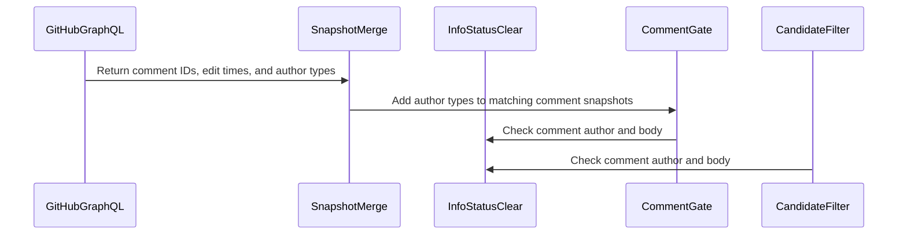

<!-- coderabbit-ai-generated:v1 -->

<!-- This is an auto-generated comment: summarize by coderabbit.ai -->
<!-- review_stack_entry_start -->

<a href="https://app.coderabbit.ai/change-stack/combsmith/.github-private/pull/2456?scope=REDACTED&amp;cs_source=review_comment"><picture><source media="(prefers-color-scheme: dark)" srcset="https://storage.googleapis.com/coderabbit_public_assets/review-stack-buttons-v1/explain-change-dark.svg"><source media="(prefers-color-scheme: light)" srcset="https://storage.googleapis.com/coderabbit_public_assets/review-stack-buttons-v1/explain-change.svg"></picture></a>

<!-- review_stack_entry_end -->
<!-- walkthrough_start -->

<strong>Summary</strong>

<dl>
<dd>

<!-- This is an auto-generated comment: release notes by coderabbit.ai -->

## Summary by CodeRabbit

* **Bug Fixes**
  * Clean status notices are exempted only when posted by a registered GitHub App and matching the expected status pattern. Notices from user accounts, unknown authors, or nonmatching comments remain subject to review.
  * Author information is included when checking comment edit times, improving consistency when evaluating status notices.

* **Documentation**
  * Clarified the author-type requirements for clean status exemptions.

<!-- end of auto-generated comment: release notes by coderabbit.ai -->
The clean info-status exemption now requires a GitHub `Bot` author, a registered login, a matching body pattern, and no finding-bearing section. The gate and candidate filter share this classifier. The GraphQL lookup and snapshot merge now include comment author types.

**Changes: Comment gate exemption**

|Layer / File(s)|Summary|
|:---|:---|
|**Fetch and merge comment author types**   `scripts/lib/maintainer-comment-gate.sh`|The GraphQL query requests each comment author's type. The snapshot merge adds the returned type to matching comments.|
|**Apply the shared clean-status rule**   `scripts/lib/maintainer-comment-gate.sh`, `docs/architecture/adr/0012-comment-gate-exemption-set.md`, `docs/pr-review-agent/maintainer-comment-gate.md`, `tests/dev-lead/unit/test_maintainer_comment_gate.bats`, `tests/dev-lead/unit/test_maintainer_resolve_comment.bats`|The gate and candidate filter use a shared classifier. Tests cover Bot, User, other, and missing author types, as well as matching and nonmatching comment bodies. Documentation and the SonarCloud fixture reflect the updated author requirement and status pattern.|

<!-- change_assessment_start -->

**Estimated code review effort:** 3 (Moderate) | ~20 minutes

<!-- change_assessment_commit:"66ce1309c986a69646cb8848ab96cb0513592521" -->
<!-- change_assessment_priority:{"version":1,"urgency":"p3","manual":false} -->
**Change:** Bug fix
<!-- change_assessment_end -->

### Sequence Diagram(s)

</dd>
</dl>

<!-- walkthrough_end -->

<strong>Merge Risk:</strong> <strong><picture></picture> Minimal</strong> · up to <code>66ce1</code>

<dl>
<dd>

<!-- final_review_risk_start -->
<!-- final_review_risk_label
**Merge Risk:** **⚪ Minimal** · up to `66ce1`
-->
<!-- final_review_risk_coverage:{"sourceCommitId":"66ce1309c986a69646cb8848ab96cb0513592521","coveredCommitId":"66ce1309c986a69646cb8848ab96cb0513592521","kind":"reviewed"} -->

The exemption now requires a matching Bot author and fails closed when author type is unavailable. Additional query-selection coverage is recommended, but no merge-blocking issue remains.
<!-- final_review_risk_end -->

</dd>
</dl>

<!-- pre_merge_checks_walkthrough_start -->

<strong>Pre-merge checks: <picture></picture> 5</strong>

<dl>
<dd>

|         Check name         |                                             Status                                             | Explanation                                                                                                                                                                                               |
| :------------------------ | :--------------------------------------------------------------------------------------------: | :-------------------------------------------------------------------------------------------------------------------------------------------------------------------------------------------------------- |
|         Title check        |  | The title clearly and concisely identifies the main change: restricting maintainer-gate info-status exemptions to Bot authors and body prefixes.                                                          |
|     Docstring Coverage     |  | Docstring coverage is 100.00% which is sufficient. The required threshold is 80.00%. Docstring coverage is scoped to functions touched by this diff with cyclomatic complexity of at least 2. Documentat… |
|     Linked Issues check    |  | Check skipped because no linked issues were found for this pull request.                                                                                                                                  |
| Out of Scope Changes check |  | Check skipped because no linked issues were found for this pull request.                                                                                                                                  |
|      Description check     |  | The description covers the required Problem, Risk, Test plan, Rollback, and Monitoring sections with specific implementation details and test results. The Summary section and the explicit N/A Interact… |

<strong>Full details: Docstring Coverage</strong>

<dl>
<dd>

**Explanation**

Docstring coverage is 100.00% which is sufficient. The required threshold is 80.00%. Docstring coverage is scoped to functions touched by this diff with cyclomatic complexity of at least 2. Documentation-only edits and deletions within surviving functions are included; unchanged diff context and fully deleted functions are excluded. Analyzed 2 functions across 3 files. (2 skipped: 2 unsupported.)

</dd>
</dl>

<strong>Full details: Description check</strong>

<dl>
<dd>

**Explanation**

The description covers the required Problem, Risk, Test plan, Rollback, and Monitoring sections with specific implementation details and test results. The Summary section and the explicit N/A Interaction contract declaration are missing, but the description remains substantially complete.

</dd>
</dl>

</dd>
</dl>

<!-- pre_merge_checks_walkthrough_end -->
<!-- autopilot:start -->
- [ ] <!-- {"checkboxId":"2708ad07-9f24-4260-9c11-7dc76a49f2e3"} --> <strong title="Keep fixing CodeRabbit findings and required CI, and resolving merge conflicts">Autofix</strong> · Keep fixing CodeRabbit findings and required CI, and resolving merge conflicts
<!-- autopilot:end -->
<!-- tips_start -->

Thanks for using [CodeRabbit](https://coderabbit.ai?utm_source=oss&utm_medium=github&utm_campaign=combsmith/.github-private&utm_content=2456)! It's free for OSS, and your support helps us grow. If you like it, consider giving us a shout-out.

<strong>Share</strong>

<dl>
<dd>

- [X](https://twitter.com/intent/tweet?text=I%20just%20used%20%40coderabbitai%20for%20my%20code%20review%2C%20and%20it%27s%20fantastic%21%20It%27s%20free%20for%20OSS%20and%20offers%20a%20free%20trial%20for%20the%20proprietary%20code.%20Check%20it%20out%3A&url=https%3A//coderabbit.ai)
- [Mastodon](https://mastodon.social/share?text=I%20just%20used%20%40coderabbitai%20for%20my%20code%20review%2C%20and%20it%27s%20fantastic%21%20It%27s%20free%20for%20OSS%20and%20offers%20a%20free%20trial%20for%20the%20proprietary%20code.%20Check%20it%20out%3A%20https%3A%2F%2Fcoderabbit.ai)
- [Reddit](https://www.reddit.com/submit?title=Great%20tool%20for%20code%20review%20-%20CodeRabbit&text=I%20just%20used%20CodeRabbit%20for%20my%20code%20review%2C%20and%20it%27s%20fantastic%21%20It%27s%20free%20for%20OSS%20and%20offers%20a%20free%20trial%20for%20proprietary%20code.%20Check%20it%20out%3A%20https%3A//coderabbit.ai)
- [LinkedIn](https://www.linkedin.com/sharing/share-offsite/?url=https%3A%2F%2Fcoderabbit.ai&mini=true&title=Great%20tool%20for%20code%20review%20-%20CodeRabbit&summary=I%20just%20used%20CodeRabbit%20for%20my%20code%20review%2C%20and%20it%27s%20fantastic%21%20It%27s%20free%20for%20OSS%20and%20offers%20a%20free%20trial%20for%20proprietary%20code)

</dd>
</dl>

<!-- tips_end -->