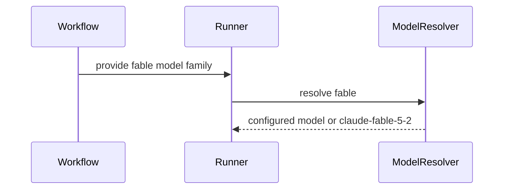

<!-- coderabbit-ai-generated:v1 -->

<!-- This is an auto-generated comment: summarize by coderabbit.ai -->
<!-- review_stack_entry_start -->

<a href="https://app.coderabbit.ai/change-stack/combsmith/.github-private/pull/2494?scope=ghh_OusAJGA4HG8ljoOV0wJvVx8NmnZIjc2DdjmxOu0xZWA&amp;cs_source=review_comment"><picture><source media="(prefers-color-scheme: dark)" srcset="https://storage.googleapis.com/coderabbit_public_assets/review-stack-buttons-v1/explain-change-dark.svg"><source media="(prefers-color-scheme: light)" srcset="https://storage.googleapis.com/coderabbit_public_assets/review-stack-buttons-v1/explain-change.svg"></picture></a>

<!-- review_stack_entry_end -->
<!-- This is an auto-generated comment: review paused by coderabbit.ai -->

> [!NOTE]
> ## Reviews paused
> 
> It looks like this branch is under active development. To avoid overwhelming you with review comments due to an influx of new commits, CodeRabbit has automatically paused this review. You can configure this behavior by changing the `reviews.auto_review.auto_pause_after_reviewed_commits` setting.
> 
> - Last reviewed commit: ac9e3b8b8cf5a57013b84ffc2782d7b7ac3e31de
> - Latest commit, not reviewed: 45d63e83c8efd27d69af12a7983bcfdbdc1ec565
> 
> Use the following commands to manage reviews:
> - `@coderabbitai resume` to resume automatic reviews.
> - `@coderabbitai review` to trigger a single review.
> 
> Use the checkboxes below for quick actions:
> - [ ] <!-- {"checkboxId":"7f6cc2e2-2e4e-497a-8c31-c9e4573e93d1"} --> Resume reviews
> - [ ] <!-- {"checkboxId":"e9bb8d72-00e8-4f67-9cb2-caf3b22574fe"} --> Trigger review

<!-- end of auto-generated comment: review paused by coderabbit.ai -->
<!-- recent_review_status_start -->

No actionable comments were generated in the recent review.

<!-- recent_review_status_end -->
<!-- walkthrough_start -->

<strong>Walkthrough</strong>

<dl>
<dd>
 

The change adds `fable` as a Claude model family, sets `claude-fable-5-2` as its default, and limits deprecation warnings to Fable 5 and 5.1. Workflow inputs, resolvers, and runner validation now accept the family.

**Changes: Fable model support**

|Layer / File(s)|Summary|
|:---|:---|
|**Model configuration, resolution, and checks**   `scripts/lib/engine-models.sh`, `scripts/engine.sh`, `tests/dev-lead/unit/test_engine_models.bats`, `tests/model_pricing.bats`, `docs/engine-configuration.md`, `AGENTS.md`|Claude accepts the `fable` key, which defaults to `claude-fable-5-2`. Family resolution uses the configured Fable chain or key, and multi-model `fable` entries retain the first model. Deprecation checks target `claude-fable-5` and `claude-fable-5-1`. Tests cover resolution, warnings, and pricing. Documentation lists the family, its default, and resolution precedence.|
|**Workflow and runner model selection**   `.github/workflows/*.yml`, `scripts/aw.sh`, `scripts/check-model-pins.sh`|Workflow inputs and resolvers accept `fable`. Runner validation and model selection include the family. Concrete `claude-*` IDs remain passed through, and model-family error messages include `fable`.|

<!-- change_assessment_start -->

**Estimated code review effort:** 3 (Moderate) | ~20 minutes

<!-- change_assessment_commit:"ac9e3b8b8cf5a57013b84ffc2782d7b7ac3e31de" -->
<!-- change_assessment_priority:{"version":1,"urgency":"p2","manual":false} -->
**Change:** Feature
<!-- change_assessment_end -->

### Sequence Diagram(s)

**Possibly related issues**
- combsmith/.github-private#2495 — The issue proposes using `ai_model_for_family fable`, which this change adds.

</dd>
</dl>

<!-- walkthrough_end -->

<strong>Merge Risk:</strong> <strong><picture></picture> Minimal</strong> · previous review <code>ac9e3</code>

<dl>
<dd>
 

<!-- final_review_risk_start -->
<!-- final_review_risk_label
**Merge Risk:** **⚪ Minimal** · up to `ac9e3`
-->
<!-- final_review_risk_coverage:{"sourceCommitId":"ac9e3b8b8cf5a57013b84ffc2782d7b7ac3e31de","coveredCommitId":"ac9e3b8b8cf5a57013b84ffc2782d7b7ac3e31de","kind":"reviewed"} -->

This change adds an opt-in Fable model family with a 5.2 default and warns only for deprecated Fable 5 and 5.1. Engine-tier defaults stay the same, and the earlier review concerns appear to be fixed. No actionable merge-blocking risk is evident.
<!-- final_review_risk_end -->

</dd>
</dl>

<strong>Security architecture risk:</strong> <strong><picture></picture> Minimal</strong> · up to <code>ac9e3</code>

<dl>
<dd>
 

<!-- architecture_review_start -->
<!-- architecture_review_label
### Security Architecture Review

**Security architecture risk:** **⚪ Minimal** · up to `ac9e3`
-->

The added selection option uses existing validation and access paths without changing default behavior. No material new security exposure was identified in the reviewed changes.

**Retained concerns**
No architecture-level concerns identified.

<strong>Security review details</strong>

<dl>
<dd>
 

**Security Blast Radius**
- _inferred_ — The effective change is bounded to runs that explicitly select the new family or receive an operator-configured override. Existing engine-tier defaults are not migrated by this PR.

**Trust Boundaries and Controls**
- _observed_ — The inspected path takes a requested family through centralized resolution and resolved-token validation before invocation. The new family does not bypass those controls. Existing concrete-ID pass-through predates this PR, and the override remains configuration authority rather than a newly introduced privilege grant.

</dd>
</dl>

<!-- architecture_review_end -->

</dd>
</dl>

<!-- pre_merge_checks_walkthrough_start -->

<strong>Pre-merge checks: <picture></picture> 5</strong>

<dl>
<dd>
 

|         Check name         |                                             Status                                             | Explanation                                                                                                                                                                                               |
| :------------------------ | :--------------------------------------------------------------------------------------------: | :-------------------------------------------------------------------------------------------------------------------------------------------------------------------------------------------------------- |
|         Title check        |  | The title clearly and concisely describes the main change: enabling Claude Fable 5.2 as the preferred Fable model.                                                                                        |
|      Description check     |  | The description covers the change, risk, testing, rollback, and monitoring. The Problem section is brief and does not include the issue link or a full problem summary, but the description is otherwise… |
|     Docstring Coverage     |  | Docstring coverage is 100.00% which is sufficient. The required threshold is 80.00%. Docstring coverage is scoped to functions touched by this diff with cyclomatic complexity of at least 2. Documentat… |
|     Linked Issues check    |  | Check skipped because no linked issues were found for this pull request.                                                                                                                                  |
| Out of Scope Changes check |  | Check skipped because no linked issues were found for this pull request.                                                                                                                                  |

<strong>Full details: Description check</strong>

<dl>
<dd>
 

**Explanation**

The description covers the change, risk, testing, rollback, and monitoring. The Problem section is brief and does not include the issue link or a full problem summary, but the description is otherwise mostly complete and relevant.

</dd>
</dl>

<strong>Full details: Docstring Coverage</strong>

<dl>
<dd>
 

**Explanation**

Docstring coverage is 100.00% which is sufficient. The required threshold is 80.00%. Docstring coverage is scoped to functions touched by this diff with cyclomatic complexity of at least 2. Documentation-only edits and deletions within surviving functions are included; unchanged diff context and fully deleted functions are excluded. Analyzed 6 functions across 6 files.

</dd>
</dl>

</dd>
</dl>

<!-- pre_merge_checks_walkthrough_end -->
<!-- finishing_touch_checkbox_start -->

<strong>Finishing Touches</strong>

<dl>
<dd>
 

<strong>Generate docstrings</strong>

<dl>
<dd>
 

- [ ] <!-- {"checkboxId":"3e1879ae-f29b-4d0d-8e06-d12b7ba33d98"} --> Commit to this branch
- [ ] <!-- {"checkboxId":"7962f53c-55bc-4827-bfbf-6a18da830691"} --> Create a new PR

</dd>
</dl>

</dd>
</dl>

<!-- finishing_touch_checkbox_end -->

<!-- autopilot:start -->
- [ ] <!-- {"checkboxId":"2708ad07-9f24-4260-9c11-7dc76a49f2e3"} --> <strong title="Keep fixing CodeRabbit findings and required CI, and resolving merge conflicts">Autofix</strong> · Keep fixing CodeRabbit findings and required CI, and resolving merge conflicts
<!-- autopilot:end -->
<!-- recent_review_start -->

<h6>

<strong><picture></picture> Recent review info</strong>

<dl>
<dd>
 

<!-- review_info_content -->

<strong><picture><source media="(prefers-color-scheme: dark)" srcset="https://storage.googleapis.com/coderabbit_public_assets/review-comment-icons-v1/cog-dark.svg"></picture> Run configuration</strong>

<dl>
<dd>
 

- **Source mode**: Auto
- **Repository**: Unavailable
- **Branch**: Unavailable
- **File**: No configuration file from this repository applied
- **Commit**: Unavailable
- **Layers**: Repository UI
- **Review profile**: CHILL
- **Plan**: Advanced
- **Run ID**: `7f39ba72-037b-4504-8d59-7a2a64c28624`

</dd>
</dl>

<strong><picture><source media="(prefers-color-scheme: dark)" srcset="https://storage.googleapis.com/coderabbit_public_assets/review-comment-icons-v1/git-commit-horizontal-dark.svg"></picture> Commits</strong>

<dl>
<dd>
 

Reviewing files that changed from the base of the PR and between b41521a42a103d3702f5b56e22b56219155b61ba and ac9e3b8b8cf5a57013b84ffc2782d7b7ac3e31de.

</dd>
</dl>

<strong><picture><source media="(prefers-color-scheme: dark)" srcset="https://storage.googleapis.com/coderabbit_public_assets/review-comment-icons-v1/file-plus-corner-dark.svg"></picture> Files selected for processing: 2</strong>

<dl>
<dd>
 

* `scripts/lib/engine-models.sh`
* `tests/dev-lead/unit/test_engine_models.bats`

</dd>
</dl>

**Included review availability:** This review used your included allowance. Your plan provides up to 10 included reviews per hour; 5 remain after this review.

</dd>
</dl>

</h6>

<!-- recent_review_end -->
